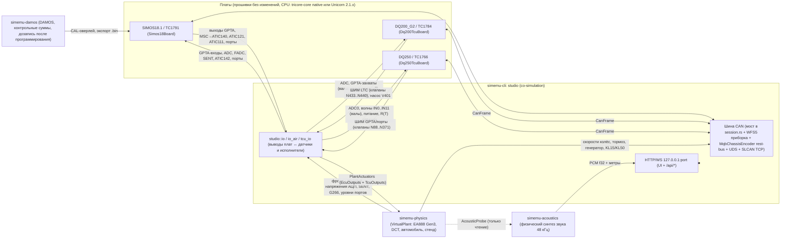
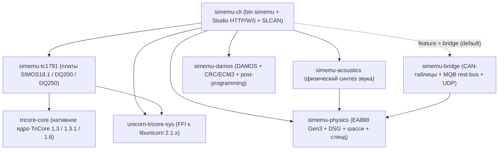

# Архитектура SIMEMU

Документ описывает устройство кода по состоянию рабочего дерева на 2026-11-17. Источники — заголовки модулей
`crates/*/src/*.rs` (в них же приведены доказательства) и документы `docs/`. Метки достоверности:
`VERIFIED-*` / `HYP` (как в `docs/SIMOS18_GPTA_IO_RE.md` §0), `UNVERIFIED` (как в коде), «не проверено».

---

## 1. Общая схема, потоки данных и Black-Box контракты

Правила потока (см. `AGENTS.md` §2): plant получает только декодированные выходы прошивок и действия
водителя/стенда; платы получают только электрические сигналы и кадры CAN. Крейты `simemu-tc1791` (железо плат) и
`simemu-physics` (физика реального мира) **не зависят друг от друга во время компиляции** (изолированные black-box
модули, стыкующиеся только в `simemu-cli::studio::io`).

Цикл studio (`crates/simemu-cli/src/studio/session.rs`, `StudioSession::step`): срез 10 мс (`SLICE_S`; кадры
шасси `MqbChassisEncoder`, регистратор, программа диностенда) из окон lock-step по 1 мс (`EXCHANGE_S`):
1. в начале окна телеметрия plant фиксируется и подаётся на входы ЭБУ и TCU (у TCU — ещё R/L катушек,
   `tcu_io::coil_params`); кадры CAN моста предыдущего окна (+ кадры шасси и внешних клиентов SLCAN) ставятся в платы;
2. параллельно: TCU (поток `tcu-worker`) исполняет прошивку до конца окна; в потоке сессии plant делает шаг
   с выходами плат конца предыдущего окна и записывает фронты ДПКВ/ДПРВ с точными метками, затем ЭБУ
   отрабатывает тот же интервал с этими фронтами;
3. барьер: GPTA ЭБУ доводится до конца окна (`Simos18Board::sync_engine_io`), декодирование выходов ЭБУ и TCU для
   plant следующего окна: форсунки DI/MPI и N276 — фронтами со сдвигом на окно (`io::ACTUATOR_DELAY_S` = 1 мс,
   `simemu_physics::TimedOutputs`), катушки — по времени конца накопления (длина прошлого накопления, иначе реальный
   конец ≤ 1 мс позже), уровни и скважности — выборка в конце окна; мост CAN: кадры ECU → TCU и наоборот (одна общая
   шина), ответы приборки на `0x010`/`0x012`, UDS и зеркалирование в `SlcanServer`.
   Муфта Haldex не управляется (её блок не эмулируется).

Результат не зависит от потоков и скорости хоста. Studio шагает сессию из потока `sim-runner` в темпе
стенных часов (`rt::Pacer`, перегрузка не пропускает шаги, а сообщается в `frame.pacing`); методика,
приоритеты потоков и замеры — `docs/PERFORMANCE.md`.

### 1.1 Контракты на границах подсистем (Black-Box API)

| Граница | Ключевые типы и инварианты | Где определены |
| :-- | :-- | :-- |
| **CPU ↔ Плата** | `tricore_core::Cpu<B>`, `Memory`, `Arch::{Tc13, Tc131, Tc16}`, типаж `Bus` (`read`, `write`, `irq_check`; под фичей `trace-data-stores` — read-only наблюдатели `data_read`, `data_write`, `call_execute` с нулевой стоимостью в обычной сборке). На уровне платы — `CpuBackend::{Native, Unicorn}` (`SIMEMU_CPU=native\|unicorn`): оба ядра работают поверх одного `Tc1791HardwareState` и дают побитно одинаковые дайджесты (`perf_determinism`, `cosim_backends_identical`). | `crates/tricore-core/src/{lib,bus,cpu,mem}.rs`, `crates/simemu-tc1791/src/{lib,native}.rs` |
| **Платы ↔ Шина CAN** | `CanFrame { node: u8, mo_index: u8, arb_id: u32, extended: bool, dlc: u8, data: [u8; 8], timestamp_us: u64 }`. Единый формат кадра для MultiCAN всех трёх плат (`Simos18Tc1791`, `Dq200Tc1784`, `Dq250Tc1766`), моста `StudioSession`, генератора rest-bus шасси `MqbChassisEncoder` (`ChassisInputs`), виртуальной приборки WFS5, встроенного UDS-клиента и внешнего TCP-сервера Lawicel/SLCAN (`127.0.0.1:28750`). | `crates/simemu-tc1791/src/memory.rs`, `crates/simemu-bridge/src/mqb.rs`, `crates/simemu-cli/src/slcan.rs` |
| **Выходы плат → Физика** | `PlantActuators { ecu: EcuOutputs, tcu: TcuOutputs, awd: AwdOutputs }` подаётся в `VirtualPlant::step(dt, &act)` вместе с `DriverInputs` (`pedal_pct`, `brake_pct`, `selector`, `ignition_on`, `start_button`) и `BenchMode` (`Road`, `AcDyno`, `EngineDyno`, `ChassisDyno`, `RoadLoadDyno`). **Инвариант Zero-Fake-Logic:** каждый исполнительный канал имеет тип `Option<T>`, где `None` означает обесточенный каскад / обрыв цепи (дроссель на пружине limp-home, вестгейт на пружине и потоке газов, соленоиды без тока, нет искры и впрыска). `EcuOutputs::timed: Option<TimedOutputs>` передаёт точные интервалы тока `Drive { on_s, off_s }` для форсунок DI/MPI, катушек зажигания и N276; `TcuOutputs` передаёт `solenoid_duty: [Option<f64>; 12]`, токи катушек `solenoid_current_a` (3 кГц контур на плате) и скорость вала насоса V401 `pump_shaft_rad_s`. | `crates/simemu-physics/src/{lib,engine,mechatronic,driveline,vehicle}.rs` |
| **Физика → Входы плат и Звук** | `PlantTelemetry` (полный снимок состояния двигателя, поцилиндровой термодинамики, износа/повреждений, температур, давлений, валов/вилок/сцеплений КПП и колёс), точные фронты зубьев 60-2 и 2×8 (`SensorEdge { t_s: f64, source: EdgeSource }`, где `EdgeSource` — `CrankTooth { tooth, forward }` \| `Cam { cam, level }`), напряжения аналоговых датчиков (`simemu_physics::sensors`), 12-битный угол SENT (`rotary_valve_sensor`), импульсы G266 (`OilLevelSender`), ток накачки/импеданс LSU 4.9 (`lambda_sensor`), затухающие синусоиды пьезодатчика детонации (`knock_sensor`). Для `simemu-acoustics` работает read-only зонд `AcousticProbe` (по умолчанию выключен, не меняет состояние plant). | `crates/simemu-physics/src/{telemetry,sensors,lambda_sensor,knock_sensor,acoustic_probe}.rs` |

---

## 2. Крейты, граф зависимостей и модули

Четыре листовых крейта (`tricore-core`, `simemu-physics`, `simemu-damos`, `unicorn-tricore-sys`) не зависят от других
крейтов workspace; первые три плюс `simemu-acoustics` и `simemu-bridge` написаны на чистом Rust без C-зависимостей и
собираются/тестируются автономно (`cargo test --release -p tricore-core -p simemu-physics -p simemu-acoustics -p simemu-damos -p simemu-bridge`).

| Крейт | Назначение |
| :-- | :-- |
| `unicorn-tricore-sys` | Сырые FFI-привязки к `libunicorn` 2.1.x (TriCore). `build.rs` ищет библиотеку (см. `README.md`) |
| `tricore-core` | Нативное ядро TriCore 1.6 / 1.3.1 / 1.3 (`Arch::{Tc16, Tc131, Tc13}`) без Unicorn; бэкенд плат `CpuBackend::Native` (§3.3); под compile-time фичей `trace-data-stores` — read-only наблюдатели `Bus::data_read`, `data_write`, `call_execute` с нулевой стоимостью в обычной сборке |
| `simemu-tc1791` | Платы и периферия: TC1791/SIMOS18.1, TC1784/DQ200_G2, TC1766/DQ250 |
| `simemu-physics` | Физика железа: двигатель, смазка, тепло, КПП, мехатроник, автомобиль, стенд |
| `simemu-damos` | Нативный распаковщик контейнеров VAG ODIS `.frf`/`.odx` (`frf.rs`: FRF XOR → ZIP/DEFLATE → ODX → AES-128-CBC + CBOOT LZSS), DAMOS-определения, чтение/запись калибровок, контрольные суммы, дозапись после программирования |
| `simemu-bridge` | Парсер CAN-дескрипторов SIMOS, rest-bus MQB (`mqb.rs`: кадры неэмулируемых блоков, `MILESTONE.md` §2.10), заготовка JSON-UDP для BeamNG |
| `simemu-acoustics` | Физический синтез звука из величин plant (`docs/ACOUSTICS.md`): трубы (матрицы передачи), модальные модели конструкций, пути до слушателя, поток реального времени |
| `simemu-cli` | Бинарник и библиотека `simemu` (команды `boot`, `unpack-frf`, `tcu-info`, `damos`, `can-table`, `can-server`, `studio`, `render-audio`, `log-report`, `cal-diff`, `replay`), `paths.rs` (поиск образов в `vault/firmwares/` и `$SIMEMU_IMAGE_DIR`, приоритет пользовательского `SBOOT` над дефолтным `rom/sboot.bin`), `slcan.rs` и `can_server.rs` (Lawicel/SLCAN поверх TCP для внешних UDS/OBD2-клиентов и снифферов, отдельно и живьём внутри `studio`), модули `studio` и `log_tools` |

### 2.1 `simemu-tc1791`

| Модуль | Содержание |
| :-- | :-- |
| `lib.rs` | `Simos18Board` (варианты `Simos18Tc1791`, `Dq200Tc1784`, `Dq250Tc1766`): карта памяти, кванты исполнения, сброс, наблюдательные хуки SC800S50 |
| `native.rs` | Бэкенд нативного ядра `tricore-core` (`CpuBackend::Native`, `HwBus` поверх `Tc1791HardwareState`, точки наблюдения и прерывания с точностью до инструкции) |
| `memory.rs` | Буферы хоста, отображаемые в Unicorn (`uc_mem_map_ptr`) и `tricore_core::Memory`, `CanFrame`, общее состояние железа |
| `cpu_hooks.rs` | MMIO-диспетчер (`uc_mmio_map`), циклы команд Flash (`UC_HOOK_MEM_WRITE_PROT`), блок-хук (учёт инструкций, поиск мест для `isa_fix`) |
| `isa_fix.rs` | Исправления дефектов транслятора Unicorn 2.1.4 (IMASK/INSERT RCRW, DEXTR, BISR, DISABLE D[a], MFCR/MTCR на нереализованных CSFR, LD.BU pre-inc, MTCR под ENDINIT, рассинхрон ICR, не декодируемые FTOU/FTOQ31/FTOQ31Z/Q31TOF — вычисляются функцией нативного ядра `fpu_div::conversion`) |
| `scu.rs` | PLL/осциллятор, сброс, WDT с ENDINIT, модель портов |
| `stm_icu.rs` | STM, регистры SRC, арбитраж прерываний, вход в прерывание TriCore |
| `multican.rs` | MultiCAN: 4 узла, 128 MO, списки и команды панели, фильтрация приёма |
| `flash.rs` | Командный автомат PMU/Flash по TC1796 UM §7.2.5: программирование страниц PFlash (256 Б) и DFlash (128 Б), стирание секторов PFlash (`SA:30`/`SA:40`) и банка DFlash (`SA:40`), регистры `FSR`/`FCON`/`MARP`/`MARD`/`PROCON0..2`, разблокировка UCB по паролю (`553C`/`5558`), Reset to Read, Resume Protection, Clear Status, синхронная инвалидация кэша кода Native/Unicorn (`docs/SIMOS18_UDS_CBOOT_RE.md` §4.3) |
| `adc.rs` | ADC0..2: автоскан, напряжение канала → регистр результата |
| `ssc.rs`, `dma.rs`, `msc.rs` | SSC0..3 (master), DMA (16 каналов, подмножество), MSC0/1 (downstream к ATIC140 + upstream) |
| `monitor_device.rs` | Блок мониторинга (MU, ECM3 level 3) микросхемы ATIC139 на SSC1/SLSO2: вопросы/ответы, счётчики, линии NDIS, сброс MC |
| `atic.rs`, `power_stages.rs` | ATIC140 (MSC), ATIC121 (SSC0), ATIC111 (SSC1), линии отключения, нагрузки, вид выходов |
| `atic139.rs` | Блоки LS/PS микросхемы ATIC139 (кадры 0xAAAA на SSC1/SLSO2, слова по командному полубайту) |
| `pic_eot.rs` | Таймер времени стоянки (PIC12LF1822) на SSC0/SLSO6, питание KL30 |
| `atic142.rs` | ИС ШДК ATIC142 на SSC1/SLSO4: протокол (init, кадр 26 слов, конфигурация), измерительный тракт ячеек LSU и двоичного датчика |
| `gpta.rs`, `gpta_ref.rs`, `gpta_trace.rs` | GPTA0/GPTA1/LTCA2 по TC1796 UM гл. 24, событийная модель (кэш событий цепочек LTC с деревом минимумов, ленивые такты фильтров FPC — `docs/PERFORMANCE.md` §3.1; ленивые счётчики синхронизируются и между вызовами `advance` — только там, где их наблюдают, интервал без событий только сдвигает время — §9); `gpta_ref.rs` — эталонная потактовая модель для дифференциальных тестов, `gpta_trace.rs` — трассировка ячеек |
| `pcp.rs` | Интерпретатор PCP2 (TC1796 UM гл. 11; кодировки — binutils TriCore) |
| `engine_io.rs` | GPTA + PCP в плате SIMOS, входы ДПКВ/ДПРВ, отводы выходов (`CellTap`), выход GPTA → MSC ALTIN |
| `sent.rs` | Модуль SENT 0xF0321000 (8 каналов): регистры, как их программирует прошивка (RDR/RSR/INTSTAT/INTCLR/INP → SRC 0x9FC/0x9F8), приёмник кадров SAE J2716 (калибровочный импульс, CRC4, проверка такта) и сторона датчика (`SentSensor`); кадры вычисляются лениво в их моменты окончания |
| `knock_fadc.rs` | FADC 0xF0100400: регистры, строб окна детонации (G0.GTC24 → GS7), таймер канала, фильтровые блоки, запросы DMA; вход датчика детонации как сумма затухающих синусоид (`PinSignal`), преобразования только внутри окна |
| `crank_wheel.rs` | Генератор фронтов 60-2 + 2×8 ДПРВ для стенда без plant (`feed_crank`) |
| `sensors_io.rs` | API платы: напряжения АЦП, уровни портов, приём CAN, CAL-оверлей, шаг реального времени |
| `tc1784_io.rs` | Периферия TC1784 платы DQ200: SSC0/1 + ST95640, DMA, ADC, GPTA0+LTCA2, SRC; нагрузки-катушки клапанов с датчиками тока (`CoilLoad`), отключение выводов клапанов по IOCR, обратное чтение P2.1 на ADC[23]/ADC[3], внешнее устройство контроля SSC1/P2.8 (`MonitorDevice`: идентификация, два канала сторожа «вопрос-ответ», ключ питания силовых каскадов ADC[30]/[31] по сторожу и выводам P3.9/P3.10/P1.13) |
| `pump_bldc.rs` (модуль `tc1784_io::pump`) | Насос V401: микросхема драйвера на SSC0/CS P3.6 (16 бит LSB first, эхо через кадр, рег.2/3/6, статус, рег.3 бит 14 — нуль усилителя тока), мост с входом коммутации P5.9 (шаг 60° эл. на фронт) и разрешением P5.3, трёхфазный БК-мотор (ток пары с L/R, ЭДС/момент по углу, 4 пары полюсов), вал шестерённого насоса под давлением G270; фронты нуля ЭДС плавающей фазы → GPTA IN47, ток звена → FADC канал 0; событийно на шаге платы (≤ 25 мкс), без выделений памяти. Параметры `BldcPumpHw` — `UNVERIFIED` |
| `fadc.rs` (модуль `tc1784_io::fadc`) | FADC TC1784 по ядру FADC TC1796 (UM гл. 26): каналы, входной каскад и усиление, время преобразования 21 такт, таймеры каналов, соседний запуск, приоритет, флаги/SR; событийная модель (время следующего события), фильтры/внешние триггеры не используются прошивкой и не моделируются |
| `st95640.rs` | SPI EEPROM M95640 (8 КБ) |
| `tcu_dq200.rs` | Плата DQ200_G2, WFS5 (`Wfs5ImmoPartner`, AES-128 + CRC-32), датчики/выходы мехатроника |
| `tcu_dq250.rs` | Плата DQ250 (TC1766): SCU, SSC, SPI EEPROM, ASC0, ADC0 + входы платы (альтернативные опоры `Adc0::vref`), SCU_CON.AN7TM; MultiCAN (раскладка AUDO-NG → модель), GPTA0 (52 слова MRA, `Gpta::tc1766`)/LTCA2 и PCP2 через `engine_io`; волны датчиков оборотов на линиях GPTA; `set_inputs`/`decode_outputs`, `gear_set`; остальное — регистровый файл |
| `dq250_io.rs` | Мехатроник DQ250: характеристики датчиков (ход, давление, температура), сторож на SSC1 (вопрос-ответ), SPI-термодатчик, клапаны (ячейки GPTA/порты, high-side, датчики тока), питание каскадов (`docs/DQ250_IO_MAP.md`) |
| `tc1766_adc.rs` | ADC0 TC1766 по TC1796 UM гл. 25: источник «Timer», CHSTAT, MSS0/1, SR → SRC, время преобразования, группы входов |

### 2.2 `simemu-physics`

| Модуль | Содержание |
| :-- | :-- |
| `lib.rs` | `VirtualPlant`: шаг 0.2 мс (`DT_SUB`), внутри — угловой шаг двигателя ≤ 1 °ПКВ / ≤ 50 мкс |
| `engine.rs` | EA888 Gen3: цилиндры, ГРМ, кривошипно-шатунный механизм с ДМФ, смазка, топливная система, воздушный тракт, турбина, цепочка отказов |
| `cylinder.rs` | Квазиразмерный цилиндр по углу: потоки через клапаны (с переносом турбулентности), подогрев свежего заряда в канале (`IntakeHeatHw`), состав газа коллектора (прорыв газов, возвращённый вентиляцией картера, — не воздух), прорыв газов, впрыск DI → плёнки днища и стенки (разжижение масла), испарение и расслоение, искра (Пашен, закоксовывание, гашение ядра), межцикловая вариация (турбулентность и φ у свечи, `CombustionHw::ccv_*`), две зоны (сгоревшая/несгоревшая), пламя вовлечения, щели, NO/CO/HC, Livengood–Wu на T_u, детонация (вплоть до развивающейся), поверхностное зажигание и LSPI, Hohenberg, узлы деталей, повреждения (перемычка по температуре канавки) |
| `combustion.rs` | Подмодели сгорания без состояния цилиндра: ламинарная скорость (Metghalchi–Keck), турбулентность K–T–k, скорость пламени Peters, геометрия фронта (сфера в цилиндре, замкнутый вид), Зельдович, CO, догорание (Westbrook–Dryer), задержка Douaud–Eyzat, детерминированный ГСЧ (равномерный и нормальный); константы `CombustionHw` (docs/SIMOS18_COMBUSTION.md) |
| `crank_train.rs` | Кинематика, прочность шатуна, пружина ДМФ, задающие диски 60-2 и 2×8 (единственный источник фронтов в studio) |
| `valvetrain.rs` | Профили кулачков ((1 − u²)ⁿ), фазовращатели, выпускной AVS (скользящие кулачки, штифты актуаторов, канавка, отдача), HLA, зависание клапанов и контакт с поршнем |
| `lubrication.rs` | Насос двух ступеней, магистрали (в т.ч. галерея форсунок охлаждения поршней за N522), уровень в картере, подшипники скольжения (Ocvirk, Greenwood–Tripp), подшипник турбины |
| `thermal.rs`, `atmosphere.rs` | Тепловая сеть (двигатель, радиатор, масло, катализатор); узлы деталей камеры сгорания (поршень: днище/перемычка/канавка, выпускной клапан: тарелка/седло, свеча: вершина изолятора/электрод с калильным числом и закоксовыванием, поверхность нагара); свойства воздуха/масла |
| `materials.rs` | Свойства материалов от температуры; Miner/Basquin, Larson–Miller |
| `clutch.rs`, `hydraulics.rs`, `mechatronic.rs` | Сухое DQ200 и мокрые DQ250/DQ381/Haldex сцепления; гидроэлементы; гидравлика мехатроников |
| `driveline.rs`, `driveline_failure.rs` | Валы, синхронизаторы, муфты, дифференциал, полуоси; прочность/усталость (ISO 6336) |
| `vehicle.rs` | Шины (Magic Formula), тормоза, кузов, ролики шасси-стенда, Haldex Gen5 |
| `sensors.rs` | Передаточные функции датчиков (обратные таблицам прошивки); датчик уровня/температуры масла G266 (`OilLevelSender`, кадр TOG) |
| `compressor_map.rs` | Табличная карта компрессора из модели самой прошивки (`ip_n_tcha_stnd`, `ip_fac_eff_cmpr`, нормировка √(T_ref/T₁)): скорость ↔ расход при PR, КПД; `IS12_SC8O40`, к IS12 пока не подключена (MILESTONE §5 п.12) |
| `lambda_sensor.rs` | Транспорт выхлопа к датчикам, ячейка LSU (Ip/ЭДС/Ri; датчик до турбины, давление коллектора), нагреватели, накопление O₂ катализатором, двоичный датчик |
| `bench_config.rs` | Конфигурация стенда: автомобиль из независимых узлов (long block, турбина, впуск, интеркулер, выпуск, навесное, свечи, топливо, пробеги узлов, КПП, кузов, атмосфера) → `EngineProfile` + `DrivetrainProfile` при запуске стенда; каталог с источниками; совместимость с калибровкой (`docs/BENCH_BUILD.md`) |
| `knock_sensor.rs` | Вибрация блока в точке датчика детонации: моды камеры при детонации, структурные моды от ударов механизмов, пьезодатчик (атомы-синусоиды, без синтеза с фиксированной частотой) |
| `cooling_valve.rs` | Поворотный клапан ОЖ N493 модуля терморегулирования: мотор + червячная передача (самоторможение), упоры 0°/263°, датчик положения (12-бит SENT), доля открытия ветви радиатора |
| `starter.rs` | Электростартер с сериесным возбуждением, обгонная муфта (бендикс) и свинцово-кислотная АКБ (`Battery`: ЭДС разомкнутой цепи и внутреннее сопротивление от заряда и температуры, просадка напряжения при прокрутке) |
| `wastegate.rs` | Электрический актуатор вестгейта: мотор + редуктор + пружина, газовая сила на заслонке, закон расхода, датчик положения; `WastegateFlowMap` — расход вестгейта по положению из модели самой прошивки (`ip_fac_bpa_sp`, `IS12_SC8O40_WASTEGATE`, подключена к IS12; docs/SIMOS18_COMBUSTION.md §17) |
| `profiles.rs` | Пресеты железа: 1.8T CJSA IS12, 1.8T IS38 hybrid, 1.8T CJSA + IS38 (`octavia_is38`), 2.0T CHHB IS20, 2.0T CJXC IS38; DQ200 FWD, DQ250 4WD, DQ250 0D9 + Haldex (Octavia A7 AWD), DQ381 4WD |
| `telemetry.rs` | Снимок состояния plant для UI |
| `acoustic_probe.rs` | Наблюдательный зонд двигателя для звука: кадр на каждый шаг ПКВ (расходы клапанов/турбины, давления, огибающая детонации, силы ГРМ, стартер) и удары (форсунки, клапаны ТНВД, посадка клапанов). По умолчанию выключен, ничего не пишет в состояние plant |
| `bench_tests.rs`, `driveline_tests.rs` | Валидация физики на виртуальном стенде (тестовое оборудование, не продукт) |

### 2.3 `simemu-cli` (верхний уровень, `log_tools` и `studio`)

| Модуль | Содержание |
| :-- | :-- |
| `main.rs`, `lib.rs` | Точка входа `simemu` (по умолчанию включает `SIMEMU_CPU=native`) и диспетчер команд CLI (`boot`, `tcu-info`, `damos`, `can-table`, `can-server`, `studio`, `render-audio`, `log-report`, `cal-diff`, `replay`) |
| `paths.rs` | Единое разрешение путей образов прошивок (`$SIMEMU_IMAGE_DIR`, `vault/firmwares/ecu/{stock,bench,custom}/`, `vault/firmwares/tcu/{dq200,dq250}/`), автопоиск доноров SBOOT и NVM |
| `slcan.rs`, `can_server.rs` | Протокол Lawicel / SLCAN поверх неблокирующего TCP (`127.0.0.1:28750`) и автономный стендовый сервер `simemu can-server` для внешних диагностических клиентов и флешеров |
| `log_tools/` (`mod.rs`, `csv_log.rs`, `channels.rs`, `forensics.rs`, `report.rs`, `caldiff.rs`) | Разбор CSV-логов SimosTools, словарь DID → RAM/FR (`channels.rs`), форензика фаз/топлива/детонации (`simemu log-report`) и сравнение калибровок по DAMOS (`simemu cal-diff`) |
| `studio/mod.rs`, `routes.rs`, `assets.rs` | HTTP-сервер на `127.0.0.1:<port>`, встроенная выдача UI (`assets.rs`), маршруты `/api/state`, `/api/map`, `/api/search`, `/api/export_bin`, `/api/step`, `/api/map/write`, `/api/preset`, `/api/dyno`, `/api/uds`, `/api/build`, `/api/check`, `/api/ws/*`, `/api/audio/*` |
| `studio/session.rs` | Сессия co-simulation (см. §1), образы, пресеты калибровок, экспорт, интеграция живого `SlcanServer` |
| `studio/rt.rs` | Роли/QoS потоков, CPU-время потока, lock-free кольцо SPSC (обмен окнами, телеметрия, звук), темп реального времени `Pacer` |
| `studio/perf_bench.rs`, `backend_cosim.rs` | Регрессионный порог RTF полной co-simulation (`cosim_realtime_guard`, `cosim_high_rpm_profile`) и побитовая сверка бэкендов `Native` ↔ `Unicorn` в замкнутом контуре (`cosim_backends_identical`) |
| `studio/io.rs` | Связь выводов плат с plant (входы ЭБУ/TCU, декодирование выходов) |
| `studio/io_air.rs` | То же для наддува / фаз ГРМ / детонации: мост вестгейта, датчики положения вестгейта и заслонок, ступени ATIC140 (N249, N428, N522, N316, актуаторы AVS 16..19), ШИМ фазовращателей, атомы вибрации → вход FADC, реле давления масла F378/F22/F447 (P6.14/P7.5/P6.15), импульсы G266 → P3.4 (IN12) |
| `studio/immo_keys.rs` | Извлечение ключей WFS5 ЭБУ из DFlash (`anvmcryptlight`) |
| `studio/immo_lab.rs` | Лабораторная привязка иммобилайзера (по умолчанию): один набор ключей из UID чипа, записи DFlash ЭБУ (FEE + `anvmcryptlight`) и EEPROM DQ200/DQ250, класс мощности из калибровки образа (`AGENTS.md` §2.4 п.5) |
| `studio/uds.rs` | ISO-TP + UDS клиент (как внешний тестер) |
| `studio/workstation.rs`, `recorder.rs`, `safety.rs`, `dyno_correction.rs` | Регистратор, защита бокса, поправки SAE J1349 / DIN 70020 / ISO 1585 / EEC 80/1269, обзор DAMOS, лента CAN |
| `studio/engine_run.rs`, `dyno_run.rs`, `restbus_run.rs` | Сценарии пуска двигателя, моторного стенда (WOT с регулированием наддува, детонацией и фазами ГРМ) и полного сетевого/ошибочного аудита rest-bus (`network_dtc_scenario`, `fault_audit_scenario`, `clear_dtc_scenario`, `user_workflow_rev_and_drive_scenario`) |
| `studio/tcu_io.rs` | Электрика катушек клапанов DQ200/DQ250 из plant в плату (`coil_params`, подаётся с окном co-simulation); стендовые сценарии ТКУ (`dq200_bench_scenario`, `dq250_drive_scenario`) |
| `studio/dq250_prep.rs` | Подготовка DQ250 со стёртым EEPROM: при включении ТКУ без сохранённого состояния — фоновый поток с отдельной безголовой `StudioSession` («автомобиль в мастерской»: сборка, образ ЭБУ, прогрет), где тестер выполняет кодирование и базовые установки из таблицы процедур образа (`basic_setting_rids`); EEPROM, записанный прошивкой, → `TcuNvm` + `tcu_<id>.prep.json`, живая ТКУ перезагружается; список образов DQ250 и кодирование по умолчанию для сборки; передаточные числа plant по калибровке ТКУ (`fit_gear_set`) |
| `studio/drive_run.rs` | Сценарий «вся машина» (`vehicle_drive_scenario`): SC8O40 + DQ200 на сборке `octavia_fl`, шасси-стенд с дорожной нагрузкой (`BenchMode::RoadLoadDyno`), только органы водителя; лента по секундам, вмешательства в момент по CAN, расшифровка DTC обоих блоков их собственными таблицами |
| `studio/audio.rs` | Звук: WebSocket `/api/audio/ws` (PCM f32 48 кГц + метры), `/api/audio/info`, неисправности жгута `/api/audio/harness`, офлайн-рендер `simemu render-audio` |
| `studio/bench_build.rs` | Сборка стенда в studio: запуск стенда (пересоздание plant, ТКУ по КПП, журнал), `/api/build`, сохранённые сборки (`~/.simemu/builds`), `SIMEMU_BUILD`/`SIMEMU_ENGINE`/`SIMEMU_TURBO`, факты калибровки образа |
| `studio/tune_check.rs` | «Проверка прошивки перед заливкой»: стандартная программа стенда для образа ЭБУ (+ ТКУ сборки) — фазы (моторный стенд WOT, разгон в передачах, старт с места в S, жара с прогревом, АИ-92), каждая — отдельная безголовая `StudioSession` той же сборки в своём потоке; действуют только водитель и стенд (в т. ч. выбор слота MultiMap педалью/тормозом для патча O30); пробы plant по цилиндрам, DID прошивки через тестер `log_replay::Tester`, DTC ЭБУ/ТКУ по таблицам образа (`ecu_error_table`); пределы с источниками (`LIMITS`), вердикт OK / риск / сломает, сравнение с эталоном; отчёт JSON/HTML (`/api/check`, вид «Проверка перед заливкой») |
| `studio/log_replay.rs` | `simemu replay`: лог автомобиля на моторном стенде (AC-машина держит обороты лога, педаль из лога, прошивка ведёт двигатель), тестер читает DID логгера, сравнение каналов |
| `studio/assets/` | `body.html`, `styles.css`, `core.js`, `channels.js`, `live.js`, `dyno.js`, `calib.js`, `sound.js` (AudioWorklet, микшер, спектрограмма), `build.js` (конфигурация стенда), `check.js` (проверка прошивки перед заливкой), `diag.js` |

### 2.4 `simemu-acoustics`

| Модуль | Содержание |
| :-- | :-- |
| `lib.rs`, `tap.rs` | Публичный API синтезатора и поток plant: слив зонда в записи (`Record`), медленные величины (КПП, генератор, вентилятор, насос) раз в шаг plant |
| `synth.rs` | Передискретизация кадров в 48 кГц, 16 источников, модальные банки, пути к 3 точкам + стетоскоп, все константы — `Params` (`UNVERIFIED`) |
| `duct.rs` | Матрицы передачи (Munjal): трубы с потерями Кирхгофа, сопротивления, полости, ответвления, импеданс источника, излучение открытого конца; геометрия выпуска и впуска |
| `conv.rs`, `fft.rs` | Разбиенная свёртка overlap-save с плавной сменой фильтра; FFT radix-2 (SoA) |
| `ring.rs`, `rt.rs` | Lock-free SPSC-кольца; поток синтеза без аллокаций/блокировок, атомики микшера и метров |
| `wav.rs`, `tests.rs` | Запись float-WAV; физические и нагрузочные unit-тесты синтезатора |

### 2.5 `tricore-core`

| Модуль | Содержание |
| :-- | :-- |
| `lib.rs`, `arch.rs`, `bus.rs` | Профили ISA `Arch::{Tc16, Tc131, Tc13}`, таблица CSFR, ловушки `Trap`, типаж внешней шины `Bus` |
| `cpu.rs`, `mem.rs`, `context.rs` | Состояние ядра `Cpu<B>`, 64 КБ таблица страниц хоста с отслеживанием гранул кода (`Memory`), сохранение/восстановление контекстов CSA, вход в прерывания и ловушки |
| `op.rs`, `cache.rs`, `fused.rs` | Центральный декодер и шитый диспетчер (`op.rs`), кэш предекодированных блоков со связыванием переходов (`cache.rs`), суперинструкции горячих блоков прошивок (`fused.rs`) |
| `fmt.rs`, `flags.rs` | Экстракторы полей всех форматов инструкций TriCore и обновление флагов `PSW` |
| `groups/` (`mod.rs`, `alu.rs`, `bitmul.rs`, `ctrl.rs`, `fpu_div.rs`, `ldst.rs`) | Реализация групп инструкций по RTL руководств TriCore 1.3 / 1.3.1 / 1.6 (включая одинарную точность FPU, Q31 и деление) |
| `replay.rs`, `testutil/` (`mod.rs`, `oracle.rs`) | Record/replay-стенд сверки против платы Unicorn и оракул поинструкционного дифференциального тестирования |

### 2.6 `simemu-damos` и `simemu-bridge`

| Крейт / модуль | Содержание |
| :-- | :-- |
| `simemu-damos/src/{lib,types,curated}.rs` | База `DamosDatabase`, типизированные оси/матрицы/формулы (`types.rs`), двуязычный каталог основных карт тюнинга (`curated.rs`) |
| `simemu-damos/src/{checksum,post_programming}.rs` | Проверка и пересчёт CRC-32 блоков CBOOT и 64-битных сумм мониторинга ECM3; дозапись маркеров валидности и сумм SIMOS18.1 и DQ250 (`AGENTS.md` §2.4 п.3) |
| `simemu-bridge/src/{lib,mqb}.rs` | Парсер таблиц CAN-дескрипторов PFlash0 SIMOS18.1, заготовка `BeamNgUdpBridge` (`lib.rs`) и генератор кадров шасси MQB с AUTOSAR E2E CRC-8H2F (`mqb.rs`) |

Безопасность локального сервера (`routes.rs`, `audio.rs`, `slcan.rs`): привязка строго к `127.0.0.1`, проверка заголовков
`Host` и `Origin`/`Sec-Fetch-Site` (защита от DNS rebinding и межсайтовых `POST`/WebSocket-запросов), `POST` только с
`Content-Type: application/json`, без CORS-заголовков, ограничение размеров заголовков/тела HTTP (`MAX_HTTP_BODY_BYTES` =
4 МБ) и буферов SLCAN, запрет обхода каталогов (`..`) при выборе образов через API.

---

## 3. CPU-бэкенд и время

### 3.1 Unicorn
- Прошивки исполняются в Unicorn 2.1.x (TCG). Подходит штатная сборка; `scripts/build_unicorn.py` собирает
  Unicorn 2.1.4 с патчем `scripts/unicorn-2.1.4-simemu.patch`: ускорение (кэш поиска отображения, цепочки
  переходов, быстрые CSA, встроенный учёт инструкций) и исправления транслятора по ISA, маска
  `SIMEMU_FIX_*` (`uc_ctl 0x5152`): PSW[24], округление FPU по PSW.RM, SRO `LD.H` off4, ICR после
  ENABLE/DISABLE/RESTORE, `UPDFL`, `RET` сохраняет RM. `build.rs` находит патченую сборку сам; со штатной
  библиотекой те же дефекты исправляет `isa_fix.rs`, если умеет, иначе они остаются (§3.2). Идентичность исполнения проверяется
  дайджестами `tests/perf_determinism.rs`.
- Исполнение квантами ≤ 2000 инструкций (`QUANTUM_MAX_INSNS`); квант режется на ближайшем сравнении STM,
  завершении АЦП и фронте датчика, чтобы прерывания и захваты были точными; у TC1784 — также на внутренних
  событиях GPTA (`Gpta::next_event_tick`). Квант заканчивается сразу после инструкции, снявшей маску (ENABLE,
  RESTORE, RFE, MTCR ICR, BISR), если ожидающее прерывание выигрывает: native — `IrqCheck`, Unicorn — хук
  `isa_fix::irq_site` (без него задержка до конца кванта меняла порядок задач DQ200, `docs/DQ200_IO_MAP.md` §5.3;
  MTCR ICR хукается и с патченой библиотекой, которая его транслирует верно — проверка прерывания нужна всё равно).
- **Точное время Unicorn** (патченая библиотека, `uc_ctl 0x5153`, `Tc1791HardwareState::exact_timing`;
  `SIMEMU_UC_EXACT=0` выключает для сравнений): у обоих бэкендов одинаковые места обращений к периферии, входов в
  прерывания и концов квантов (с точностью до инструкции):
  - обращение к периферии видит число инструкций, выполненных до обращающейся (`simemu_io_begin` по адресу
    возврата в блок; пролог блока прибавил весь блок заранее);
  - инструкция, обратившаяся к периферии, всегда последняя в своём блоке (при первом обращении из середины блока
    её адрес запоминается, блок сбрасывается, инструкция исполняется заново в конце блока — правило
    детерминированного ввода-вывода QEMU, `cpu_io_recompile`): остановка, запрошенная обращением (запрос
    прерывания SETR, перенастройка STM, старт АЦП, смена fCPU), действует со следующей инструкции, как у native;
  - квант кончается ровно на бюджете: блок-хук просит повторить блок, ограниченный остатком бюджета
    (`truncate` → `helper_simemu_truncate`, cflags со счётчиком инструкций);
  - найденные места `isa_fix` ставятся без конца кванта (лишний конец кванта сдвигал обработку периферии);
    метки времени наблюдательных хуков (вехи регионов и сигнатур) — на своей инструкции, не на конце блока.
  Цена: Unicorn медленнее на ~30–50 % (больше трансляций: блоки с ограниченным счётчиком и блоки, разрезанные
  по местам ввода-вывода; поиск блока на каждое обращение к периферии; замер — `MILESTONE.md` §2.5). Со штатной
  библиотекой точного времени нет: обращения к периферии видят время конца блока, квант может перебежать
  бюджет на блок, остановки по обращениям — в конце блока; бэкенды тогда расходятся (§3.2a).
- Модель времени: 1 инструкция = 1 такт CPU (`CYCLES_PER_INSN = 1`, допущение IPC = 1; конвейер, такты
  ожидания Flash не моделируются — не проверено против железа). Время платы = инструкции / fCPU, точная функция
  числа инструкций (`Tc1791HardwareState::time_at`: отрезки постоянной fCPU; запись, меняющая fCPU, заканчивает
  квант, новый отрезок начинается на его конце) — не зависит от того, как исполнение разбито на кванты.
- `isa_fix.rs`: места с дефектными кодировками находятся динамически при трансляции блока; на адрес ставится
  одиночный хук, который вычисляет результат по ISA. Байты прошивки не меняются.

### 3.2 Дефекты бэкенда Unicorn, выявленные нативным ядром
Найдены record/replay-сравнением с нативным ядром (`crates/tricore-core/tests/board_replay.rs`, функция
`classify`). С 2026-11-01 исправлены (патч Unicorn и/или `isa_fix.rs`, по unit-тесту на каждый):

| Код | Дефект | Частота (лог `build/replay_simos_300m_opt.log`, SC8S50, 300 M инструкций) |
| :-- | :-- | :-- |
| U1 | `psw_read()` маскирует PSW `0x06FFFFFF`: теряется PSW[24] (RM[0]) | 1 |
| U3 | SRO `LD.H D15,[A[b]]off4`: адрес `off4` вместо `2·off4` | 395 |
| U4 | Округление FPU при PSW.RM ≠ 00 (RM передаётся без сдвига) | 7952 |
| B1 | Вход в прерывание на плате выставляет PSW.CDE | — |
| B2 | Вход в прерывание/ловушку сохранял PSW без флагов из кэша `PSW_USB_*` | — |
| B3 | Хук `isa_fix` пишет PC посреди блока: счётчик инструкций платы завышен (в бенчмарке ~7 %) | — |
| U7 | RR `FTOU`/`FTOQ31`/`FTOQ31Z`/`Q31TOF` (4BH, op2 12H/11H/18H/15H) не декодируются → IOPC (класс 2, TIN 1) | SC8S50 — 0; DQ250 — расчёт оборотов (2026-11-02) |

Следствие: поведение прошивки на непатченом Unicorn может отличаться (пример — `MILESTONE.md` §2.1, зажигание).

### 3.2a Расхождения бэкендов по времени (2026-11-02)
Найдены сравнением потоков событий обоих бэкендов (`tests/backend_lockstep.rs`, `--ignored`: каждое обращение к
периферии и вход в прерывание с числом инструкций). Дефектов транслятора и нативного ядра среди них нет — все
от того, как плата отмеряла время на Unicorn. Исправлены (§3.1 «Точное время Unicorn»):

| Код | Причина | Первое проявление (SC800S50, стимулы `perf_determinism`) |
| :-- | :-- | :-- |
| T1 | Обращение к периферии на Unicorn видело время конца блока | SBOOT: чтение STM TIM0 на инструкции 6086 (native) / 6091 (Unicorn), значения `0x16FE`/`0x1701` → другой CMP1 → цикл ожидания SBOOT дольше на 60 000 тиков STM (2 мс); все вехи и CAN позже на ~2 мс |
| T2 | Первый блок кванта на Unicorn исполнялся целиком: квант, отрезанный под событие (STM, АЦП, SSC), перебегал бюджет | прерывания по таймеру/периферии позже, чем у native |
| T3 | Остановка, запрошенная обращением к периферии, на Unicorn — в конце блока | прерывание по записи SETR, перепланирование STM |
| T4 | MTCR ICR с патченой библиотекой не был местом `irq_site` | `0x8008D594 mtcr ICR, d15` снимает маску SRPN 0x33 (SSC/DMA): native берёт его на инструкции 3 552 052, Unicorn — на 55 позже |
| T5 | Установка хука `isa_fix` заканчивала квант Unicorn (лишняя граница) — лениво обрабатываемая периферия (GPTA/PCP на границах) поднимала запросы в другие моменты | SRPN 0x30 (GPTA) на 7 298 217 (native) / 7 298 754 (Unicorn) |
| T6 | Время платы копилось по квантам в f64 (`sim_time_s += n/f`), fCPU применялась ко всему кванту записи PLL | число инструкций кадра `run_for` зависело от разбиения на кванты (539 786 693 / 539 785 951 за 3 с) |
| T7 | Метки времени вех на Unicorn — конец блока | вехи регионов/сигнатур на 1–5 тиков STM позже |

Проверка: `backend_lockstep` — 1 686 532 события ЭБУ и 3 438 936 событий ТКУ за 3 с без единого расхождения;
дайджесты `perf_determinism` ЭБУ/DQ200/DQ250 равны на обоих бэкендах; `backend_diff` — одинаковые потоки CAN, вехи и
счётчики (в т.ч. с `SIMEMU_DIFF_SPLIT`); замкнутый контур studio (ЭБУ + ТКУ + plant, пуск двигателя) —
`simemu-cli` `cosim_backends_identical` (`--ignored`): телеметрия plant, выходы ЭБУ/ТКУ и счётчики плат равны на
каждом шаге 10 мс.

### 3.3 Нативное ядро `tricore-core`
- Интерпретатор с предекодированием блоков, точный счёт инструкций, CSA, прерывания/ловушки; TC1.6
  (TC1791), TC1.3.1 (TC1784) и TC1.3 (TC1766). Покрытие инструкций по переписи `docs/tricore_core/insn_census.md`.
- Исполнение — шитый код: обработчик на каждую горячую операцию, хвостовой вызов следующей записи и
  связанного блока-преемника; суперинструкции целых блоков по профилю прошивок (`fused.rs`); после
  ENABLE/DISABLE/MTCR ICR ядро спрашивает плату (`Bus::irq_check`) и выходит, только если прерывание
  выигрывает. Устройство и замеры — `docs/PERFORMANCE.md` §8.
- Проверка: тесты групп по RTL из руководств, дифференциальный тест против Unicorn (`tests/bitmul.rs`),
  record/replay против платы (`tests/board_replay.rs`, `--ignored`): в логе
  `build/replay_simos_300m_opt.log` — 300 000 002 инструкций SC8S50, 299 832 233 сверены точно, расхождения
  только из таблицы §3.2.
- Скорость ядра без периферии (`bench_native_vs_unicorn`, `--ignored`, трасса 300 M инструкций SC800S50):
  754 MIPS (до шитого кода — 394); с периферией — `docs/PERFORMANCE.md` §8.5.
- Бэкенд плат: `simemu-tc1791/src/native.rs` (`SIMEMU_CPU=native|unicorn`; библиотека по умолчанию —
  Unicorn, CLI — native). Периферия та же; сравнение бэкендов — `tests/backend_diff.rs`,
  `tests/backend_lockstep.rs`, `perf_determinism` (§3.2a).

### 3.4 Тактовые частоты (из записей прошивок в регистры)

| Блок | Значения | Источник |
| :-- | :-- | :-- |
| TC1791 / SIMOS18.1 | PLLCON0 NDIV 71, PDIV 1, K2DIV 3 → fCPU **180 МГц** (при fOSC 20 МГц — HYP); CCUCON0 `0x00010001` → fFPI **90 МГц**; STM_CLC `0x314` → fSTM **30 МГц**; тик ОС 1 мс (CMP0 += 30 000); fGPTA = fFPI (FDR `0x43FF`) = 90 МГц; GT0 5.625 МГц; fPCP 90 МГц (декод поля — HYP); SSC 1 МГц (BR `0x2C`); MSC fFPI/2 | `stm_icu.rs`, `engine_io.rs`, `ssc.rs`, `msc.rs`, GPTA doc §2 |
| TC1784 / DQ200_G2 | fOSC 20 МГц, NDIV 47 / PDIV 1 / K2DIV 3 → fCPU **120 МГц**; CCUCON0 `0x80000001` → fFPI **60 МГц**; STM_CLC `0x200` → **30 МГц**; тик ОС 5 мс (`0x249F0` тиков STM); fGPTA = fFPI·683/1024 = **40.02 МГц** | `tcu_dq200.rs`, `tc1784_io.rs` |
| TC1766 / DQ250 | CBOOT ~40 МГц, ASW ~80 МГц — декодирование PLL_CLC **UNVERIFIED**; fADC = fSYS·621/1024 (FDR `0x826D`) | `tcu_dq250.rs`, `tc1766_adc.rs`, `tests/dq250_boot.rs` |

Отношение «тиков STM на инструкцию» от частоты кварца не зависит.

---

## 4. TC1791 / SIMOS18.1: память и загрузка

### 4.1 Отображение памяти в эмуляторе (`Simos18Board::map_memory`)

| Адрес | Размер | Содержимое |
| :-- | :-- | :-- |
| `0x80000000` / `0xA0000000` | 2 МБ | PFlash0 = файл `0x000000..0x1FFFFF` (кэшируемый / некэшируемый вид) |
| `0x80800000` / `0xA0800000` | 2 МБ | PFlash1 = файл `0x200000..0x3FFFFF` |
| `0xAF000000` | 96 КБ | DFlash DF0 = байты `0x00000..0x17FFF` NVM платы (дамп EEPROM) |
| `0xAF080000` | 96 КБ | DFlash DF1 = байты `0x18000..0x2FFFF` (в дампе — нули = стёрт; раскладка `hw.dflash`, сохранённая DFlash включается такой же) |
| `0xAFFFC000` / `0x8FFFC000` | 16 КБ | BROM (содержимого нет; стартовое ПО BROM не эмулируется, кроме записи UID — `AGENTS.md` §2.4 п.4) |
| `0xD0000000` | 128 КБ | DSPR |
| `0xC0000000` | 32 КБ | PSPR (сюда копируется ядро ОС; BIV = `0xC0000000`, BTV = `0xC0007B00`) |
| `0xB0000000` / `0x90000000` | 128 КБ | LMU |
| `0xF0000000`, `0xF7E00000`, `0xF8000000`, `0xF87F0000` | — | MMIO (`uc_mmio_map`) |

Flash отображается только для чтения; любая запись идёт в командный автомат (`flash.rs`). Стёртая Flash
читается как `0x00`, программирование устанавливает биты (`OR`). Набор команд — TC1796 UM V2.0 §7.2.5:
Page Mode (`50` PFlash / `5D` DFlash), Load Page (`55F0`/`55F4`), Write Page (`5554:AA, AAA8:55, 5554:A0, PA:AA`),
Erase Sector (`5554:AA, AAA8:55, 5554:80, 5554:AA, AAA8:55, SA:30|40`), Disable Protection (`5554:AA, AAA8:55,
553C:UCB, AAA8:PW0, AAA8:PW1, 5558:08|05`), Reset to Read (`5554:F0`), Clear Status (`5554:F5`), Resume Protection
(`5554:5E`). Страница PFlash = 256 Б, DFlash = 128 Б; логические сектора PFlash = `8×16 КБ + 128 КБ + 7×256 КБ`
на банк 2 МБ (драйвер CBOOT `0x8003494E`, `VERIFIED-S`; карта физических секторов для `SA:40` и единица стирания
DFlash 96 КБ — `UNVERIFIED`). На физическом блоке `06K907425B` `H13` установлен `SAK-TC1791S-384 F200EP AB`
(3 МБ PFlash = 2 МБ `PFlash0` + 1 МБ `PFlash1`, `docs/SIMOS18_BOARD_HW.md` §1); адресное окно `PFlash1`
отображается на полные 2 МБ совместимо с `TC1791F-512`. Моделируются `FSR`, `FCON` (`RPA`), `MARP`/`MARD`,
`PROCON0..2` и сброс трансляций кода обоих ядер (`Native` и `Unicorn`) при изменении `PFlash` гостевым кодом.

### 4.2 Блоки PFlash (по `scripts/frf_to_bin.py`, `simemu-damos/src/checksum.rs`, `post_programming.rs`)

| Блок | CPU-адрес | Длина | Заголовок CRC | Маркер валидности |
| :-- | :-- | :-- | :-- | :-- |
| SBOOT (не входит в FRF) | `0x80000000..0x8001BFFF` | 112 КБ | `0x80000300` | — |
| CBOOT | `0x8001C000` | `0x23E00` | `0x8001C300` | `0x8003FE00 = 0x90244842` (проверяет SBOOT @`0x80002F94`) |
| ASW1 | `0x80040000` | `0xFFC00` | `0x80040300` | `0x8013FE00 = 0x90482442` |
| ASW2 | `0x80140000` | `0xBFC00` | `0x80140000` | `0x801FFE00 = 0x90482442` |
| CAL | `0x80800000` | `0x7FC00` | `0x80800300` | `0xA087FE00 = 0x42244890` |
| ASW3 | `0x80880000` | `0x7FC00` | `0x80880000` | `0x808FFE00 = 0x90482442` |

- CRC блоков: полином `0x04C11DB7`, MSB-first, init 0, без финального XOR, по включительным диапазонам из
  заголовка (`+4` CRC, `+8` число диапазонов, `+12` пары адресов).
- Суммы ECM3 (фоновый тест ROM/CAL в ASW): `0x0123456789ABCDEF + Σ u32` по диапазонам; ссылки
  `0x80040540` (ASW) и `0x80800400` (CAL).
- В SBOOT-области лежат FAZIT-блок (`0x80001100`, ID_ecu ×3 по `0x80001150`), копия UID чипа (`0x80014200`)
  и код `anvmcryptlight` (`0x80017B2C..`), который `docs/SIMOS18_WFS5_RE.md` относит к CBOOT —
  принадлежность к SBOOT/CBOOT не проверена.

### 4.3 Цепочка загрузки (наблюдаемые вехи SC800S50)

Сброс → PC = `0xA0000000` (`SIMOS_RESET_VECTOR`). Вехи (хуки наблюдения по сигнатурам кода):
`0x80005354` SBOOT main → `0x8001CAE8` вход CBOOT → `0x8010860C` старт ASW → `0x8010E2B0` инициализация
FADC → `0x801124F4` инициализация GPTA → `0x801144EC` STM CMP0 → `0xC0003144` запуск ОС в PSPR
(диспетчер задач `0xC0003300`, ISR `0xC0002FFA`). ОС в коде называется RTA-OS; идентифицирующих строк в образе
нет — не проверено. PLL программируется в SBOOT (`0x800056B8..0x80005748`).

Наблюдаемые итоги (тест `boot_regression`, 3 с модельного времени): 0 сбросов, CAN-передача, тесты ROM/CAL
проходят (см. `MILESTONE.md` §2.1). Прежнее описание «холодный BIST → программный тёплый сброс» текущей
картине не соответствует (сбросов нет) и удалено.

---

## 5. Периферия TC1791 (как смоделирована)

| Блок | База | Примечания |
| :-- | :-- | :-- |
| SCU / WDT | `0xF0000500..` | `SCU_RSTSTAT` `0xF0000550`, `SCU_SWRSTCON` `0xF0000560`, `WDT_CON0/1/SR` `0xF00005F0/F4/F8`, `SCU_CHIPID` `0xF0000640` = **`0x87009502`** (CHID `0x95`, CHREV `0x02`; старший байт `UNVERIFIED`) |
| STM | `0xF0000200` | `CLC +0x00`; `TIM0..TIM5 +0x10..+0x24` (биты от `4·k`); `TIM6 +0x28` (биты 63:32); `CAP +0x2C`; `CMP0 +0x30`, `CMP1 +0x34`; `CMCON +0x38`; `ICR +0x3C`; `ISRR +0x40`; `SRC1 0xF00002F8`, `SRC0 0xF00002FC` |
| SRC (все) | — | `SRPN [7:0]`, `TOS [11:10]`, `SRE 12`, `SRR 13`, `CLRR 14`, `SETR 15`; TOS=PCP идут в PCP, не в CPU |
| Порты | `0xF0000C00..` | уровни внешних входов задаёт плата (`set_port_input`) |
| MSC0 / MSC1 | `0xF0000800` / `0xF0000900` | к ATIC140 #0/#1; DMA каналы 10/12 для upstream |
| GPTA0 / GPTA1 / LTCA2 | `0xF0001800` / `0xF0002000` / `0xF0002800` | ячейка `0xF0001900 + 8·cell`; SRC `база + 0x7FC − 4·node` |
| DMA | `0xF0003C00` | 16 каналов; используются задания SSC и MSC |
| MultiCAN | `0xF0004000` | списки `+0x100..+0x13C`, `MSPND +0x140`, `MSID +0x180`, `MSIMASK +0x1C0`, `PANCTR +0x1C4`, `MCR +0x1C8`; узлы `+0x200 + 0x100·n` (`NCR +0`, `NSR +4`, `NIPR +8`); MO `+0x1000 + 0x20·n`: `MOFCR +0x00`, `MOFGPR +0x04`, `MOIPR +0x08`, `MOAMR +0x0C`, `MODATAL +0x10`, `MODATAH +0x14`, `MOAR +0x18`, `MOCTR`(запись)/`MOSTAT`(чтение) `+0x1C` |
| PCP | `0xF0043F00` (регистры), PRAM `0xF0050000` (16 КБ), CMEM `0xF0060000` (32 КБ) | код PCP копируется прошивкой из `0x8012DE00..0x80130F1E` |
| ADC0..2 | `0xF0101000`, `0xF0101400`, `0xF0101800` | 12 бит, выравнивание вправо — `UNVERIFIED` |
| SSC0..3 | `0xF0310000 + 0x100·n` | master, DMA; SSC0/SLSO0 — ATIC121, SSC0/SLSO6 — PIC (таймер стоянки), SSC1/SLSO2 — ATIC139 (MU + LS/PS), SSC1/SLSO3 — ATIC111, SSC1/SLSO4 — ATIC142 (`atic142.rs`, ШДК LSU 4.9 + нижний ДК); `docs/SIMOS18_BOARD_HW.md` |

Регистры, которые прошивка пишет, но модель не интерпретирует, хранятся как регистровый файл.

---

## 6. Ввод-вывод двигателя (GPTA + PCP)

Подробно: `docs/SIMOS18_GPTA_IO_RE.md` (§1–§11 — реверс, §12–§12.3 — результаты интеграции).

- Обработку зубьев ДПКВ, фронтов ДПРВ, катушек и впрыска выполняет PCP (23 SRC с TOS=PCP), поэтому плата
  исполняет интерпретатор PCP2 параллельно CPU.
- Входы: ДПКВ → GPTA0 IN24 (FPC0), ДПРВ0 → IN30 (FPC3), ДПРВ1 → IN34 (FPC5) (назначение SINk2 = IN(2k+24)
  по TC1796 UM — HYP для TC1791). В studio фронты генерирует plant (`crank_train`), плата добавляет
  только электронику датчика (длительность импульса CPDD). Геометрия диска совпадает с константами NC прошивки
  (тест `wheel_geometry_matches_board_wheel`).
- Синхронизация: прошивка синхронизируется ~через 80 мс после включения входного каскада; GT1 = 15 360
  микротиков/оборот (`tests/engine_io_crank_sync.rs`).
- Зажигание: G0.GTC15/12/14/13 = катушки цилиндров 1/2/3/4; в покое высокий уровень, накопление = низкий
  уровень, искра = передний фронт; порядок 1-3-4-2 (§12). Утверждение §6.1 «искра = задний фронт»
  этим заменено.
- Мультиплексор выходов (OMCR/LIMCR/GIMCR) декодирован; маршрутизация GPTA → MSC (MMXCTR) для TC1791 —
  `UNVERIFIED` (§12).
- Пуск (§12.1): KL50 = P4.2 (+ «память запроса пуска» на G1.LTC60/61), обратная связь KL50R = P1.9,
  P/N = P0.3, педаль тормоза ADC0.CH12 и P9.4, KL15 = ADC2.CH4; реле стартера = ATIC140#1 биты 6/7;
  главные реле — порты (P13.1+P13.0, P7.1+P2.7); бензонасос EFP J538 = BSW PWM канал `0xE` → MSC0 →
  ATIC140#0 бит 21.
- Аналоговые входы: карта каналов в `sensors_io.rs` (`UNVERIFIED_ANALOG_MAP`, часть каналов VERIFIED-T по
  ответам OBD).
- Впрыск (§12.3): входы ATIC121 = G0.GTC04/17/16/05 → форсунки цилиндров 1/2/3/4 (`INJECTOR_GTC_BY_CYL`),
  активный уровень низкий; банки обслуживают каналы PCP 0x29 (G0.GTC20/21) и 0x28 (G0.GTC22/23). G1.GTC08..15
  (прежняя гипотеза «впрыск») — исполнительные механизмы AVS (переключение подъёма клапанов).
- Тестовое напряжение контроля АЦП уровня 2 (ECM2 17.5): ШИМ канала BSW `0x14` (LTCA2 LTC56..59) → RC-фильтр
  на плате (`engine_io::RcNode`, τ `UNVERIFIED`) → ADC0.CH14 и АЦП блока MU. Без него прошивка обнаруживает
  «залипший» сигнал и отключает все цилиндры.
- Декодируется в plant (`studio::io::decode_ecu_outputs`, `studio::io_air::decode`): зажигание (с учётом разрешений ATIC140), впрыск
  DI и MPI (с учётом разрешения ATIC121; импульсы с точными фронтами), клапан ТНВД N276, главные реле, реле
  стартера, управляющий сигнал бензонасоса, мотор дросселя (мост 0 ATIC111: ШИМ G1.LTC27 → P4.1 + направление
  P14.4 → `etc_duty`), актуатор вестгейта V465 (мост 2 ATIC111: ШИМ L2.LTC35 + направление P13.6 + отключение P4.9),
  поворотный золотник ОЖ N493 (мост 1 ATIC111: ШИМ G1.LTC31 → P4.4 + направление P4.5 + отключение P13.9),
  вентилятор радиатора J293 (BSW PWM канал `0xF`, G0.LTC15, 50 Гц → `fan_duty`),
  фазовращатели N205/N318 (`G0.LTC27`/`L2.LTC31`), выпускной AVS (`ATIC140` биты 16..19 + обратная связь `P4.12`/`P4.8`),
  заслонки впуска N316, клапан давления масла N428, перепускной клапан N249, клапан охлаждения поршней N522,
  нагреватели ШДК/ДК (`L2.LTC19`, `G1.LTC59`) и интерфейс ШДК (`ATIC142`).
- Характеристики аналоговых датчиков plant (`simemu_physics::sensors`) и дроссельной заслонки / форсунок /
  ТНВД (`profiles`, `engine`) взяты из калибровок SC800S50 как данные железа (адреса в коде); plant не читает
  калибровку прошивки во время работы.

## 7. Мониторинг и силовые каскады

- MU (блок мониторинга ECM3 микросхемы ATIC139) на SSC1/SLSO2: кадр из 7 слов по DMA, состояния INIT → CONF → NORM,
  вопросы FS-IST, PFM; линии NDIS0/NDIS1 (`monitor_device.rs`, тест `moc_e2e.rs`). Блоки LS/PS той же
  микросхемы (`atic139.rs`) и таймер стоянки PIC (`pic_eot.rs`) — тест `board_chips_e2e.rs`; перечень микросхем
  платы — `docs/SIMOS18_BOARD_HW.md`.
- ATIC140 ×2 (MSC0/MSC1), ATIC121 (SSC0), ATIC111 (SSC1) с диагностикой и линиями отключения
  (NDIS0, NDIS1, LS_DIS0 = P1.6, MTC_DIS = P6.7, EN7_8 = P13.15). Проверка путей отключения (SOPC) прошивки
  проходит на моделях (тест `power_stages_e2e.rs`).

## 8. CAN

- Дескрипторы в PFlash0 SC800S50 (`crates/simemu-bridge`): таблица `0x8005BBE4` (48 байт/запись, 23 записи)
  — по заголовку модуля кадры, которые ЭБУ **принимает** (`Klemmen_Status_01 0x3C0`, `Kombi_01 0x30B`,
  `LWI_01 0x086`); таблица `0x8005C038` (44 байта, 68 записей) — кадры, которые ЭБУ **передаёт**
  (`Motor_11 0x0A7`, `Motor_12 0x0A8`, `Motor_20 0x121`, `Motor_14 0x3BE`, `Motor_07 0x640`,
  `Motor_Code_01 0x641`). Поле `period_raw` — `UNVERIFIED`. Имена констант (`TX_TABLE_*` для таблицы приёма)
  и подписи в `simemu can-table` перепутаны относительно этого заголовка (см. `MILESTONE.md` §5).
- Прежнее описание «85 дескрипторов по 44 байта @ `0x8005BD00`» в коде не подтверждено и удалено.
- DQ200_G2 передаёт `Getriebe_11..16` (`0x0AD`, `0x0AE`, `0x12D`, `0x3C8`, `0x394`, `0x128`) — по
  `docs/DQ200_G2_REVERSE_ENGINEERING_CHECKPOINT.md`; селектор принимается в `0x0AF` (MO44). Список MO
  приёма/передачи, снятый с работающей прошивки, — `docs/DQ200_IO_MAP.md` §2 (таблица MO в чекпоинте неверна).
- MultiCAN: приём с фильтрацией `MOAMR`/`MIDE` в первый подходящий MO по порядку списка, DLC в `MOFCR`;
  передача в момент выполнения всех условий TX. Тайминг шины и арбитраж между узлами не моделируются.

## 9. Платы КПП

### 9.1 DQ200_G2 (TC1784, `tcu_dq200.rs`, `tc1784_io.rs`)
- Плата задаёт только электрические входы (напряжения выводов АЦП, CAN, EEPROM ST95640 на SSC0 с CS P3.5,
  захваты GPTA) и наблюдает выходы; RAM прошивки не пишет.
- Входы: датчики оборотов валов через GPTA (порядок G501/G502 для датчиков 0/1 — `UNVERIFIED`), датчики хода
  сцеплений K1/K2 как ШИМ (порядок и характеристика `UNVERIFIED`), питание/давление через делители АЦП, вилки —
  два выхода Холла на вилку по характеристике CAL прошивки (`tcu_dq200::ForkSensors`, обратная таблица).
- Выходы: 8 каналов Pwm клапанов → ячейки GPTA0 LTC (таблица `0x8013B884`), 2 модуля по 4 канала
  (`0x8013AEF0`), датчики тока каналов → АЦП (`0x8013CF24`) — VERIFIED-S; функция клапана внутри модуля
  выведена из поведения прошивки (`VALVE_PWM_CHANNEL_OF_SOLENOID`, `docs/DQ200_IO_MAP.md` §3.1, HYP). Катушки (`tc1784_io::CoilLoad`) интегрируются точно между фронтами ШИМ на стороне платы
  (R по температуре катушки из plant, `studio::tcu_io::coil_params`): токовые регуляторы прошивки 3 кГц
  замыкаются на шаге платы, а не через обмен с plant (1 мс). Клапан включён только пока его выводы
  (P0.1/3/5/9/11/13/15, P1.8) настроены на выход: ПО безопасности при отключении переводит их во вход.
  Насос V401 — бесколлекторный без датчиков: драйвер на SSC0/CS P3.6, мост, мотор и вал насоса моделируются на
  плате (`tc1784_io::pump`, §4 IO map); прошивка коммутирует переключением P5.9 по своему таймеру шага LTCA2
  LTC23 и сама синхронизируется по фронтам нуля ЭДС на IN47; plant получает обороты вала
  (`TcuOutputs::pump_shaft_rad_s`) и считает подачу.
- ПО безопасности (`0x80041000..0x80045FFF`): слово `0xD001FF58`, счётчик ошибок, проверки шин и обратного
  чтения, FADC (проверка 7), внешнее устройство SSC1/P2.8 (идентификация, сторож «вопрос-ответ», тесты пути
  отключения); отключение держится при ≥ 22 ошибках. С моделями FADC и устройства выходы разрешаются через
  ~0.1 с и не отключаются. Подробно — `docs/DQ200_IO_MAP.md` §5, §5.1.
- Питание силовых каскадов клапанов (`tc1784_io::Tc1784Io::valve_supply_v`): батарея через ключ устройства
  контроля; ключ замкнут, пока ошибки обоих каналов сторожа < 7 и выводы P3.9 = 1, P3.10 = 0, P1.13 = 1
  (правило выведено из проверок прошивки, `UNVERIFIED`); от него питаются катушки и входы ADC[30]/ADC[31].
- PCP не моделируется: приложение DQ200 PCP не использует (все SRC направлены в CPU).

### 9.2 DQ250 (TC1766, `tcu_dq250.rs`)
- Карта AUDO-NG: SCU/WDT `0xF0000000`, STM `0xF0000200`, порты `0xF0000C00`, GPTA0 `0xF0001800`, DMA
  `0xF0003C00`, MultiCAN `0xF0004000` (2 узла, 64 MO с `+0x400`), SSC0/1 `0xF0100100/0xF0100200`; CHIPID
  `(SCU_CHIPID & 0xFF00) == 0x8B00`.
- Ядро TriCore 1.3 (`tricore_core::Arch::Tc13`): SVLCX/BISR не меняют PCXI.PCPN/PIE (выведено из ОС ASW, по
  документу TC1.3 не проверено; Unicorn — `isa_fix::Fix::SvlcxTc13` и BISR), `MILESTONE.md` §2.3.
- SBOOT → CBOOT → ASW. CBOOT запускает ASW только при верных CRC блоков (или статусе EEPROM); устаревшие CRC
  пересчитывает `simemu_damos::apply_post_programming_dq250` (с записью в лог). ASW: ОС, периодический CAN узла 1,
  UDS `0x7E1 → 0x7E9`. GPTA0/LTCA2 и PCP2 — общие модели `engine_io`; MultiCAN — общая модель с отображением
  глобальных регистров AUDO-NG; ADC0 — `tc1766_adc.rs`; FADC — ядро TC1796. Мехатроник (`dq250_io.rs`): датчики
  оборотов (волны на IN0..IN11), ход/давления/температуры на ADC0, сторож SSC1/CS P2.1, термодатчик SSC0/CS P2.9,
  питание каскадов и 11 катушек клапанов (интегрирование по фронтам ячеек GPTA). DMA не эмулируется.
- В studio — `studio::tcu_io::TcuBoard::Dq250` для сборок с КПП 0D9 (CAN автомобиля на узле 1); plant — мокрый
  мехатроник (`mechatronic::wet`, раскладка актуаторов и законы клапанов прошивки). Образ ТКУ и кодирование — поля
  сборки (`BenchConfig::tcu_image/tcu_coding`); стёртый EEPROM готовит `studio::dq250_prep`; питание платы
  (`StudioSession::dq250_supply`, HYP): выключившаяся после зажигания ТКУ включается заново по КЛ15.

## 10. Физика (`simemu-physics`)

- Интерфейс: `EcuOutputs` / `TcuOutputs` / `DriverInputs` / `BenchMode` на входе, `PlantTelemetry` на выходе.
  `EcuOutputs::timed` (`TimedOutputs`: фазы `Drive { on_s, off_s }` форсунок DI/MPI, катушек, N276 во времени plant) — то, что
  исполняет plant в studio; угловые команды `injection`/`port_injection`/`ignition`/`hpfp_*` — сводка последнего цикла
  для отображения и команда тестов физики (без `timed`).
  `BenchMode::RoadLoadDyno` — 4WD шасси-стенд с электрической имитацией инерции и дорожной нагрузки (масса, Cd·A,
  сопротивление качению шин сборки; синхронизированные барабаны под обеими осями, вентилятор обдува по скорости барабанов,
  `vehicle::Rollers::step_road_load`); на `BenchMode::ChassisDyno` обе оси также стоят на связанных барабанах. Скорость ESP в CAN — по колёсам (неведущие для FWD, минимальное для AWD).
  На неподвижных стендах (`EngineDyno`, `AcDyno`, `ChassisDyno`) интеркулер и радиатор обдувает вентилятор бокса
  (`VirtualPlant::test_cell_fan_ms`, `TEST_CELL_FAN_MS` = 25 м/с = 90 км/ч, UNVERIFIED), складываясь с тягой штатного
  вентилятора радиатора `J293` (`EcuOutputs::fan_duty`). На моторном стенде (`EngineDyno`, `AcDyno`) при работающем
  двигателе стендовый restbus (`StudioSession::chassis_frames`) подаёт в ЭБУ синхронную скорость 4-й передачи (снимая
  стояночную отсечку `LV_N_MAX_VST` 3808 об/мин, FR p.8244), оставляя ТКУ на физическом покое в `P` (механически
  отсоединён, насос КПП мокрого типа вращается от маховика); для сборок без прошивки ТКУ КПП (`DQ381`, `DQ250 02E`)
  стенд подключает на шину CAN донорский мехатроник `DQ200_G2` в `P`, исключая аварийное ограничение `IP_N_MAX_SUB`
  5152 об/мин по `U0101` (`COM_TCU_TOUT`, FR p.8229).
- Решатель: явное интегрирование с подшагом 0.2 мс; двигатель — по углу (≤ 1 °ПКВ, ≤ 50 мкс); тепловая
  сеть — раз в вызов с осреднёнными потоками.
- Отказы: накопление повреждений по законам материалов (перегородки колец, прокладка ГБЦ, шатун, клапаны,
  вкладыши, турбина, шестерни, валы, сцепления); сценарных отказов нет.
- Параметры профилей без паспортных данных — `UNVERIFIED`, вынесены в поля.
- Топливная система (`engine.rs`, поля `EngineProfile::hpfp_*`, `mpi_*`, `port_film`): ТНВД с клапаном N276 по току
  [`hpfp_close_deg`, `hpfp_off_deg`) (закрытие только на ходе плунжера вверх, самоудержание давлением), рейка с
  предохранительным клапаном, DI-форсунки (поток ∝ √ΔP), MPI-форсунки на НД с плёнкой x–τ в каждом канале и зарядом
  канала, который ближайший такт втягивает поршневым течением (`PortFuel`, `PortFuel::induct`, `EcuOutputs::port_injection`),
  подогрев заряда во впускном коллекторе (`manifold_air_temp_k`). Значения
  насоса/форсунок — из калибровки «своего» двигателя (CJXC ↔ 8V0906259J, CJSA ↔ SC8O40), конфигурация стенда
  (двигатель × турбина) от образа не зависит.
- Проверки: изолированные стендовые тесты физики в `bench_tests.rs` и `driveline_tests.rs` (ведёт тестовый
  «оператор стенда» — числовые критерии в утверждениях тестов) и полный замкнутый контур с неизменёнными прошивками ЭБУ
  и ТКУ в `simemu-cli` (`engine_start_scenario`, `dyno_run`, `vehicle_drive_scenario`, `dq250_drive_scenario`,
  `tune_check`, `scripts/run_scenarios.sh` — см. `MILESTONE.md` §2).

## 11. Калибровки (`simemu-damos`)

- Загрузка DAMOS JSON, поиск, чтение/запись 1D/2D/3D (округление и насыщение по пределам определения),
  объединение с определениями патчей (`merge_from_json`, напр. `O30_Switch_Patch` для SC8O30).
- Запись без потерь: тест `full_database_read_write_roundtrip_is_lossless`.
- Контрольные суммы: проверка и исправление CRC блоков и сумм ECM3 (`checksum.rs`); экспорт образа из studio
  пересчитывает суммы.
- CAL-оверлей в плату: `write_live_calibration` (запись байтов PFlash1 — модель перепрошивки/эмуляционной RAM).
