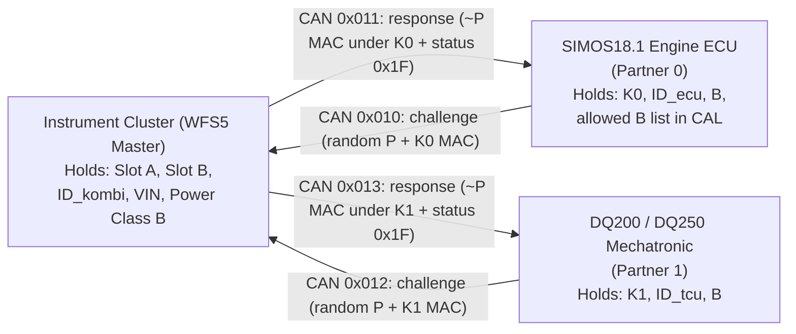
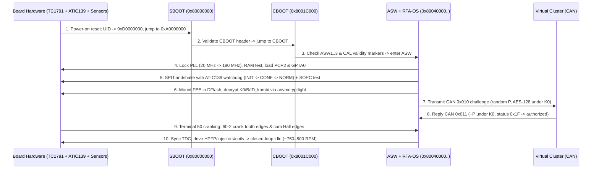

# Firmware, Memory Regions, Keys & Boot Guide (SIMOS18.1, DQ200_G2, DQ250)

> Русская версия: [FIRMWARE_AND_BOOT_GUIDE.ru.md](FIRMWARE_AND_BOOT_GUIDE.ru.md)

In an MQB-platform vehicle, the engine and the dual-clutch transmission are run by separate control units built around **Infineon TriCore** microcontrollers. SimEmu executes their unmodified factory firmware binaries **as-is — without patching a single instruction byte**: immobilizer checks are not bypassed, checksum routines are not nopped out, and RAM variables are never force-written behind the firmware's back.

Because of that hardware-level fidelity, newcomers often ask: **why isn't a dealer `.frf` update file (or an OBD read) enough on its own on bare silicon, what are `rom/sboot.bin` and `rom/dflash.bin` in this repository, what flash regions and cryptographic keys exist inside each unit, and how do the ECU and DSG mechatronic actually boot and authenticate?**

This guide walks through the entire architecture in plain engineering English — from flash memory layouts and immobilizer keys all the way to cranking, idle control, and gearbox clutch engagement.

---

## 1. What Types of Memory Exist Inside Real ECUs and Mechatronics

When people say "an ECU firmware file", they usually mean a single file on disk. Inside a real automotive control unit, however, several distinct memory regions work together, and dealer update containers only carry part of them:

| Memory Type | Physical Location | What It Stores | Non-Volatile? | Included in `.frf` / OBD Reads? |
| :-- | :-- | :-- | :-- | :-- |
| **Mask BROM** | Hard-wired inside the Infineon TriCore silicon die | First-stage chip reset microcode executed at power-up | Yes (permanent) | No |
| **PFlash** (Program Flash) | On-chip Flash inside the TriCore MCU (`4 MB` on SIMOS18.1, `2.625 MB` on DQ200, `1.5 MB` on DQ250) | Bootloaders (`SBOOT`, `CBOOT`), application software (`ASW`), and calibration maps (`CAL`) | Yes | Partially: `.frf` and OBD reads **omit `SBOOT`** (bench/boot reads of DQ200/DQ250 include the full PFlash) |
| **DFlash** (Data Flash) | On-chip Flash inside the TriCore MCU (`256 KB` on SIMOS18.1) | The engine ECU's internal non-volatile storage: vehicle coding, WFS5 immobilizer keys, throttle/fuel adaptations, fault memory (DTCs) | Yes | **Never** (only readable via Bench / Boot-mode tools) |
| **External SPI EEPROM** | Dedicated 8-pin serial chip on the mechatronic PCB (`8 KB` over SPI) | Non-volatile storage for **DQ200** and **DQ250** gearboxes: coding, clutch kiss-point and shift-fork end-stop adaptations, WFS5 keys, DTCs | Yes | **Never** (only readable with a bench programmer) |
| **RAM** (`DSPR`, `PSPR`, `LMU`) | On-chip SRAM inside the TriCore MCU | Live working variables, call stacks, and RTOS task state | No (lost when power is cut) | No |

> **Key takeaway:** An official VAG ODIS update container (`.frf` / `.odx`) or a standard OBD read contains **only the field-updatable portion of `PFlash`** (`CBOOT + ASW + CAL`). Dealer flashing intentionally leaves the factory `SBOOT` region and non-volatile memory (`DFlash` / `EEPROM`) untouched because those are already programmed inside a real car's ECU.
>
> In an emulator, we power up a fresh virtual microcontroller from cold reset. So that you do not need bench hardware or donor dumps just to boot a stock `.frf`, SimEmu ships clean, ready-to-run **`rom/sboot.bin`** and **`rom/dflash.bin`** images out of the box.

---

## 2. Inside the Continental SIMOS18.1 Engine ECU (`SAK-TC1791`)

### 2.1 Program Flash (`PFlash`, `4 MB`) Layout

The `SAK-TC1791` microcontroller contains two 2 MB program flash banks (`PF0` and `PF1`). In a 4 MB (`4,194,304`-byte / `0x400000`) binary file they are stored back-to-back, while in the CPU's virtual address space they map with a gap (`0x80000000` and `0x80800000`; `0xA0…` is simply the uncached mirror of `0x80…`):

| File Offset | CPU Address Range | Block | Contents & Purpose |
| :-- | :-- | :-- | :-- |
| `0x000000..0x01BFFF` (`112 KB`) | `0x80000000..0x8001BFFF` | **`SBOOT`** | Continental's factory primary bootloader (Supplier Boot), per-chip 12-byte `UID` (`0x80014200`), immobilizer partner ID `ID_ecu` (`0x80001150`), and the `anvmcryptlight` export table (`0x80014088`). **Absent in `.frf` and OBD reads.** |
| `0x01C000..0x03FFFF` (`144 KB`) | `0x8001C000..0x8003FFFF` | **`CBOOT`** | VAG Customer Bootloader. Handles UDS flashing over CAN (`0x7E0 → 0x7E8`), LZSS decompression, and block-validity checks before jumping into `ASW`. |
| `0x040000..0x0FFFFF` (`768 KB`) | `0x80040000..0x800FFFFF` | **`ASW1`** | First bank of engine application code and constant tables. |
| `0x100000..0x1FEFFF` (`1020 KB`) | `0x80100000..0x801FEFFF` | **`ASW2`** | Second bank of application code (`RTA-OS` scheduler, air/fuel/spark/boost/cam control, diagnostics, WFS5 immobilizer library). |
| `0x200000..0x27FFFF` (`512 KB`) | `0x80800000..0x8087FFFF` | **`CAL`** | **Calibration sector** (torque, airflow, ignition, lambda, boost maps, DTC tables, immobilizer power-class list). These are the 512 KB edited via DAMOS/A2L. |
| `0x280000..0x2FFFFF` (`512 KB`) | `0x80880000..0x808FFFFF` | **`ASW3`** | Third bank of application code in `PF1`. |
| `0x300000..0x3FFFFF` (`1024 KB`) | `0x80900000..0x809FFFFF` | Unused (`0x00`) | Unallocated tail of `PF1` (on ECC-protected TriCore flash, the erased state is **all zeros `0x00`**, not `0xFF`). |

#### Three Layers of Integrity Verification in `PFlash`
Unmodified SIMOS18.1 firmware verifies its own flash image at three distinct stages:
1. **Post-programming block-validity markers** (in the `+0xFE00` footer of each logical block: `0x8003FE00`, `0x800FFE00`, `0x801FEE00`, `0x8087FE00`, `0x808FFE00`). On a real car, `CBOOT` writes these markers at the end of a successful ODIS flash session. Without them, `CBOOT` assumes flashing was interrupted mid-way, stays stuck in bootloader mode, and refuses to start the engine application.
2. **Per-block `CRC-32` (IEEE) checksums** covering `CBOOT`, `ASW1..3`, and `CAL`.
3. **Background 64-bit `ECM3` monitoring checksums** (at the end of `CAL`, `0x8087FF50..`). Once the engine application (`ASW`) is running, its Level-3 safety monitor continuously sweeps flash in the background. If you edit even a single calibration byte without updating `ECM3`, the engine will boot and run for **~3 seconds** before the safety monitor trips a software reset loop.

Whenever you load any `.frf` or modified `.bin`, `simemu_damos::apply_post_programming` performs the exact completion step a flashing tool performs: it checks and updates any stale block markers, `CRC-32` words, and `ECM3` sums in RAM (leaving your file on disk untouched and logging every update transparently in the UI header and console).

---

### 2.2 What `rom/sboot.bin` (`112 KB`) Is and Why It Is Needed

[`rom/sboot.bin`](../rom/sboot.bin) (`114,688` bytes) is the `0x80000000..0x8001BFFF` supplier boot region from SIMOS18.1 hardware (`06K 907 425 B`, `SAK-TC1791`).

Without these 112 KB, a raw `.frf` or OBD image cannot boot on TriCore hardware for four concrete reasons:
1. **CPU reset entry point (`0xA0000000`)**: Upon power-on reset, the TriCore core fetches its very first instruction from `0xA0000000` (the start of `SBOOT`). If that region is `0x00` (`nop`), execution slides through empty memory instead of initializing the chip.
2. **Factory chip `UID` (`0x80014200`, 12 bytes)**: Continental stores the reference copy of the MCU's unique silicon serial number here. During startup, `ASW` compares `0x80014200` against the boot-ROM copy in `DSPR` (`0xD0000000`) and feeds the first 8 bytes into the key schedule that **decrypts `DFlash`**.
3. **Cryptographic export table (`0x80014088` / `0x8001405C`)**: Neither `CBOOT` nor `ASW` duplicates the `anvmcryptlight` cipher implementation — both call into `SBOOT` (`0x80017540..0x80017C64`) through function pointers at `0x8001405C..0x80014088`.
4. **Production block & `ID_ecu` (`0x80001100..`, `0x80001150`)**: Holds three redundant copies of the 16-bit `ID_ecu` identifier (read via 2-of-3 majority vote) used to sign outgoing WFS5 CAN challenges.

#### `SBOOT` Override Priority
SimEmu **never overwrites** an `SBOOT` that is already present in your dump:
1. If your `.bin` file already contains a non-empty `SBOOT` (e.g., a full 4 MB or 3 MB Bench/BSL read), **your dump's own `SBOOT` and `UID` are used byte-for-byte**.
2. If the `SBOOT` region is empty (`.frf`, `.odx`, or OBD-only read), SimEmu first checks for a user-supplied `sboot.bin` or bench dump in `vault/firmwares/ecu/bench/` (or `$SIMEMU_IMAGE_DIR`).
3. Otherwise, it supplies the bundled [`rom/sboot.bin`](../rom/sboot.bin) in memory (which you can also replace on disk without recompiling).

---

### 2.3 What `rom/dflash.bin` (`256 KB`) Is and What Lives Inside It

The SIMOS18.1 PCB has **no external EEPROM chip**. Everything that must survive disconnecting the car battery is stored inside the `SAK-TC1791`'s internal Data Flash (**DFlash**) mapped at `0xAF000000`.

[`rom/dflash.bin`](../rom/dflash.bin) (`262,144` bytes = `256 KB`) covers both DFlash banks:
- First **`96 KB`** (`0x00000..0x17FFF`, `0xAF000000..0xAF017FFF`) — active bank **`DF0`**, holding the firmware's non-volatile file system.
- Remaining **`160 KB`** (`0x18000..0x3FFFF`) — bank `DF1` (erased, all `0x00`).

#### How the `DF0` File System Works (Continental ECME / FEE)
Raw flash cells wear out if rewritten in place thousands of times. To avoid that, SIMOS18.1 formats `DF0` as a log-structured **Flash EEPROM Emulation (FEE)** store:
- `DF0` is divided into `256`-byte (`0x100`) pages. Byte `0` of every page is a page-status marker (`0x00`, `0x10`, `0x20`, `0x30`), not payload data.
- Data is organized into numbered **ECME channels** (over 100 logical channels, identified in trailers as `(channel << 8) | 0x46`).
- Whenever the firmware updates a channel (for instance, new UDS coding or learned throttle stops), it **appends** a fresh record upward in flash followed by an 8-byte **trailer** sealed with `CRC-16/ARC` (seeded with the bank's seed `0x9C3` from bank headers `0xFFFE` at `0x17E00` / `0x17F00`).
- At ignition-on, the FEE driver scans **backwards** from the end of the bank: the latest CRC-valid instance of each channel wins, while older instances remain inert history.

#### What Data Is Stored Inside `rom/dflash.bin`
`rom/dflash.bin` contains **zero executable code** — only structured NVM records in the firmware's native format:
1. **FEE bank metadata**: bank headers `0xFFFE` (`0x17E00/0x17F00`) and management channel `0x30` (`0x17900..0x17C00`) required for the firmware's FEE driver to mount the bank cleanly.
2. **Standard ECU identification, coding, and adaptation channels**:
   - channels `1..3` — standard OEM hardware/container part strings (`06K907425B`);
   - vehicle coding (`UDS DID 0x0600`) — gearbox type (manual / DQ200 / DQ250), climate control, cruise control, AWD/chassis topology;
   - learned actuator adaptations (throttle body end stops, fuel trims, warm-up counters, fault memory).
3. **WFS5 immobilizer channels `6, 7, and 8`** (three redundant 100-byte copies + 19-byte statistics channel `5`):
   - Bytes `0..13` — **state record** (`0xAA` adapted flag, 4-byte last challenge `P`, 4-byte drive-cycle counter, `CRC-16/CCITT-FALSE`).
   - Bytes `13..66` — **53-byte immobilizer data record**: 16-byte partner key **`K0`**, 17-character ASCII **`VIN`**, 1-byte **power class `B`**, 2-byte cluster ID **`ID_kombi`**, status flags, 4-byte write counter, and `CRC-16/CCITT-FALSE`.
   - Bytes `66..83` — reserved zeros.
   - Bytes `83..100` — plaintext `VIN` mirror read by `CBOOT`.

#### `anvmcryptlight` Encryption & How `rom/dflash.bin` Is 100% Scrubbed
Sensitive ECME channels (`6, 7, 8`, `5`) are encrypted before hitting flash using **`anvmcryptlight`** — a Hitag2-shaped nonlinear stream cipher keyed by the first 8 bytes of the MCU's `UID` (`0x80014200`). If a DFlash image does not match the MCU's `UID`, decryption produces garbage, record CRCs fail, and the firmware sets the VIN to `EEPROM-READ-ERROR`.

In the bundled [`rom/dflash.bin`](../rom/dflash.bin), **all 397 instances of channels `6, 7, and 8` have been completely scrubbed and re-encrypted**:
- Zero bytes of any real vehicle's VIN or keys remain. Every instance holds SimEmu's deterministic lab credentials (`VIN = LABEMU9F200CED3B7`, `K0` derived from `SIMEMU-IMMO-LAB1` + `rom/sboot.bin`'s `UID`, `ID_kombi = 47 05`, `B = 0x5C`).
- Every record in `DF0` passes both `CRC-16/CCITT` and `FEE CRC-16/ARC`, so unmodified SIMOS18.1 firmware mounts `rom/dflash.bin` cleanly and can read and write coding (`2E 06 00`) across power cycles.

#### `DFlash` Override Priority
1. Any user-supplied DFlash dump (`256 KB` or `96 KB` `DF0`) placed in `vault/firmwares/ecu/bench/` (or `$SIMEMU_IMAGE_DIR` / CLI argument) **always takes priority**.
2. Otherwise, SimEmu uses `<root>/rom/dflash.bin` on disk (falling back to the compile-time embedded copy if run as a standalone executable).

---

## 3. MQB WFS5 (Immo 5) Architecture: Keys, Identifiers & Authentication

MQB vehicles use fifth-generation VAG immobilizer security (**WFS5**). Understanding three simple design rules explains why any combination of ECU and TCU firmwares works cleanly in SimEmu without code patches.

### 3.1 Star Topology: The ECU and Gearbox Never Share Keys



The **instrument cluster** is the sole WFS5 master. Only the cluster holds the vehicle's two 16-byte master secrets (**`Slot A`** and **`Slot B`**). From those two master slots, the cluster slices a distinct 16-byte partner key for each slave unit:
- Engine ECU (**Partner 0**): `K0 = A[0..4] || B[4..12] || A[12..16]`
- Transmission TCU (**Partner 1**): `K1 = B[0..4] || A[4..7] || B[7..12] || A[12..16]`

Neither the ECU nor the TCU knows `Slot A/B` or the other unit's key — each slave authenticates independently against the cluster over CAN.

### 3.2 Complete Key & Identifier Map Across All Units

| Item | Size | Engine ECU (`SIMOS18.1`) | `DQ200_G2` (`0CW`) | `DQ250 MQB` (`0D9`) | Purpose at Boot |
| :-- | :-- | :-- | :-- | :-- | :-- |
| **Chip `UID`** | 12 bytes | `PFlash` `0x80014200` (`SBOOT`) + `RAM` `0xD0000000` | Internal MCU register (EEPROM is unencrypted) | Internal MCU register (EEPROM is unencrypted) | On SIMOS18.1, `UID[0..8]` keys `anvmcryptlight` to decrypt `DFlash`. Missing/mismatched UID forces state `0x58`. |
| **Partner Key (`K0` / `K1`)** | 16 bytes (AES-128) | `DFlash` (`DF0`) ch `6, 7, 8`, data offset `+1` (`anvmcryptlight`-encrypted) | External `8 KB SPI EEPROM`, 3 plain copies at `0x1E8`, `0x220`, `0x268` (`+1`) | External `8 KB SPI EEPROM`, 3 plain copies at `0x844`, `0x87C`, `0x8B4` (`+1`) | `AES-128` key used to sign challenges (`0x010`/`0x012`) and verify cluster replies (`0x011`/`0x013`). |
| **Power Class `B`** | 1 byte | 1) Adapted `B`: `DFlash` ch `6/7/8` (`+0x23`);<br>2) Allowed 5-byte list `imo_idxtun01..05_c_vw`: **inside `CAL`** | External `SPI EEPROM`, 3 copies (`+0x23`); RAM allow-list is all-zero → accepts any `B` | External `SPI EEPROM`, 3 copies (`+0x23`) | Prevents cross-flashing higher-output engine calibrations onto lower-tier ECUs. Included inside the AES-128 MAC input! |
| **`ID_kombi`** | 2 bytes | `DFlash` ch `6/7/8` (`+0x25..0x27`) | External `SPI EEPROM`, 3 copies (`+0x25..0x27`) | External `SPI EEPROM`, 3 copies (`+0x25..0x27`) | Home cluster identifier; XORed onto bytes `2..3` of cluster replies `0x011` / `0x013`. |
| **`ID_ecu` / `ID_tcu`** | 2 bytes | `PFlash` `0x80001150` (`SBOOT`, 2-of-3 vote) | Computed from `SBOOT` constants (`0xC100`, `0xC304`) | Constant in `PFlash` | Unit's factory partner ID; XORed onto bytes `6..7` of outgoing challenges `0x010` / `0x012`. |
| **`VIN`** | 17 ASCII bytes | `DFlash` ch `6/7/8` (`+0x11..0x22` & `+83..100`) | External `SPI EEPROM`, 3 copies (`+0x11..0x22`) | External `SPI EEPROM`, 3 copies (`+0x11..0x22`) | Reported over UDS (`22 F1 90`) and identification blocks. |

### 3.3 Why Power Class `B` Matters When Switching Calibrations

Inside the `CAL` block of every SIMOS18.1 firmware sits a 5-byte table `imo_idxtun01..05_c_vw` listing the power classes permitted for that calibration:
- **1.8 TSI (`SC8O40`, e.g. `8V0906264H__0005` / `J__0003`)**: `0x5C`
- **2.0 TSI 220–230 PS (`SC8S50` `8V0906264K__0003`, `SC8H83` `8V0906264F__0003`)**: `0x6A`
- **2.0 TSI Golf 7 R / Audi S3 (`8V0906259J`)**: `AC B7 B9 BA`

At startup, the ECU checks whether the `B` byte stored in `DFlash` appears in the loaded calibration's 5-byte allow-list. If it does not match (for example, `DFlash` has `0x5C` from a 1.8 TSI, and you load a 2.0 TSI `.frf` expecting `0x6A`), the firmware immediately locks into state **`0x42` (`IMMO P-CLASS ERROR`)**, never transmits a `0x010` challenge, and disables spark and fuel injection.

### 3.4 Automatic In-Memory Lab Binding (`immo_lab`) vs. `SIMEMU_IMMO=dump`

By default, whenever SimEmu loads any ECU and TCU firmware pair, `immo_lab` performs a clean, data-only adaptation **in RAM** (never touching files on disk and never modifying code):
1. Derives one deterministic virtual cluster key set (`LAB-xxxxxxxx`, `Slot A/B`, `ID_kombi`, `VIN = LABEMU…`) from the ECU's `UID`.
2. Locates `imo_idxtun01..05_c_vw` in the loaded ECU calibration by code signature and picks a valid power class `B` for that exact calibration.
3. Updates the latest instance of `DFlash` channels `6/7/8` in RAM with `K0` and `B`, encrypts via `anvmcryptlight`, and seals the FEE trailer CRC.
4. Writes the matching partner key `K1` and `B` into the three WFS5 data copies in the TCU's `SPI EEPROM` in RAM.

Both unmodified firmwares then execute their genuine `AES-128` challenge-response over CAN (`0x010 → 0x011` and `0x012 → 0x013`) and release engine start and gearbox torque transfer naturally.
- If a user loads a third-party tuned `.bin` that already has an `immo-off` code patch (`mov.u d2, #0x58; ret` in the state getter), SimEmu leaves the code untouched and reports the detected patch in the UI header and console.
- To test a matched pair of real-vehicle bench dumps using their original keys untouched, set `SIMEMU_IMMO=dump`.

---

## 4. Complete SIMOS18.1 Engine ECU Boot Sequence

Here is what happens step by step from cold power-up to closed-loop idle:



1. **Cold Reset & `SBOOT`**: Terminal 30 (~13.8 V battery) and Terminal 15 (ignition) are applied. The 12-byte `UID` is placed at `0xD0000000`, and execution starts at `0xA0000000` (`SBOOT`), which sets up early `ENDINIT`-protected registers and enters `CBOOT`.
2. **`CBOOT` Block Check**: `CBOOT` inspects the `+0xFE00` validity footers of `ASW1..3` and `CAL`. Seeing all blocks complete, it hands off to `ASW` and performs its normal warm startup transition.
3. **180 MHz Clock Lock & Real-Time Co-Processor (`PCP2` + `GPTA0`)**:
   - `ASW` ramps the `PLL` from the `20.000 MHz` crystal to **`fCPU = 180 MHz`**.
   - Loads `PCP2` channel microcode into `PRAM/CMEM` and configures the `GPTA0` timer array to capture every tooth edge of the **`60-2` crankshaft trigger wheel** and intake/exhaust camshaft Hall sensors, and to schedule microsecond-accurate coil dwell, spark, and injector pulses.
   - Starts **ETAS RTA-OS** (`1 ms / 5 ms / 10 ms / 20 ms / 100 ms` tasks + crank-angle synchronous interrupts).
4. **Hardware Safety Companion (`ATIC139`), `SOPC`, and `ECM3`**:
   - Energizes the main relay (`KL87`) and checks the 5 V sensor reference rails (`VCC_0..2`) on ADC0.
   - Drives the external **Continental ATIC139** safety supervisor over SPI (`SSC0`) through `INIT → CONF → NORM` and services its periodic question-answer watchdog.
   - Exercises the hardware **Safety Shut-Off Path (`SOPC`)** (verifying it can cut H-bridge throttle drive during the startup self-test) and runs continuous `ECM3` flash verification in the background.
5. **FEE Mount & `WFS5` Handshake**:
   - Scans `DF0` (`0xAF000000`), restores vehicle coding (`0x0600`) and adaptations, decrypts channels `6/7/8`, validates power class `B`, sends CAN **`0x010`**, validates the cluster's **`0x011`** reply, and clears start immobilization.
6. **Cranking, Sync & Closed-Loop Idle**:
   - Starter torque spins the crankshaft (~220–260 RPM). `PCP2` detects the missing two-tooth gap on the `60-2` wheel alongside cam edges to lock cylinder phase, commands rail pressure via the HPFP metering valve (`MSV`), fires injectors and ignition coils, and transitions smoothly into closed-loop idle control via throttle angle and spark reserve.

---

## 5. Complete DSG Mechatronic Boot Sequence: `DQ200_G2` & `DQ250 MQB`

Each DSG mechatronic is an independent TriCore ECU mounted on the gearbox. It exchanges 500 kbit/s powertrain CAN frames with SIMOS18.1 (shift torque intervention requests, target speeds, engaged gear) and drives proportional hydraulic solenoids with closed-loop current sensing to actuate clutches `K1/K2` and four shift forks.

Unlike SIMOS18.1, both **DQ200_G2** and **DQ250 MQB** store their non-volatile data in an **external 8 KB SPI EEPROM** wired to `SSC0`. Records in that EEPROM are **not encrypted to the MCU's `UID`**.

---

### 5.1 DSG7 `DQ200_G2` (`0CW` — 7-Speed Dry Clutch, Electric Hydraulic Accumulator Pump)

- **MCU**: `Infineon SAK-TC1784` (`TriCore 1.3.1` @ `180 MHz`).
- **`PFlash` Layout** (`2,752,512` bytes = `2.625 MB` / `0x2A0000`):
  - `0x80000000..0x8000CFFF` — **`SBOOT`** (`"TEMIC ACCESS OK"`, production constants for `ID_tcu`);
  - `0x80010000..0x8001FFFF` — **`CBOOT`** (`"DQ200G2_CBoot_V0006"`);
  - `0x80020000..0x8003FFFF` — **`CAL`** (shift maps, gear ratios `1..7, R`, VAG-to-SAE DTC tables, supply voltage thresholds);
  - `0x80040000..0x8013FFFF` — **`ASW`** (application software, interrupt vector table at `0x80040000`).
- **External `SPI EEPROM` (`ST95640`, `8,192` bytes = `8 KB`)**:
  - Stores coding, pressure and fork-position sensor zero offsets, dry-clutch `K1/K2` kiss points, and three plain 53-byte `WFS5` records at **`0x1E8`, `0x220`, and `0x268`** (`K1`, `VIN`, `B`, `ID_kombi`, counter, `CRC-16/CCITT`).

#### Boot Path & File Requirements for `DQ200_G2`
1. With `KL30` and `KL15` inside the valid `9..17 V` window (`ADC[20]` and `ADC[13]`), execution flows `SBOOT → CBOOT → ASW`.
2. `ASW` reads all 8 KB of `ST95640` over SPI, verifies page checksums, picks the newest `WFS5` record, sends CAN **`0x012`**, accepts **`0x013`** (entering authorized state `7`), runs the electric pump motor to charge the hydraulic accumulator (~`42–52 bar`), centers the shift forks, and broadcasts `Getriebe_11 / 14 / 15` on CAN.
3. **Why `DQ200_G2` requires both files (`micro.bin` + `eeprom.bin`)**: Automatic blank-EEPROM basic settings are not yet scripted for `DQ200_G2`, so the firmware expects a valid `8 KB` `ST95640` page layout (`K1` is still bound automatically in RAM).

---

### 5.2 DSG6 `DQ250 MQB` (`0D9` — 6-Speed Wet Clutch, Engine-Driven Mechanical Oil Pump)

- **MCU**: `Infineon SAK-TC1766` (`TriCore 1.3.1`, `AUDO-NG` peripheral family).
- **`PFlash` Layout** (`1,572,864` bytes = `1.5 MB` / `0x180000`, or `1,540,096` bytes = `0x178000` physical PFlash size):
  - `0x80000000..0x80007FFF` — **`SBOOT`** (entry `0x80004000`, `"DQ250_MQB"`, SPI EEPROM driver on `SSC0` / chip-select `P2.8`);
  - `0x80010000..0x80017FFF` — **`CBOOT`** (`"EV_TCMDQ250021"`, UDS bootloader on CAN `0x7E1 → 0x7E9` and full-block `CRC-32` verifier);
  - `0x80020000..0x8003FFFF` — **`CAL`** (shift maps, gear/final-drive tooth counts, DTC tables; block `CRC-32` at `0x8003FFFC`);
  - `0x80040000..0x8016FFFF` — **`ASW`** + constants (block `CRC-32` at `0x8016FFFC`).

#### Why `DQ250 MQB` Needs ONLY the `1.5 MB` Flash File (No EEPROM Dump Needed!)
Full 1.5 MB `DQ250 MQB` PFlash reads are widely available, whereas matching 8 KB external SPI EEPROM dumps almost never are.

Rather than inventing fake adaptation bytes, SimEmu commissions a brand-new mechatronic **the exact way a dealership workshop does**:
1. **Blank `8 KB` SPI EEPROM (`0xFF`)**: SimEmu starts with an erased `0xFF` chip and writes **only the three 53-byte WFS5 `K1` records** at `0x844`, `0x87C`, and `0x8B4`. Every other byte stays `0xFF`.
2. **Initial `CBOOT` CRC Sweep (~2.5 s)**: Because the blank EEPROM has no cached block-valid status yet, `CBOOT` computes reflected `CRC-32` across `CAL` and `ASW` (`apply_post_programming_dq250` updates both CRC words in RAM if you modified the calibration) and jumps to `ASW`.
3. **WFS5 Auth & Unadapted Safe State**: `ASW` completes `0x012 → 0x013` authentication, detects an uncoded/unadapted EEPROM, logs genuine `No Coding` / `No Basic Setting` DTCs, and holds the clutches open.
4. **Automatic Headless Workshop Commissioning (`dq250_prep`)**: On first launch of a `DQ250` image, Studio automatically runs the genuine VAG UDS workshop sequence (`0x7E1 → 0x7E9`):
   - Enters extended session (`10 03`) and writes vehicle coding (`2E 06 00 …`);
   - Starts the engine (because `DQ250`'s mechanical oil pump is driven by the engine input shaft — without engine RPM there is zero hydraulic line pressure to move the forks!);
   - Starts **Transmission Basic Settings (`31 01 03 80`)** and clutch adaptation (`0x04D4`);
   - The unmodified `DQ250` firmware energizes its solenoids, sweeps all four shift forks against the physics model's mechanical end stops, calibrates Hall position sensors and `K1/K2` pressures, and reports routine completion (`0x04`);
   - Studio then switches ignition (`KL15`) off so the firmware flushes all learned adaptation pages into the SPI EEPROM during its power-down *Nachlauf* phase.
5. **Cached Ready-to-Drive State**: The firmware-written 8 KB EEPROM is saved to `build/studio_state/tcu_<asw_id>.eeprom.bin`. Every subsequent session boots **instantly** with zero faults and immediate `D` / `S` / `R` driveability.

#### Important CAN Pairing Detail (`Getriebe_15` / `0x0B1`)
- **1.8 TSI (`SC8O40`, e.g. `8V0906264H__0005`)** expects periodic CAN frame **`Getriebe_15` (`0x0B1`)** from the gearbox. The factory 1.8 TFSI 4WD DQ250 calibration **`0D9300012F` (SW `4930`)** transmits `0x0B1`; the 2.0 TSI DQ250 calibration **`0D9300011R` (SW `4319`)** does not (because 2.0 TSI `SC8S50` ECUs do not expect `0x0B1`).
- Studio's vehicle presets automatically pair `SC8O40` with `0D9300012F` (`a3_8v_quattro`) and `SC8S50` with `0D9300011R` (`golf7_gti`, `golf7r`), while gracefully falling back to whichever DQ250 image you have in `vault/firmwares/tcu/dq250/`.

---

## 6. Quick Reference: Which Files Do You Actually Need?

Drop your files into `vault/firmwares/` (or point `SIMEMU_IMAGE_DIR` to any folder). You do **not** need to rename files to special names — SimEmu auto-detects `.frf` containers, binary sizes, and internal OEM software strings.

```text
simemu/
├── rom/
│   ├── sboot.bin                 # Bundled (112 KB default SBOOT + UID for .frf and OBD reads)
│   └── dflash.bin                # Bundled (256 KB scrubbed SIMOS18.1 DFlash / FEE image)
├── definitions/
│   └── SC8O40.json, SC8S50.json… # Bundled calibration map definitions
└── vault/firmwares/
    ├── ecu/
    │   ├── frf/                  # Official VAG ODIS .frf containers (e.g. FL_8V0906264H__0005.frf)
    │   ├── stock/                # Or unpacked 4 MB stock .bin images
    │   ├── custom/               # Your tuned / modified .bin or .frf images
    │   └── bench/                # (Optional) Your own Bench/BSL SBOOT + DFlash (256 KB / 96 KB)
    └── tcu/
        ├── dq250/                # 1.5 MB DQ250 MQB Flash read (0D9300011R / 0D9300012F) — NO EEPROM needed!
        └── dq200/                # DQ200_G2 (0CW) pair: 2.625 MB PFlash + 8 KB ST95640 EEPROM
```

| Use Case | Already Bundled in SimEmu | What You Need to Supply |
| :-- | :-- | :-- |
| **1. Boot SIMOS18.1 on the engine dyno, edit maps & run power pulls** | `rom/sboot.bin` + `rom/dflash.bin` + `definitions/*.json` | **Just 1 file:** any stock SIMOS18.1 `.frf` (e.g. `FL_8V0906264H__0005.frf` or `FL_8V0906264K__0003.frf`) in `vault/firmwares/ecu/frf/`. |
| **2. Full road/chassis-dyno car with DSG6 `DQ250`** | `rom/sboot.bin` + `rom/dflash.bin` + automatic UDS EEPROM commissioning | **2 files:** SIMOS18.1 `.frf`/`.bin` in `ecu/frf/` + one `1.5 MB` `DQ250 MQB` (`0D9`) Flash read in `tcu/dq250/`. |
| **3. Full road/chassis-dyno car with DSG7 `DQ200_G2`** | `rom/sboot.bin` + `rom/dflash.bin` + automatic `K0/K1` binding | **3 files:** SIMOS18.1 `.frf`/`.bin` + `DQ200_G2` pair (`2.625 MB` PFlash + `8 KB` ST95640 EEPROM) in `tcu/dq200/`. |
| **4. Test a modified OBD tune (empty `SBOOT`, stale checksums)** | `rom/sboot.bin` + `rom/dflash.bin` + automatic `CRC-32`/`ECM3` update | Your `4 MB` (or `3 MB`) `.bin` in `vault/firmwares/ecu/custom/`. |
| **5. Forensic analysis of a full bench dump from a real car** | Hardware-accurate emulation without touching source files | Your full `4 MB` PFlash + `256 KB` `DFlash` in `vault/firmwares/ecu/bench/` (optionally with `SIMEMU_IMMO=dump`). |
