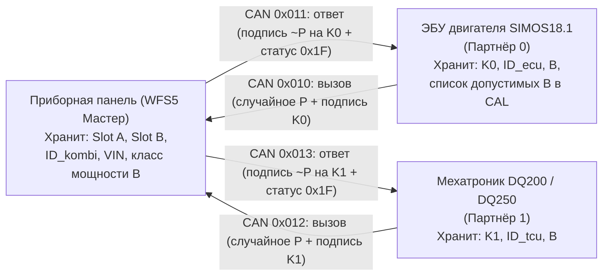
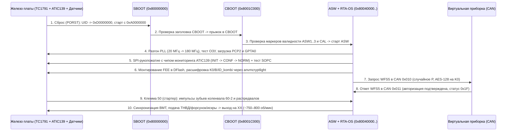

# Путеводитель по памяти, ключам и запуску блоков в SimEmu (SIMOS18.1, DQ200_G2, DQ250)

> English version: [FIRMWARE_AND_BOOT_GUIDE.md](FIRMWARE_AND_BOOT_GUIDE.md)

В реальном автомобиле платформы MQB двигатель и коробка передач управляются отдельными компьютерами на базе микроконтроллеров **Infineon TriCore**. SimEmu исполняет их заводские прошивки **как есть — без единого изменённого байта кода**: не вырезает проверки иммобилайзера, не глушит контрольные суммы и не подменяет переменные в оперативной памяти.

Из-за такой честности у многих возникает резонный вопрос: **почему дилерского файла `.frf` (или прошивки, считанной через розетку OBD) самого по себе недостаточно на реальном «голом» процессоре, зачем в репозитории лежат файлы `rom/sboot.bin` и `rom/dflash.bin`, какие вообще флеши и ключи есть внутри блоков и как именно заводится связка ЭБУ + DSG?**

Ниже всё это разобрано простым инженерным языком — от устройства памяти до момента, когда мотор выходит на холостой ход, а мехатроник включает передачу.

---

## 1. Какие виды памяти вообще есть в ЭБУ и мехатронике

Когда в быту говорят «прошивка блока», обычно имеют в виду только один файл. На самом деле внутри любого автомобильного блока управления живёт сразу несколько разных областей памяти, и у каждой — своя роль:

| Память | Где физически находится | Что хранит | Сохраняется без питания? | Есть ли в `.frf` / OBD-чтении? |
| :-- | :-- | :-- | :-- | :-- |
| **Масочный BROM** | Зашит на фабрике Infineon внутри самого кристалла TriCore | Самый первый микрокод старта чипа при подаче питания | Да (навсегда) | Нет |
| **PFlash** (Program Flash) | Внутри процессора TriCore (`4 МБ` у SIMOS18.1, `2.625 МБ` у DQ200, `1.5 МБ` у DQ250) | Загрузчики (`SBOOT`, `CBOOT`), основная программа управления (`ASW`) и таблицы калибровок (`CAL`) | Да | Частично: в `.frf` и OBD **нет области `SBOOT`** (в DQ200/DQ250 читают полный дамп со `SBOOT`) |
| **DFlash** (Data Flash) | Внутри процессора TriCore (`256 КБ` у SIMOS18.1) | Внутренний «жёсткий диск» ЭБУ двигателя: кодирование комплектации, ключи иммобилайзера, адаптации дросселя и топлива, ошибки (DTC) | Да | **Никогда нет** (читается только на столе в режиме Bench / Boot) |
| **Внешний SPI EEPROM** | Отдельная маленькая 8-ногая микросхема на плате мехатроника (`8 КБ`, шина SPI) | Энергонезависимая память коробок **DQ200** и **DQ250**: кодирование, адаптации точек касания сцеплений и упоров вилок, ключи иммобилайзера, ошибки | Да | **Никогда нет** (читается только программатором на столе) |
| **RAM** (`DSPR`, `PSPR`, `LMU`) | Внутри процессора TriCore | Оперативная память для текущих расчётов, стека и задач ОС реального времени | Нет (обнуляется при снятии питания) | Нет |

> **Главный вывод:** дилерский контейнер обновления VAG ODIS (`.frf` / `.odx`) и обычное чтение по диагностической розетке OBD содержат **только обновляемую часть `PFlash`** (`CBOOT + ASW + CAL`). Они никогда не трогают ни заводской первичный загрузчик `SBOOT`, ни энергонезависимую память (`DFlash` / `EEPROM`), потому что в живой машине эти области уже записаны на заводе и при обновлении ПО у дилера должны остаться нетронутыми.
>
> А в эмуляторе мы включаем процессор «с нуля». Чтобы пользователю не приходилось искать паяльник и программатор ради запуска обычного стокового `.frf`, в репозитории уже лежат готовые чистые образы **`rom/sboot.bin`** и **`rom/dflash.bin`**.

---

## 2. Память ЭБУ двигателя Continental SIMOS18.1 (`SAK-TC1791`)

### 2.1 Карта программной памяти `PFlash` (`4 МБ`)

В микроконтроллере `SAK-TC1791` есть два физических банка программной флеш-памяти по 2 МБ (`PF0` и `PF1`). В файле полного дампа размером `4 194 304` байт (`0x400000`) они идут подряд, но в адресном пространстве процессора отображаются с разрывом (`0x80000000` и `0x80800000`; сегмент `0xA0…` — это просто некэшируемое зеркало тех же самых адресов `0x80…`):

| Смещение в файле | Адреса в процессоре | Раздел | Что внутри и зачем нужно |
| :-- | :-- | :-- | :-- |
| `0x000000..0x01BFFF` (`112 КБ`) | `0x80000000..0x8001BFFF` | **`SBOOT`** | Первичный загрузчик завода Continental (Supplier Boot), индивидуальный `UID` процессора (`0x80014200`), номер партнёра иммобилайзера `ID_ecu` (`0x80001150`) и библиотечные функции шифрования NVM (`0x80014088`). **Отсутствует в `.frf` и OBD-чтениях.** |
| `0x01C000..0x03FFFF` (`144 КБ`) | `0x8001C000..0x8003FFFF` | **`CBOOT`** | Клиентский загрузчик VAG (Customer Boot). Отвечает за прошивку блока по UDS (CAN `0x7E0 → 0x7E8`), распаковку сжатия LZSS и проверку целостности программы перед передачей управления в `ASW`. |
| `0x040000..0x0FFFFF` (`768 КБ`) | `0x80040000..0x800FFFFF` | **`ASW1`** | Первая часть основной управляющей программы двигателя и таблицы констант. |
| `0x100000..0x1FEFFF` (`1020 КБ`) | `0x80100000..0x801FEFFF` | **`ASW2`** | Вторая часть управляющей программы (ОС `RTA-OS`, алгоритмы впрыска, зажигания, наддува, фазовращателей, диагностики, библиотека иммобилайзера WFS5). |
| `0x200000..0x27FFFF` (`512 КБ`) | `0x80800000..0x8087FFFF` | **`CAL`** | **Калибровки** (карты наполнения, УОЗ, смесей, наддува, лимитеры момента, список классов мощности иммобилайзера). Именно эти 512 КБ меняют калибровщики по DAMOS/A2L. |
| `0x280000..0x2FFFFF` (`512 КБ`) | `0x80880000..0x808FFFFF` | **`ASW3`** | Третья часть управляющей программы во втором банке `PF1`. |
| `0x300000..0x3FFFFF` (`1024 КБ`) | `0x80900000..0x809FFFFF` | Пусто (`0x00`) | Неиспользуемый хвост банка `PF1` (на процессорах TriCore чистое стёртое состояние флеш-памяти с ECC — это **нули `0x00`**, а не `0xFF`). |

#### Три рубежа контроля целостности внутри `PFlash`
Прошивка SIMOS18.1 проверяет сама себя в три этапа:
1. **Маркеры завершения программирования блоков** (в служебном футере `+0xFE00` каждого блока: `0x8003FE00`, `0x800FFE00`, `0x801FEE00`, `0x8087FE00`, `0x808FFE00`). На реальной машине эти байты дописывает сам `CBOOT` в последнюю секунду прошивки через ODIS. Если взять «сырой» распакованный `.frf` без этих маркеров, `CBOOT` решит, что прошивка оборвалась на полпути, останется в режиме загрузчика и никогда не запустит мотор.
2. **Блочные контрольные суммы `CRC-32` (IEEE)** — покрывают каждый логический блок (`CBOOT`, `ASW1..3`, `CAL`).
3. **Фоновые 64-битные суммы безопасности `ECM3`** (в конце сектора калибровок `0x8087FF50..`) — их непрерывно в фоне пересчитывает уже запущенная рабочая программа `ASW` (мониторинг безопасности уровня 3). Если поправить хотя бы один байт в картах `CAL` и не пересчитать `ECM3`, двигатель запустится, но ровно через **~3 секунды** мониторинг обнаружит расхождение и уйдёт в бесконечный программный сброс.

Когда вы загружаете любой `.frf` или изменённый `.bin` в SimEmu, модуль `simemu_damos::apply_post_programming` делает ровно то, что делает дилерский прибор ODIS или флешер в конце записи: проверяет и при необходимости аккуратно проставляет маркеры блоков и пересчитывает `CRC-32` + `ECM3` в оперативной памяти (файл на диске не трогается, а все действия честно пишутся в заголовок и лог).

---

### 2.2 Что такое `rom/sboot.bin` (`112 КБ`) и зачем он нужен

Файл [`rom/sboot.bin`](../rom/sboot.bin) (`114 688` байт) — это образ области `0x80000000..0x8001BFFF` заводского аппаратного блока SIMOS18.1 (`06K 907 425 B`, процессор `SAK-TC1791`).

Без этих 112 КБ ни один `.frf`-файл физически не может стартовать на процессоре TriCore по четырём причинам:
1. **Точка аппаратного старта (`0xA0000000`)**: после подачи питания ядро TriCore всегда начинает исполнение кода с адреса `0xA0000000` — то есть с самой первой инструкции `SBOOT`. Если там нули (`0x00` — инструкция `nop`), процессор просто провалится по нулям в никуда.
2. **Заводской уникальный номер чипа `UID` (`0x80014200`, 12 байт)**: по этому адресу Continental на заводе записывает эталонную копию аппаратного серийного номера процессора. При старте программа `ASW` сверяет её с копией `UID` в начале оперативной памяти (`0xD0000000`, куда её кладёт стартовый микрокод чипа) и использует первые 8 байт `UID` как **ключ расшифровки энергонезависимой памяти `DFlash`**.
3. **Таблица криптографических вызовов (`0x80014088` / `0x8001405C`)**: клиентский загрузчик `CBOOT` и рабочая программа `ASW` не хранят у себя код потокового шифра `anvmcryptlight` — они вызывают его напрямую по таблице указателей внутри `SBOOT` (`0x80017540..0x80017C64`).
4. **Производственный блок FAZIT и `ID_ecu` (`0x80001100..`, `0x80001150`)**: трижды продублированное 16-битное число `ID_ecu` (голосуется по правилу «2 из 3»), которым ЭБУ подписывает свои запросы иммобилайзера в шине CAN.

#### Приоритет выбора `SBOOT` в SimEmu
Эмулятор **никогда не навязывает** свой `rom/sboot.bin`, если у вас есть собственный полный дамп:
1. Если загружаемый вами `.bin` уже содержит непустой `SBOOT` (например, вы считали полный 4 МБ / 3 МБ дамп на столе в BSL/Bench) — **всегда без изменений используется родной `SBOOT` из вашего файла**.
2. Если область `SBOOT` в загружаемом файле пустая (`.frf`, `.odx` или чтение по OBD), SimEmu сначала ищет пользовательский `sboot.bin` или полный стендовый дамп в `vault/firmwares/ecu/bench/` (либо в `$SIMEMU_IMAGE_DIR`).
3. Только если своих стендовых файлов нет, в оперативной памяти подставляется штатный [`rom/sboot.bin`](../rom/sboot.bin) (при желании вы можете просто заменить этот файл на диске без пересборки программы).

---

### 2.3 Что такое `rom/dflash.bin` (`256 КБ`) и что лежит внутри него

На плате SIMOS18.1 **нет отдельной микросхемы EEPROM**. Всю информацию, которая должна переживать снятие клеммы аккумулятора, процессор `SAK-TC1791` хранит во внутренней флеш-памяти данных — **DFlash** по адресу `0xAF000000`.

Файл [`rom/dflash.bin`](../rom/dflash.bin) (`262 144` байта = `256 КБ`) состоит из двух частей:
- Первые **`96 КБ`** (`0x00000..0x17FFF`, адреса `0xAF000000..0xAF017FFF`) — активный банк **`DF0`**, в котором живёт файловая система энергонезависимой памяти ЭБУ.
- Оставшиеся **`160 КБ`** (`0x18000..0x3FFFF`) — резервный банк `DF1` (чистый, заполнен нулями `0x00`).

#### Как устроена файловая система внутри `DF0` (Continental ECME / FEE)
Флеш-память нельзя перезаписывать по одному байту на одном и том же месте тысячи раз — ячейки быстро износятся. Поэтому прошивка SIMOS18.1 организует внутри `DF0` **журнальную систему выравнивания износа (Flash EEPROM Emulation, FEE)**:
- Весь банк `DF0` разбит на страницы по `256` байт (`0x100`). Самый первый байт каждой страницы — служебный маркер состояния страницы (`0x00`, `0x10`, `0x20`, `0x30`), а не данные.
- Данные блока разделены на нумерованные **логические каналы ECME** (всего более 100 каналов, идентификатор записи в трейлере имеет вид `(номер_канала << 8) | 0x46`).
- Когда прошивка обновляет какой-то параметр (например, вы сменили кодирование или мотор обновил долгосрочную топливную коррекцию), она **не стирает старую запись**, а дописывает в конец свободного места новую порцию данных и закрывает её 8-байтным **трейлером** с контрольной суммой `CRC-16/ARC` (посчитанной с учётом уникального `seed` банка `0x9C3`, хранящегося в заголовках банка `0xFFFE` по смещениям `0x17E00` и `0x17F00`).
- При включении зажигания драйвер FEE сканирует банк **с конца к началу**: самая последняя запись каждого канала с валидной `CRC-16` считается актуальной, а все более ранние копии просто игнорируются как архивные.

#### Какие именно данные лежат в каналах `rom/dflash.bin`
Внутри `rom/dflash.bin` **нет ни одного байта исполняемого кода** — только структуры данных самой прошивки:
1. **Служебная разметка банка FEE**: заголовки банка `0xFFFE` (`0x17E00/0x17F00`) и управляющие страницы канала `0x30` (`0x17900..0x17C00`), без которых драйвер FEE считает память неразмеченной.
2. **Паспортные и конфигурационные каналы ЭБУ**:
   - каналы `1..3` — стандартные заводские идентификаторы аппаратной ревизии и контейнера (`06K907425B`, версия ПО);
   - канал длинного кодирования (`UDS DID 0x0600`) — тип коробки передач (МКПП / DQ200 / DQ250), наличие климат-контроля, круиз-контроля, полного привода и систем шасси;
   - рабочие каналы адаптаций (крайние положения дроссельной заслонки, заслонок впуска, коррекции смеси, счётчики циклов прогрева и память неисправностей).
3. **Каналы иммобилайзера `6, 7 и 8`** (три независимые резервные копии по 100 полезных байт каждая + канал статистики `5` на 19 байт):
   - Байты `0..13` — **запись состояния** (`0xAA` = блок адаптирован, 4 байта последнего случайного вызова, 4-байтный счётчик циклов и `CRC-16/CCITT-FALSE`).
   - Байты `13..66` — **запись данных иммобилайзера** (53 байта): 16-байтный секретный ключ **`K0`**, 17 символов **`VIN`**, 1 байт **класса мощности `B`**, 2 байта номера приборной панели **`ID_kombi`**, флаги состояния, 4-байтный счётчик записей и `CRC-16/CCITT-FALSE`.
   - Байты `66..83` — нули (резерв).
   - Байты `83..100` — дублирующая копия `VIN` для загрузчика `CBOOT`.

#### Шифрование `anvmcryptlight` и полная обезличенность `rom/dflash.bin`
Чувствительные каналы в `DFlash` (включая каналы `6, 7, 8`) не лежат в открытом виде: перед записью во флеш прошивка пропускает их через потоковый шифр **`anvmcryptlight`** (вариация регистра сдвига с нелинейной фильтрацией на базе полинома Hitag2), ключом к которому служат первые 8 байт `UID` процессора (`0x80014200`). Если просто перенести чужой `DFlash` на процессор с другим `UID`, при расшифровке получится мусор, `CRC-16` не сойдётся, а вместо VIN в памяти появится строка `EEPROM-READ-ERROR`.

В поставляемом в репозитории файле [`rom/dflash.bin`](../rom/dflash.bin) **абсолютно все 397 исторических и текущих записей каналов `6, 7 и 8` полностью очищены и перешифрованы**:
- Вместо данных реального автомобиля во всех копиях записан детерминированный лабораторный профиль SimEmu (`VIN = LABEMU9F200CED3B7`, лабораторный ключ `K0` от метки `SIMEMU-IMMO-LAB1` и `UID` из `rom/sboot.bin`, `ID_kombi = 47 05`, класс мощности `B = 0x5C`).
- Все 100% записей банка `DF0` имеют корректные контрольные суммы `CRC-16/CCITT` и трейлеры `FEE CRC-16/ARC`, поэтому любая заводская прошивка SIMOS18.1 штатно монтирует `rom/dflash.bin`, читает из него настройки и сохраняет туда новое кодирование между перезапусками.

#### Приоритет выбора `DFlash`
Точно так же, как и со `SBOOT`, ваши собственные дампы всегда главнее:
1. Если вы положили свой дамп `DFlash` (`256 КБ` или `96 КБ` `DF0`) в `vault/firmwares/ecu/bench/` (или указали `$SIMEMU_IMAGE_DIR` / аргумент командной строки) — SimEmu загрузит **ваш файл**.
2. Если своего дампа нет — используется [`rom/dflash.bin`](../rom/dflash.bin) с диска (или его встроенная в бинарник копия, если исполняемый файл запущен вообще отдельно от папок).

---

## 3. Иммобилайзер WFS5 (MQB Immo 5): какие ключи есть и кто с кем общается

На платформе MQB используется пятое поколение иммобилайзера концерна VAG — **WFS5** (*Wegfahrsperre 5*). Чтобы понимать, почему разные прошивки в эмуляторе работают вместе без единого патча кода, достаточно знать три главных принципа его архитектуры.

### 3.1 Схема «звезда»: ЭБУ и коробка не знают ключей друг друга



Главный центр доверия автомобиля — **приборная панель (комбинация приборов)**. Только она хранит два 16-байтных мастер-слота автомобиля (**`Slot A`** и **`Slot B`**). Из этих двух слотов приборка по фиксированной маске «нарезает» индивидуальные 16-байтные ключи для каждого ведомого блока:
- для ЭБУ двигателя (**Партнёр 0**): `K0 = A[0..4] || B[4..12] || A[12..16]`;
- для коробки передач (**Партнёр 1**): `K1 = B[0..4] || A[4..7] || B[7..12] || A[12..16]`.

Ни ЭБУ двигателя, ни мехатроник DSG не знают мастер-слотов `A/B` и не знают ключей друг друга: каждый из них проверяет только ответы приборной панели на своём собственном ключе (`K0` или `K1`).

### 3.2 Полная карта всех ключей и идентификаторов по блокам

| Параметр | Размер | Где лежит в ЭБУ (`SIMOS18.1`) | Где лежит в `DQ200_G2` (`0CW`) | Где лежит в `DQ250 MQB` (`0D9`) | Роль при запуске |
| :-- | :-- | :-- | :-- | :-- | :-- |
| **`UID` чипа** | 12 байт | `PFlash` `0x80014200` (`SBOOT`) + копия в `RAM` `0xD0000000` | Внутренний регистр чипа (не шифрует внешний EEPROM) | Внутренний регистр чипа (не шифрует внешний EEPROM) | В SIMOS18.1 первые 8 байт являются ключом шифра `anvmcryptlight` для чтения `DFlash`. Если `UID` стёрт/неверный — иммобилайзер уходит в статус `0x58`. |
| **Секретный ключ партнёра (`K0` / `K1`)** | 16 байт (AES-128) | `DFlash` (`DF0`), каналы `6, 7, 8`, смещение `+1` записи данных (зашифровано `anvmcryptlight`) | Внешний `SPI EEPROM` (`8 КБ`), 3 открытые копии по `0x1E8`, `0x220`, `0x268` (смещение `+1`) | Внешний `SPI EEPROM` (`8 КБ`), 3 открытые копии по `0x844`, `0x87C`, `0x8B4` (смещение `+1`) | Ключ шифрования `AES-128`, которым блок подписывает свой запрос (`0x010`/`0x012`) и проверяет ответ приборки (`0x011`/`0x013`). |
| **Класс мощности `B` (`Power Class`)** | 1 байт | 1) Адаптированный `B`: в `DFlash` (каналы `6/7/8`, `+0x23`);<br>2) Разрешённый список из 5 байт `imo_idxtun01..05_c_vw`: **в секторе `CAL` прошивки** | Внешний `SPI EEPROM`, 3 копии (`+0x23`); список в ОЗУ пустой → принимает любой `B` | Внешний `SPI EEPROM`, 3 копии (`+0x23`) | Защита VAG от заливки калибровок от более мощного мотора в младший блок. Входит внутрь AES-блока вызова и ответа! |
| **`ID_kombi`** | 2 байта | `DFlash` (каналы `6/7/8`, `+0x25..0x27`) | Внешний `SPI EEPROM`, 3 копии (`+0x25..0x27`) | Внешний `SPI EEPROM`, 3 копии (`+0x25..0x27`) | Идентификатор «своей» приборной панели. Накладывается операцией `XOR` на байты `2..3` ответа `0x011` / `0x013`. |
| **`ID_ecu` / `ID_tcu`** | 2 байта | `PFlash` `0x80001150` (`SBOOT`, голосование 2 из 3) | Вычисляется из заводских констант `SBOOT` (`0xC100` и `0xC304`) | Константа в `PFlash` | Собственный заводской ID блока; накладывается `XOR` на байты `6..7` исходящего запроса `0x010` / `0x012` (для формирования ответа приборке знать его не обязательно). |
| **`VIN`** | 17 байт ASCII | `DFlash` (каналы `6/7/8`, `+0x11..0x22` и `+83..100`) | Внешний `SPI EEPROM`, 3 копии (`+0x11..0x22`) | Внешний `SPI EEPROM`, 3 копии (`+0x11..0x22`) | Отображается по диагностике UDS (`22 F1 90`) и в паспорте блока. |

### 3.3 Ловушка с классом мощности `B` (почему мотор может не завестись даже с правильным ключом)

Это один из самых частых вопросов при смене прошивок. Внутри сектора калибровок `CAL` каждой прошивки SIMOS18.1 зашит короткий массив из 5 байт `imo_idxtun01..05_c_vw` — перечень классов мощности, с которыми этой прошивке разрешено работать:
- у заводских прошивок **1.8 TSI** (`SC8O40`, например `8V0906264H__0005` / `J__0003`) там прописан класс **`0x5C`**;
- у заводских прошивок **2.0 TSI 220–230 л.с.** (`SC8S50` `8V0906264K__0003` и `SC8H83` `8V0906264F__0003`) — **`0x6A`**;
- у прошивок **Golf 7 R / Audi S3 2.0 TSI** (`8V0906259J`) — список **`AC B7 B9 BA`**.

При включении зажигания прошивка ЭБУ достаёт байт `B`, сохранённый в `DFlash`, и ищет его в этом 5-байтном списке из загруженной калибровки `CAL`. Если байта `B` там нет (например, в `DFlash` лежал `0x5C` от 1.8 TSI, а вы загрузили прошивку 2.0 TSI с `0x6A`), ЭБУ **мгновенно переходит в состояние блокировки `0x42` («IMMO P-CLASS ERROR»)**, даже не пытается отправить запрос `0x010` приборке и полностью блокирует катушки зажигания и топливные форсунки.

### 3.4 Лабораторная привязка `immo_lab` (по умолчанию) и режим `dump`

Как подружить между собой **любую** выбранную пользователем прошивку ЭБУ (хоть 1.8 TSI, хоть 2.0 TSI, хоть тюнинг) и **любую** прошивку коробки передач, не ломая код прошивок патчами `immo-off`?

По умолчанию SimEmu при старте сессии выполняет в оперативной памяти **лабораторную адаптацию NVM (`immo_lab`)**:
1. Из `UID` процессора ЭБУ генерируется единый детерминированный лабораторный комплект виртуальной приборной панели (`LAB-xxxxxxxx`, слоты `A/B`, `ID_kombi`, `VIN = LABEMU…`).
2. Модуль по сигнатуре кода находит таблицу `imo_idxtun01..05_c_vw` прямо в загруженной вами прошивке ЭБУ и берёт из неё законный для этой прошивки класс мощности `B` (`0x5C`, `0x6A`, `0xBA` и т.д.).
3. В копии `DFlash` ЭБУ (в ОЗУ!) обновляется последняя запись каналов `6/7/8` с ключом `K0` и этим классом `B`, шифруется штатным `anvmcryptlight` и запечатывается контрольной суммой FEE.
4. В копии `SPI EEPROM` мехатроника (`DQ200` или `DQ250`, тоже только в ОЗУ!) в три ячейки иммобилайзера записывается парный ключ `K1` и тот же класс `B`.

В результате виртуальная приборная панель стенда и оба немодифицированных блока проходят настоящее криптографическое рукопожатие `AES-128` по шине CAN так, как будто их официально привязали дилерским онлайном GeKo на одну машину.
- Если вы загрузите кастомную прошивку, в которой тюнер ранее вырезал иммобилайзер патчем кода (`mov.u d2, #0x58; ret` в геттере состояния), SimEmu **не правит код обратно**, но честно напишет в заголовке и логе, что в образе обнаружен патч `immo-off` и блок не опрашивает приборку.
- А если вы исследуете родную пару дампов с одной реальной машины и хотите проверить её собственные ключи без перепривязки — просто запустите эмулятор с переменной `SIMEMU_IMMO=dump`.

---

## 4. Полный путь запуска ЭБУ SIMOS18.1 — от подачи питания до холостого хода

Вот что происходит миллисекунда за миллисекундой, когда вы нажимаете запуск на виртуальном стенде:



1. **Аппаратный старт и `SBOOT`**: на блок подаются клемма 30 (постоянные ~13.8 В батареи) и клемма 15 (зажигание). В начало быстрой памяти `DSPR` (`0xD0000000..0xD000000B`) ложится 12-байтный `UID` чипа, и ядро прыгает на `0xA0000000` (`SBOOT`). Первичный загрузчик инициализирует базовые регистры защиты `ENDINIT` и передаёт управление клиентскому загрузчику `CBOOT`.
2. **Проверка блоков в `CBOOT`**: `CBOOT` проверяет служебные маркеры валидности всех программных секций (`ASW1`, `ASW2`, `ASW3`, `CAL`). Убедившись, что ни один блок не оборван на этапе программирования, `CBOOT` запускает основную программу `ASW` и делает запланированный «тёплый» пересброс в рабочий режим.
3. **Разгон частоты и запуск периферии реального времени**:
   - `ASW` переключает ФАПЧ (`PLL`) от внешнего кварца `20.000 МГц` на рабочую частоту ядра **`180 МГц`**.
   - Копирует микрокод периферийного сопроцессора **`PCP2`** в память `PRAM/CMEM` и настраивает массив таймеров **`GPTA0`**. С этого момента сопроцессор `PCP2` аппаратно, без участия основного ядра, ловит фронты каждого зуба реперного колеса коленвала **`60-2`** и датчиков Холла распредвалов, а также формирует микросекундные импульсы катушек зажигания и форсунок прямого/распределённого впрыска.
   - Запускается операционная система реального времени **ETAS RTA-OS** с периодическими задачами `1 мс / 5 мс / 10 мс / 20 мс / 100 мс` и синхронными прерываниями по углу поворота коленвала.
4. **Аппаратный мониторинг безопасности (`ATIC139`, `SOPC` и `ECM3`)**:
   - ЭБУ замыкает главное реле питания (`KL87`) и подаёт 5 В на опорные линии датчиков (`VCC_0..2` — если напряжения на АЦП не сойдутся с окнами допуска, прошивка уйдёт в аварийный режим).
   - По внутренней шине SPI (`SSC0`) процессор общается с внешним контроллером безопасности **Continental ATIC139**: переводит его по цепочке состояний `INIT → CONF → NORM` и далее каждые несколько миллисекунд отвечает на его проверочные запросы (Question-Answer Watchdog).
   - Одновременно блок кратковременно проверяет тракт аварийного аппаратного обесточивания силовых каскадов (**`SOPC`** — тест запирания драйвера дроссельной заслонки при срабатывании защиты) и запускает фоновый подсчёт 64-битных контрольных сумм `ECM3` по всей памяти.
5. **Чтение `DFlash` и авторизация иммобилайзера `WFS5`**:
   - Драйвер `FEE` сканирует банк `DF0` (`0xAF000000`), восстанавливает кодирование автомобиля (`0x0600`), адаптации заслонок и расшифровывает через `anvmcryptlight` каналы иммобилайзера `6/7/8`.
   - Проверив, что класс мощности `B` разрешён калибровкой, ЭБУ выставляет в шину CAN кадр вызова **`0x010`**, получает через миллисекунду валидный ответ приборки **`0x011`** (`0x42A = 0x42B = 0x428 = 1`), прекращает повторные вызовы и снимает внутренний запрет пуска двигателя.
6. **Прокрутка стартером и пуск**:
   - При подаче сигнала прокрутки стартера физическая модель стенда начинает вращать коленвал (~220–260 об/мин). На вход `GPTA0` идут импульсы индуктивного датчика коленвала `60-2` и фронты кулачков распредвалов.
   - Увидев характерный пропуск двух зубьев и сверив фазу распредвалов, `PCP2` и `ASW` ловят точную верхнюю мёртвую точку (синхронизацию по цилиндрам), накачивают давление в топливной рампе регулятором ТНВД (`MSV`), подают импульсы впрыска и искру с нужным углом опережения. В цилиндрах начинается сгорание, обороты подхватываются выше порога отключения стартера, и ПИД-регулятор прошивки плавно удерживает прогревочный или горячий холостой ход дроссельной заслонкой и углом зажигания.

---

## 5. Полный путь запуска мехатроников КПП: `DQ200_G2` и `DQ250 MQB`

Мехатроник роботизированной коробки DSG — это самостоятельный блок управления со своим процессором TriCore, который стоит прямо внутри/на корпусе КПП, общается с ЭБУ двигателя по шине CAN Привод (`500 кбит/с`, запросы ограничения момента при переключениях, целевые обороты, включённая передача) и напрямую через силовые ключи с токовой обратной связью двигает гидравлические соленоиды сцеплений `K1/K2` и вилок выбора передач.

В отличие от ЭБУ SIMOS18.1, и в **DQ200_G2**, и в **DQ250 MQB** энергонезависимая память вынесена в **отдельную внешнюю 8-килобайтную микросхему SPI EEPROM**, подключённую к синхронному последовательному порту `SSC0` процессора. Записи в этой микросхеме **не привязаны шифрованием к `UID` процессора** (что на реальных машинах и позволяет клонировать EEPROM при замене платы мехатроника, а в эмуляторе — прозрачно адаптировать иммобилайзер).

---

### 5.1 DSG7 `DQ200_G2` (`0CW` — 7 ступеней, сухие сцепления, свой электронасос гидроаккумулятора)

- **Микроконтроллер**: `Infineon SAK-TC1784` (архитектура ядра `TriCore 1.3.1`, частота `180 МГц`).
- **Карта `PFlash`** (файл `2 752 512` байт = `2.625 МБ` / `0x2A0000`):
  - `0x80000000..0x8000CFFF` — **`SBOOT`** (`"TEMIC ACCESS OK"` и заводские константы для расчёта `ID_tcu`);
  - `0x80010000..0x8001FFFF` — **`CBOOT`** (`"DQ200G2_CBoot_V0006"`);
  - `0x80020000..0x8003FFFF` — **`CAL`** (калибровки переключений, передаточные числа передач `1..7, R`, таблицы кодов ошибок DTC и пороги датчиков);
  - `0x80040000..0x8013FFFF` — **`ASW`** (рабочая программа мехатроника и таблица векторов прерываний по `0x80040000`).
- **Внешний `SPI EEPROM` (`ST95640`, файл `8 192` байта = `8 КБ`)**:
  - Хранит кодирование блока, калибровочные нули датчиков давления и хода 4 вилок, выученные точки касания сухих сцеплений `K1/K2`, а по смещениям **`0x1E8`, `0x220` и `0x268`** — три открытые 53-байтные копии записи иммобилайзера `WFS5` (ключ `K1`, `VIN`, класс `B`, `ID_kombi`, счётчик и `CRC-16/CCITT`).

#### Как запускается `DQ200_G2` и почему нужны оба файла
1. При подаче питания и зажигания (`KL30` и `KL15` подаются через резистивный делитель на каналы АЦП `ADC[20]` и `ADC[13]` — прошивка проверяет, что напряжение бортсети лежит в рабочем окне `9..17 В`) управление проходит цепочку `SBOOT → CBOOT → ASW`.
2. `ASW` вычитывает по SPI все 8 КБ микросхемы `ST95640`, сверяет постраничные контрольные суммы адаптаций и выбирает самую свежую копию записи иммобилайзера из трёх (`0x1E8/0x220/0x268`).
3. Мехатроник отправляет в шину CAN вызов **`0x012`**, получает от виртуальной приборки ответ **`0x013`** на ключе `K1` (переходит во внутреннее состояние авторизации `7`), включает электромотор насоса для накачки давления в гидроаккумуляторе (~`42–52 бар`), ставит вилки в нейтраль/паркинг и начинает слать в CAN штатные кадры трансмиссии (`GRA_Neu`, `Getriebe_11`, `Getriebe_14`, `Getriebe_15`).
4. **Почему для `DQ200_G2` нужны оба дампа (`micro.bin` 2.625 МБ + `eeprom.bin` 8 КБ)**: в отличие от DQ250, для `DQ200_G2` в Studio пока не реализована автоматическая процедура первичной базовой установки вилок с абсолютно пустой микросхемы `0xFF`, поэтому прошивка ожидает увидеть в `ST95640` валидную структуру заводских страниц EEPROM (ключи `K1` при этом привязываются автоматически в ОЗУ).

---

### 5.2 DSG6 `DQ250 MQB` (`0D9` — 6 ступеней, мокрые сцепления, механический маслонасос от коленвала)

- **Микроконтроллер**: `Infineon SAK-TC1766` (архитектура `TriCore 1.3.1`, семейство периферии `AUDO-NG`).
- **Карта `PFlash`** (файл `1 572 864` байта = `1.5 МБ` / `0x180000`, либо `1 540 096` байт = `0x178000` по размеру физической флеши чипа):
  - `0x80000000..0x80007FFF` — **`SBOOT`** (старт с `0x80004000`, `"DQ250_MQB"`, драйвер `SPI EEPROM` на порту `SSC0`, пин выбора кристалла `P2.8`);
  - `0x80010000..0x80017FFF` — **`CBOOT`** (`"EV_TCMDQ250021"`, UDS-прошивальщик на CAN `0x7E1 → 0x7E9` и проверка `CRC-32` блоков);
  - `0x80020000..0x8003FFFF` — **`CAL`** (калибровки, зубчатые пары главной передачи и 6 ступеней, таблицы ошибок, в последнем слове `0x8003FFFC` лежит `CRC-32` всего 128-КБ блока `CAL`);
  - `0x80040000..0x8016FFFF` — **`ASW`** + константы (в последнем слове `0x8016FFFC` лежит `CRC-32` всего 1216-КБ блока `ASW`).

#### Почему для `DQ250 MQB` вам нужен ТОЛЬКО один файл прошивки Flash (без дампа EEPROM!)
В открытом доступе и у калибровщиков легко найти полные 1.5 МБ чтения флеш-памяти `DQ250 MQB` (например, PCMFlash 58-м модулем вычитывает весь `PFlash` со `SBOOT` и `CBOOT`), но почти никогда нет парного 8 КБ дампа внешней `SPI EEPROM`.

SimEmu решает эту задачу **строго по-честному — без подделки байтов адаптаций**, точно так же, как дилерский сервис вводит в эксплуатацию совершенно новую плату мехатроника из запчастей:
1. **Старт с чистой микросхемы (`0xFF`)**: эмулятор создаёт чистый 8 КБ чип `SPI EEPROM` (`0xFF` — стёртое состояние SPI-флеши) и записывает туда **только три 53-байтные копии ключа иммобилайзера `K1`** по штатным адресам `0x844`, `0x87C` и `0x8B4`. Остальные ~8000 байт остаются девственно чистыми — эмулятор ничего не выдумывает.
2. **Первая проверка `CBOOT` (~2.5 секунды)**: так как в чистом EEPROM ещё нет флага «блоки проверены», `CBOOT` честно вычитывает и считает `CRC-32` по всем 1.3 МБ областей `CAL` и `ASW` (если вы правили калибровки DQ250, `apply_post_programming_dq250` заранее пересчитает оба слова CRC в ОЗУ) и запускает `ASW`.
3. **Авторизация WFS5, но запрет движения из-за отсутствия базовых установок**: `ASW` проходит авторизацию `0x012 → 0x013` с приборкой, но видит неадаптированный мехатроник: выставляет честные коды ошибок «Нет кодирования» и «Нет базовой установки» (`P1077` / `U1013` / `P0810`) и не смыкает сцепления в `D` и `R`.
4. **Автоматическая «виртуальная мастерская» (`dq250_prep`)**: при первом выборе пресета с `DQ250` Studio автоматически запускает в фоне штатную сервисную процедуру VAG по диагностическому протоколу **UDS (`0x7E1 → 0x7E9`)**:
   - открывает расширенную диагностическую сессию (`10 03`) и записывает заводское кодирование автомобиля в `DID 0x0600` (`2E 06 00 …`);
   - заводит двигатель (поскольку у `DQ250` механический масляный насос приводится от первичного вала мотора, без вращения коленвала в гидроблоке нет рабочего давления масла!);
   - запускает заводскую сервисную процедуру **базовой установки коробки передач (`31 01 03 80`)** и при необходимости калибровку точек касания сцеплений (`0x04D4`);
   - сама прошивка мехатроника подаёт ток на соленоиды, по очереди двигает все 4 вилки до физических упоров нашей механической модели, замеряет их ход в миллиметрах датчиками Холла, калибрует давления `K1/K2` и сообщает об успешном завершении (`0x04`);
   - затем стенд штатно выключает зажигание (`KL15 = off`), давая прошивке мехатроника в фазе выбега (*Nachlauf*) самой сбросить все выученные таблицы и контрольные суммы по SPI в микросхему EEPROM!
5. **Сохранение готового EEPROM**: полученный 8 КБ образ, полностью сформированный самой прошивкой `DQ250`, сохраняется в `build/studio_state/tcu_<имя_ПО>.eeprom.bin`. Все следующие запуски стартуют с него **мгновенно**, уже без повторного обучения, с нулём ошибок в памяти неисправностей.

#### Важный нюанс по совместимости прошивок 1.8 TSI и 2.0 TSI с `DQ250`
В матрице CAN платформы MQB есть тонкое отличие между прошивками разных моторов:
- Прошивки **1.8 TSI (`SC8O40`, например `8V0906264H__0005`)** обязательно ждут от коробки передач периодический CAN-кадр **`Getriebe_15` (`0x0B1`)**. Штатная прошивка DQ250 от полноприводного 1.8 TFSI — **`0D9300012F` (SW `4930`)** — этот кадр передаёт, и связка работает без единой ошибки.
- А штатная прошивка DQ250 от 2.0 TSI (Golf 7 R / Audi S3 **`0D9300011R`, SW `4319`**) кадр `0x0B1` не передаёт вовсе, потому что парные ей прошивки ЭБУ **2.0 TSI (`SC8S50`, например `8V0906264K__0003`)** этот кадр и не слушают.
Поэтому пресеты стенда по умолчанию подбирают родную пару (`SC8O40` + `0D9300012F` для 1.8 TFSI 4WD и `SC8S50` + `0D9300011R` для 2.0 TSI GTI / Golf R), а если у вас лежит только один образ DQ250 — универсально запустят тот, который есть.

---

## 6. Практическая шпаргалка: какие файлы нужны и куда их класть

Все пользовательские прошивки кладутся в каталог `vault/firmwares/` рядом с `simemu` (или в любую папку, указанную в переменной окружения `SIMEMU_IMAGE_DIR`). Переименовывать файлы под какие-то «особые» имена не нужно — эмулятор распознаёт контейнеры `.frf`, размер дампов и заводские строки идентификации внутри самой прошивки.

```text
simemu/
├── rom/
│   ├── sboot.bin                 # Уже в комплекте (112 КБ, дефолтный SBOOT + UID для .frf и OBD-дампов)
│   └── dflash.bin                # Уже в комплекте (256 КБ, чистый обезличенный DFlash / FEE для SIMOS18.1)
├── definitions/
│   └── SC8O40.json, SC8S50.json… # Уже в комплекте (описания карт калибровок)
└── vault/firmwares/
    ├── ecu/
    │   ├── frf/                  # Сюда кладите дилерские контейнеры VAG ODIS (.frf), например FL_8V0906264H__0005.frf
    │   ├── stock/                # Или распакованные чистые 4 МБ .bin стоки
    │   ├── custom/               # Ваши тюнинговые / модифицированные .bin или .frf
    │   └── bench/                # (Необязательно) Свои полные Bench/BSL чтения SBOOT + свой DFlash (256 КБ / 96 КБ)
    └── tcu/
        ├── dq250/                # Полный 1.5 МБ дамп Flash DQ250 MQB (0D9300011R / 0D9300012F) — EEPROM НЕ нужен!
        └── dq200/                # Пара дампов DQ200_G2 (0CW): Flash (2.625 МБ) + ST95640 EEPROM (8 КБ)
```

### Что нужно для каждого сценария

| Ваша задача | Что уже есть в SimEmu | Что нужно положить вам |
| :-- | :-- | :-- |
| **1. Быстрый старт ЭБУ двигателя на моторном стенде, правка карт и замер мощности** | `rom/sboot.bin` + `rom/dflash.bin` + `definitions/*.json` | **Всего 1 файл:** любой заводской `.frf` SIMOS18.1 (например, `FL_8V0906264H__0005.frf` или `FL_8V0906264K__0003.frf`) в `vault/firmwares/ecu/frf/`. Ни `DFlash`, ни распаковка в `.bin` не требуются. |
| **2. Полноценный ездовой автомобиль на шасси-стенде с коробкой DSG6 `DQ250`** | `rom/sboot.bin` + `rom/dflash.bin` + автоподготовка EEPROM по UDS | **2 файла:** `.frf` (или `.bin`) ЭБУ SIMOS18.1 в `ecu/frf/` + один `1.5 МБ` дамп Flash мехатроника `DQ250 MQB` (`0D9`) в `tcu/dq250/`. |
| **3. Полноценный ездовой автомобиль с коробкой DSG7 `DQ200_G2`** | `rom/sboot.bin` + `rom/dflash.bin` + автопривязка `K0/K1` | **3 файла:** `.frf` (или `.bin`) ЭБУ SIMOS18.1 + пара дампов `DQ200_G2` (`2.625 МБ` PFlash + `8 КБ` EEPROM ST95640) в `tcu/dq200/`. |
| **4. Проверка кастомного тюнинга после OBD-флешера (нет `SBOOT`, не посчитаны суммы)** | `rom/sboot.bin` + `rom/dflash.bin` + пересчёт `CRC-32`/`ECM3` при загрузке | Ваш `4 МБ` (или `3 МБ`) `.bin` в `vault/firmwares/ecu/custom/`. Эмулятор сам дополнит пустой `SBOOT`, обновит контрольные суммы в ОЗУ и привяжет иммобилайзер. |
| **5. Форензика полного настольного вычита реальной машины (с её родными ключами и адаптациями)** | Честная эмуляция железа без перезаписи файлов | Полный 4 МБ дамп ЭБУ + родной 256 КБ `DFlash` в `vault/firmwares/ecu/bench/` (и при желании `SIMEMU_IMMO=dump`). Эмулятор возьмёт **ваш** `SBOOT`, **ваш** `UID` и **ваш** `DFlash`. |
