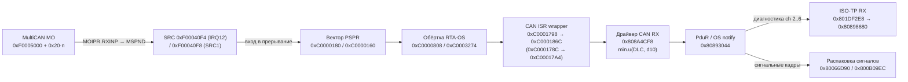

# SIMOS18.1 (TC1791) — диагностический стек CAN / ISO-TP / UDS, загрузчик CBOOT и защита PMU/UCB: справочник реверс-инжиниринга

Документ сводит проверенные результаты статического (REA / Rizin) и динамического (неизменённые прошивки на нативном
ядре `tricore-core` и Unicorn через внешний SLCAN-клиент) реверс-инжиниринга коммуникационного, диагностического и
загрузочного стека ЭБУ двигателя **Continental SIMOS18.1** (Infineon SAK-TC1791, TriCore 1.6).

Код эмулятора: `crates/simemu-tc1791/src/{multican,flash,stm_icu,native}.rs`, `crates/simemu-cli/src/can_server.rs`,
`crates/simemu-cli/src/studio/uds.rs`. Связанные документы: `docs/SIMOS18_WFS5_RE.md` (криптография WFS5 и DFlash FEE),
`docs/SIMOS18_GPTA_IO_RE.md` (тактовые частоты и периферия), `ARCHITECTURE.md` §4 (карта памяти и блоков PFlash).

---

## 0. Источники, образы и метки доказательности

### 0.1 Конвенции доказательности

Метки соответствуют стандарту проекта (`docs/SIMOS18_GPTA_IO_RE.md` §0, `AGENTS.md` §2.3):

| Метка | Значение |
| :-- | :-- |
| **VERIFIED-S** | Статически прочитано в образе прошивки через MCP-инструменты `rea` (`execute_rizin_command` на ELF-образах, PFlash0 `0x80000000`, PFlash1 `0x80800000`). Приведены адрес в образе и `ev_…` Evidence ID. |
| **VERIFIED-T** | Подтверждено трассой исполнения неизменённой прошивки на виртуальной плате (`Simos18Board`, read-only пробы и наблюдатели `trace-data-stores`, без записи в RAM/регистры/PC из хоста) при обмене по внешнему каналу SLCAN → MultiCAN. |
| **VERIFIED-FR** | Документация Continental Funktionsrahmen SIMOS18 (`SC8L50Y0`, номер страницы PDF по `scripts/fr_tool.py`). Имена констант совпадают, конкретные адреса и пороги калибровки проверяются по образу. |
| **VERIFIED-DS** | Документация Infineon: даташит TC1791 V1.1 (`vault/docs/infineon/infineon-tc1791-ds-en.pdf`) и руководство пользователя семейства AUDO-NG TC1796 V2.0 (`vault/docs/infineon/tc1796_um_v2.0_2007_07.pdf`, локальная копия в `.gitignore`, страницы PDF). |
| **HYP** | Рабочая гипотеза, согласованная с поведением кода, но не сверенная напрямую с закрытым даташитом TC1791 / BROM. |
| **UNVERIFIED** | Физический параметр или аппаратная деталь без прямого измерения на реальном кристалле (в частности, содержимое физической области UCB стендового блока и размер физической единицы стирания DFlash). |

### 0.2 Исследованные образы и соотношение `SC8O40` / `SC8S50` / `CBOOT`

| Образ | ПО / калибровка | Назначение | Дайджест SHA-256 и состав |
| :-- | :-- | :-- | :-- |
| `8V0906264H__0005.bin` | `8V0906264H` `0005`, ASW `SC8O4010` (`111SC8E0O400`), CAL `SC8O40` | Заводской сток (из ODIS `.frf`) для 1.8 TSI EA888 Gen3 `CJSA/CJSB` (Skoda Octavia A7) — **основной целевой образ документа** | Файл 4 МБ: `59bd0b04aa8a077ab7abd8013e0b8ecda32ce46bec0abb0b3b92b13628676207` (ELF для REA: `74b2807a3dab3b764edfb86cf6491727f749234917f3eee045eabf540d606b58`); SBOOT `0x000000..0x01BFFF` подставлен из стендового дампа того же HW `06K907425B` (`AGENTS.md` §2.4 п.2) |
| `8V0906264K__0003.bin` и донор `8V0906259J` | `264K` / `8V0906259J`, ASW `SC8S5010` (`111SC8I0S500`), CAL `SC8S50` | Заводской сток FRF для 2.0 TSI `CJXC/CJXE/CJXH` (VW Golf 7 R) и стендовый донор — **опорная база сравнения** | SBOOT/CBOOT/ASW1–3 у `264K__0003` и донора `259J` совпадают побитно (`AGENTS.md` §3.1) |

Архитектурная идентичность и различия между образами (**VERIFIED-S**, `ev_254139616a0cbba86f7dfc83ca76362e07ed7932e9490094219a0df137493a3e`, `ev_3ce43905a7e96ea16624da1570aeef0f7ba55e05a8d2d8ffecc06b129f37b131`, `ev_23d1bb390566b325b7df320e6db68990df2895f2b78b07081d6ab696bb7ce35b`, `ev_e596cd31bc8cca03d2476df4ba9be4b9c7880cb48281e327342de9ca003d2b94`):
- **SBOOT (`0x80000000..0x8001BFFF`, 112 КБ)**: поставщицкий первичный загрузчик `SC841-10307151AA------` (`0x80001806`), в контейнеры `.frf` не входит; SHA-256 области `0x80000000..0x8001BFFF` в стендовом дампе и собранных из FRF образах равен `3e6f1c8bd6b975a8d313ba213751530204d654ecd9322b5a5edbe44b2a8a1fa0`. Здесь же расположены производственный блок FAZIT (`0x80001100`, `ID_ecu` по `0x80001150`), таблица экспорта криптопримитивов/OTP (`0x80014000`), заводская копия UID чипа с паролями Flash (`0x80014200..0x8001421B`) и шифр NVM `anvmcryptlight` (`0x80017B2C`).
- **CBOOT (`0x8001C000..0x8003FDFF`, 143.5 КБ)**: клиентский загрузчик (`Customer Bootloader`, базовый идентификатор `SC820` @ `0x8001D504`, `SC8.1` @ `0x80023FC8`; область `0x80010000..0x80013FFF` заполнена NOP/нулями и к коду CBOOT не относится, `ev_c98209eaa4a4bbd58ba9c1b140b46f0b7be9d19ae5cbb9323a36ed19c6a9df85`). Внутри одного семейства ПО (`8V0906264H__0005` и `8V0906264J__0003` для `SC8O40`; `8V0906259J` и `8V0906264K__0003` для `SC8S50`) блок CBOOT побитно идентичен. Между `SC8O40` (`SC841-111SC8E0` / `111SC8E0L2000000`, CRC `0x1D561FAF` @ `0x8001C304`) и `SC8S50` (`SC841-111SC8I0` / `111SC8I0S0000000`, CRC `0x216AB000` @ `0x8001C304`) совпадают точка входа `0x8001CAE8` (`0x8001C000`), структура заголовка CRC (`[0x8001C000..0x8001C2FF]` + `[0x8001CA00..0x8003FBDF]`, `ev_b54adb333abab146dacf530ca893d5713230495748a1d2c3af21e74d0eeb53ac`, `ev_eb37d175f533760a49b7cd52ccf8f4a89ad4085d407d7c9bab62fa2944ba764e`) и схема исполнения основного образа из RAM (`0x80022000..0x800382FE` → `DSPR` `0xD0008000..0xD001E2FE`).
- **ASW (`ASW1..3`: `0x80040000..0x801FFBDF`, `0x80880000..0x808FFBDF`)**: архитектура подсистем BSW/DCM/ISO-TP/CCP одинакова, но конкретные адреса функций и таблиц между сборками `SC8O40` и `SC8S50` смещены (например, таблица 21 диагностического сервиса лежит по `0x8005AA8C` в `SC8O40` и по `0x800561AC` в `SC8S50`). **Все адреса в разделе ASW ниже приведены для заводского образа `SC8O40` (`8V0906264H__0005.bin`)**, если явно не оговорено иное.
- **Среда исполнения RAM (`PSPR` и `LDRAM`)**: ядро ОС приложения исполняется из `PSPR` (`0xC0000000..0xC0007FFF`), а рабочий код перепрограммирования `CBOOT` — из `DSPR` (`0xD0008000..0xD001E2FE`). В статическом ELF прошивки эти сегменты пусты, поэтому дизассемблирование `0xC000xxxx` и `0xD0008xxx..0xD001Exxx` выполнено через REA по read-only снимкам памяти работающей платы на нативном ядре.

---

## 1. Приёмный тракт MultiCAN → ОС → PduR, NMH и CCP

### 1.1 Цепочка прерываний приёма и копирование кадра в ASW

Маршрут входящего CAN-кадра от аппаратного буфера MultiCAN (`0xF0004000`) до верхних уровней коммуникационного стека в ASW (**VERIFIED-S/-T**):

Ключевые узлы и инварианты безопасности границ:
1. **Аппаратный запрос и вход в ОС**: при приёме кадра в подходящий объект сообщений (MO) с ненулевым маршрутом прерывания выставляется бит в `MSPND` и флаг `SRR` в узле запросов MultiCAN (`0xF00040F4` для основного диагностического тракта IRQ12, `0xF00040F8` `SRC1 = 0x300B` для очереди `MO5`). Ядро переходит на вектор в `PSPR` `0xC0000180` (`0xC0000160`), который вызывает диспетчер прерываний ОС `0xC0000808` (завершение ISR — `0xC0003274`, отложенное уведомление — `0xC0000814`) и CAN-обёртку `0xC0001798 → 0xC000186C` (либо общий обработчик отложенных MO `0xC000178C → 0xC00017A4 → 0xC0001852`, указатель в ROM `0x80053B8C`) (**VERIFIED-S/-T**, `ev_3fc25d6ed9fde2e341b3b0986888bfde043bd211c1d2082bf352bbf36ed5e475`, `ev_c8a94c799333052e7998fd23e93f47254eaa081079d3ea64d886af86a4b2a88b`, `ev_9b67c2c373bdeabb73c74823285b0711f2b15ddee93ab8edd7cae686cee0a370`).
2. **Драйвер чтения кадра `0x808A4CF8`**: выбирает аппаратный MO по конфигурационной таблице, извлекает фактический `DLC` (`d0`) из MMIO и на `0x808A4DB8` выполняет `min.u d8, d0, d10`, где `d10` — сконфигурированный максимальный размер буфера кадра (при живом вызове `d10 = 8`). Копирующий цикл `0x808A4DC4..0x808A4DCA` переносит ровно `min(DLC, d10)` байт из `MODATAL`/`MODATAH` в буфер вызывающего уровня — байты полезной нагрузки CAN не влияют на длину копирования (**VERIFIED-S/-T**, `ev_6c39fb12e299449cd533f9f26518d44ce999a1de94caf470810b3aa2cd8af4ef`, `ev_ae0f4924c9ecfd5a70031ed866aa0bb0b0605822396b9273b36474fef45a6d2c`, `ev_d1ae86ac4eb79351270b87114fa5d8eb65756ed066bd30478c3e019ba5c5651f`).
3. **Маршрутизация `PduR` (`0x80893044`) и прикладные каналы**:
   - Корневая структура контроллера в DSPR `0xD000083C` хранит `{ 0x80065044, 0xD000AE64, 0xD0019817 }` (дескриптор узла CAN `0x80065044`, массив состояний транспорта `0xD000AE64` и состояние `PduR` `0xD0019817`; дополнительные указатели таблиц: `0xD0000708 = 0x80053B48`, `0xD000084C = 0xD0008474`) (**VERIFIED-S/-T**, `ev_cdebb942b3c53ae7c365b4f8c9c71ae94bc1af6bac5fa09907a0abf95d56b653`, `ev_a6be24617c482c5f1d449e456dcca9f9f0da9ed0f34032f462cdc7a893bd1b5f`, `ev_9650f9f141c54e9a5867c32c2dc232537e9d8206219e44f5925b96b34ec91414`, `ev_68517b4580cb8f3e788f8cc8796e589f12bb770cd597df8192f53d79ca44cd8e`).
   - Функция `0x80893044` регистрирует флаги/события задач ОС по битовым маскам (`ev_e6cc827b757e8194652e0e54f7f0b7020f8d45c1c02827a8ae15cac3f9551429`).
   - Трамплины `0x801DF2E8..0x801DF30A` передают фиксированный номер канала `d4 = 2..6` в приёмник ISO-TP `0x8089867C` (`0x80898680`), тогда как `0x801DF310`/`0x801DF318` (`d4 = 0..1`) вызывают периодический автомат тайм-аутов и TX-подтверждений `0x80898A08` (**VERIFIED-S**, `ev_a74e467586e5a32ea7016cd5d531870a6d2bef9ae2fa72ae01b10169a15b15f9`, `ev_d02f9c49d6c89380cd0eebfde170198c6872feb987c3866e8594a326e636e2f1`).
   - Обычные периодические кадры шасси и агрегатов распаковываются через ROM-сконфигурированные дескрипторы (`0x80066D90..0x80066DDC`, `0x800B09EC`/`0x800B09F4`/`0x800B09FC`) строго по длине и целевым адресам из ПЗУ (**VERIFIED-S/-T**, `ev_fbe05e63f1848a49ed2623a00220b06b7022bc5bc5a1d6e4571b924fd675f835`, `ev_b32e2fea56853b1de206fd3baffaa75cffd3cb5404022e52df37a245e5ec4309`, `ev_9ce6553a2a1847e70b6e9d94f84bf2f73b45e5db9828cdce9b8aae77bac9c8d1`).

### 1.2 Диапазон сетевого управления NMH (`0x1B000000..0x1B0000FF`, MO66)

- В конфигурации MultiCAN `SC8O40` аппаратный объект **`MO66`** (список `1`) настроен с `MOAR = 0xBB000000` и маской приёма `MOAMR = 0x3FFFFF00`, то есть принимает весь диапазон 29-битных кадров управления сетью MQB **`0x1B000000..0x1B0000FF`** (включая `NMH_Gateway = 0x1B000010` и `NMH_MO_01 = 0x1B000076`) (**VERIFIED-T**).
- При подаче кадров `0x1B000010` / `0x1B000076` по шине CAN аппаратный `MO66` фиксирует приём (`NEWDAT`), но прерывание в CPU не возникает и прошивка регистры данных/статуса `MO66` не читает.
- Причина соответствует спецификации кремния (**VERIFIED-DS**, TC1796 UM V2.0 p.1369): у `MO66` не включено собственное объектное прерывание приёма (`RXIE`/`RXINP`), а на уровне узла CAN регистры равны `NCR = 0`, `NIPR = 0` — бит **`NCR.TRIE = 0`** (*Transfer Interrupt Enable*). Согласно руководству по MultiCAN, узловое прерывание успешной передачи/приёма кадра генерируется только при `NCR.TRIE = 1`.

### 1.3 Протокол калибровки CCP на платформе MQB

В прошивке присутствуют два слоя таблиц CCP, из которых активной конфигурации MQB принадлежит расширенный 29-битный канал:

1. **Стандартные 11-битные ID `0x7C3` / `0x7C4` (`0x7C5..0x7C7`)**: константы лежат в таблицах ROM `0x8005259C..0x800525D4` и `0x800528CC..0x80052904` (заглушка `0x808A1760 = ret` в `0x80052584/8C/94` является callback подтверждения передачи TX, а не обработчиком приёма), однако ни один активный аппаратный фильтр MultiCAN в `SC8O40` идентификатор `0x7C3` не принимает (`accepted = 0`) (**VERIFIED-S/-T**, `ev_87d9c0a4e53d07086cb33f51ae9f1001c88366ec1c40238c0b295eb49873d92f`, `ev_757a65686eb6888a96fc4cab5c3e8903c5bf6393224c2ac29d2443ef099f310e`, `ev_0dee97203bc4c175fd543e900bb58d4035d21a4700fd3d2a6023cd6e2d07fcbb`).
2. **Канал MQB CCP (`0x1BFFB600` → `0x1BFFB601`)**:
   - По спецификации `FR p.14374` (**VERIFIED-FR**) на платформе MQB заданы 29-битные идентификаторы `CCP_Motor_CRO_01 = 0x1BFFB600` (команды мастера CRO) и `CCP_Motor_DTO_01 = 0x1BFFB601` (ответы/DAQ DTO). Кадры `0x1BFFB600` принимаются аппаратным объектом **`MO5`** (`MOIPR = 0x0501`: `RXINP = 1`, `MPN = 5`, `MCR = 0`, прерывание `SRC1 = 0xF00040F8`).
   - При инициализации `0x801B34AC` читает слово калибровки по `0x808025BE`, равное `0x4328` (`C_CCP_PT_ACT`), и заполняет указатели очередей CCP в DSPR (`0xD00007E4 = 0x80044384`, `0xD00007E8 = 0x800443B4`, `0xD000065C = 0x80044370`, `0xD0000660 = 0x8004475C`, бит 1 `0xD00173DC`; планировщик передачи `0x800E2580` / `0x800E27BC`) (**VERIFIED-S/-T**, `ev_7e3413b4b64fc15ecaaec61744966f0a2987a5472da7a2e4ba18ea1515dfdf1f`, `ev_5f4d697225ab3664385e6baa7f5d3a2e423a01128a6fd073f04f5706936fba62`, `ev_ef80ae8078c3425ad1bd5c4405484f6ad543b330f227915254be3187eddb671d`).
   - **Реальный диспетчер команд CCP — `0x800AE72C`** (**VERIFIED-S**, `ev_2310963f353ec86faaebba8671edb1a035bb0be76e6c3b96733f880709f8b8a6`, `ev_edccc6bf30748c3f29d5ba975d9fc417c7651ec62c4adb1151641227bfc99db9`, `ev_c7024f69ee5be25ab2c6d01573bdc57fbcc1b6215ff4d79a54370ebb903b5080`):
     - читает код команды CRO из `0xD0019EEC` (`a9 + 0x1EEC`) и обрабатывает 27 кодов (`0x01..0x09`, `0x0C..0x19`, `0x1B`, `0x20`, `0x23`, `0x30`);
     - в `CONNECT` (`0x01`, `0x800AE80E` → `0x800AF232`) и `TEST` (`0x05`, `0x800AE9A0`) собирает 16-битный little-endian `station address` из `0xD0019EEF..0xD0019EF0` и сравнивает его с **`1`**; `GET_CCP_VERSION` (`0x1B`, `0x800AF112`) возвращает версию протокола `02 01`;
     - в `DNLOAD` (`0x03`, `0x800AE880`) проверяет длину блока `d10 < 6`, окно буфера `0xD0019EF4 >= d10 + 3`, разрешённые таблицы адресов через `0x800AE6C0` и привилегии `CAL/DAQ/PGM` через `0x800B17D4` (`FR p.23111–23122`, `ev_0713afe9f6d166356dab8ef65342c1c9baf0b7d3256255a0751492cb2536d21a`, `ev_ff0a880a1e74d6c88faab029b1fed99d8669de1ed5fe06bfead37f91a9321077`).
   - **Причина отсутствия ответов CCP в штатной конфигурации ASW без активации маршрута**:
     - Кадр `0x1BFFB600` принимается в `MO5`, вызывает прерывание `0xC0000160 → 0xC00017A4 → 0xC0001852` и передаётся в `0x80893044(a4 = 0x80052274)`, который взводит событие группы 0 в `0xD0006724` (**VERIFIED-T**, `ev_a76820c72bb2951f1f410cdfb36730129813f0ae9db24198f9fd09f9e394f83a`, `ev_95851404f45d1a851b5c9b51e4980b19605d5b173346f00e368fa311de37878d`, `ev_ec997d21ece850d88e1e813fa0a99510e0e70af155703dde588d1549a069e2a5`).
     - Однако при старте выполняется `0x801D9228(d4 = 2) → 0x800AE714(d4 = 2)`, записывающий `1` во внутренний флаг блокировки (inhibit) CCP `[a9 - 0xC23]` (`ev_7206866443146b38eec502927899eecb12f0d62a23d0efde2937e01046e58c40`), тогда как ветка запуска `0x801B308C → 0x800AE714(d4 = 0)` (`ev_93bab5787586ca1026538c8d23fb71889a2cd6bfe65700502190081db4d3d830`) требует активного выбора интерфейса `AS = CCP_PT` (`HAL_CAN_SET_CCP = 1`), который по `FR p.23131–23134` переключается через предварительную запись в NVM (`as_preselected` → `as_chosen`) и вступает в силу только после следующего сброса питания (`0x801B2D90..0x801B2EAC`, `ev_d2d3554803dda7e570bbe229a2da392576a37ae58cc28f53ece4a2fe6020f6d2`, `ev_4d816fe2e0094d1677f5da13447d306ac8cb7de0d0c0fb4fa93d32a97e1f2b65`). В результате на серийном образе данные из `MO5` в буфер `0xD0019EEC` не перекладываются и `0x800AE72C` не вызывается.

---

## 2. Транспортный уровень ISO-TP (ISO 15765-2)

В прошивке SIMOS18.1 сосуществуют две независимые реализации транспортного протокола ISO 15765-2 с различными пределами буферизации: реализация BSW в приложении (`ASW`, лимит **997 байт**) и реализация загрузчика (`CBOOT`, лимит **4095 байт**).

| Параметр | ASW (`0x7E0` → `0x7E8`) | ASW `ServiceKey` (`0x17FC0276` → `0x17FE0276`) | CBOOT (`0x7E0` → `0x7E8`) |
| :-- | :-- | :-- | :-- |
| Формат CAN ID | 11-бит (физ. `0x7E0`, функц. `0x7DF`) | 29-бит Extended | 11-бит (физ. `0x7E0`, функц. `0x7DF` только SF) |
| Функция автомата RX | `0x8089867C` / `0x80898680` | `0x8089867C` / `0x80898680` | `0xD000A0A0` (LDRAM) |
| Индекс и структура состояния | Канал `2`, `0xD000AE64..0xD000AE77` (20 Б) | Канал `5`, `0xD000AEC8..0xD000AEDB` (20 Б) | Контекст `0xD00117CA`, длина в `0xD00014AC` |
| Аллокатор и макс. размер SDU | `0x800EEF5C`: **`0x3E5` = 997 байт** | `0x800EEF5C`: **`0x3E5` = 997 байт** | `0xD00117CA`: **`0xFFF` = 4095 байт** |
| Буфер сборки в DSPR | `0xD000E24E` / `0xD000E251..0xD000E635` | `0xD000E24E` (общий пул 997 Б) | `0xD0001793..0xD0002791` |

### 2.1 Автомат приёма и выделение буфера в ASW (`0x80898680`, `0x800EEF5C`)

- **Single Frame (`N_PCI` тип `0`)**: проверка `0x808986E0..0x808986FA` требует `1 <= SF_DL <= 7` и `SF_DL <= DLC - 1`. Некорректные кадры с `SF_DL = 0` или `8..15` уходят по ветке ошибки `0x808986FA → 0x8089891C` до обращения к аллокатору; цикл копирования `0x8089874C..0x80898760` ограничен `d9 <= 7` (**VERIFIED-S/-T**, `ev_e2611485b5c68020c8a1dbd79f67b396b2b17f3045cd2148294a103b899139ac`, `ev_8f289d9b73ceb3fc7d3e3429f5d1d1d575024766e815033bd902056eece7dc7f`).
- **Выделение буфера `0x800EEF5C` и предел 997 байт**: при получении `First Frame` (`N_PCI` тип `1`, 12-битная длина `FF_DL`) вызывается аллокатор диагностического буфера `0x800EEF5C`, содержащий жёсткую проверку верхней границы **`0x3E5` = 997 байт** (то же значение возвращает геттер ёмкости DCM `0x800E2DD4`). Запросы с `FF_DL <= 997` получают буфер в DSPR (`0xD000E251..0xD000E635`) и ответный кадр `FlowControl (30 00 ...)`; при `FF_DL >= 998` (998, 1024, 4095) аллокатор возвращает код отказа (`d2 = 7`), и кадр `FlowControl` не передаётся (**VERIFIED-S/-T**, `ev_f781a7e53429ffeb104a6f2695481cb79e3b4866e1668e8634763326befc6b8e`, `ev_2d70dc4137636859d62e114ca5075057329336c769c7dc1cb6276f87185791ca`, `ev_f1aa0ac213f2a076b4e0c5c1a05c1b3f763807be0cc79ebe149ba5b84e90957d`).
- **Копирование `First Frame` (`0x80898830`) и `Consecutive Frame` (`0x808988C6`)**:
  - `0x80898830` записывает первые 6 байт многокадрового сообщения;
  - `0x808988C6` перед копированием каждого `CF` (`N_PCI` тип `2`) проверяет активное состояние сборки канала, совпадение ожидаемого 4-битного счётчика `SN` и остаток объявленной длины `FF_DL`, ограничивая число копируемых байт остатком до конца `FF_DL` (**VERIFIED-S/-T**, `ev_f549ffb2433897b33ea1e560d2359eb4f6b47ee8b2a82fe71f9bdc34e4ee4dcd`). Дополнительный `CF`, пришедший после завершения 997-байтового пакета, не вызывает записи за адрес `0xD000E635`.
  - Повторный валидный `First Frame` до окончания текущего потока проходит повторное выделение в `0x800EEF5C` и сбрасывает состояние сборки канала (`ev_73b6e88d4be9739e99a5f4dfc64c41a144db77b7719d63fb5c193a5b4d1a36ee`, `ev_6c31b4eb455ae784e4dae3e69d3bb33bd3eeb7fc861cd0d6e5fccd95dfb1167f`).

### 2.2 Обработка входящего `FlowControl` при передаче ответа ЭБУ (`0x80898940`)

Когда ЭБУ отправляет многокадровый ответ на `0x7E8`, приём кадра `FlowControl` (`N_PCI` тип `3`) с `0x7E0` обрабатывается функцией **`0x80898940`** (**VERIFIED-S/-T**, `ev_22f98758b0a67a4b2ff48b446fc8d59907f276c7784680c4cf603c503399a8c0`, `ev_5f7a821565ab968dbaceff5a2fadb0da3308850562b29c372a3682001891e55d`, `ev_4476746489dd50d85cbfd7eac8c4028737291c15cfde265a9239e2e89437ce21`):

- **Проверка состояния**: кадр `FC` принимается только если передатчик канала находится в состоянии ожидания управления потоком (`state == 5`); ложный `30 00 00` вне активной многокадровой передачи отбрасывается.
- **Поле `FlowStatus` (`FS = byte0 & 0x0F`)**:
  - `FS = 0` (`ContinueToSend`) — сохраняет параметры `BS`/`STmin` и переводит канал к передаче очередного блока `CF`;
  - `FS = 1` (`Wait`) — переводит передатчик в ожидание следующего `FC`;
  - `FS >= 2` (`Overflow = 2` и зарезервированные `3..0xF`) — немедленно прерывает передачу ответа по ветке ошибки.
- **`BlockSize` (`BS = byte1`)**: записывается в поле `state + 5` (`0xD000AE69`, инструкция `st.b` на `0x808989AE`).
- **Декодирование `STmin` (`byte2`)**: преобразуется без табличной индексации и сохраняется в `state + 6` (`0xD000AE6A`, запись на `0x808989D4`):
  - `0x00` → `0` (минимальный темп планировщика без дополнительной паузы);
  - `0x01..0x7F` (1..127 мс) → `STmin + 1`;
  - **`0xF1..0xF9`** (100..900 мкс по ISO 15765-2) → отображаются в минимальную ненулевую задержку шага планировщика (`1` мс-тик);
  - зарезервированные значения **`0x80..0xF0` и `0xFA..0xFF`** зажимаются сверху максимальным валидным значением `0x7F` (`127` мс → запись `0x80` = `0x7F + 1` в `0xD000AE6A`).

> **Практическое замечание для внешнего тестера** (`MILESTONE.md` §2.1): отправка `FlowControl` строго в том же окне 1 мс сразу за `First Frame` может опередить перевод состояния канала ЭБУ в `state == 5`; задержка ≥ 1 мс гарантирует безошибочный приём многокадровых ответов на обоих бэкендах CPU.

### 2.3 Отличия транспорта в CBOOT (`0xD000A0A0`) и канал `ServiceKey`

1. **ISO-TP загрузчика CBOOT (`0xD000A0A0` в LDRAM)**:
   - Парсер `0xD000A0A0` и функция выбора диагностического буфера `0xD00117CA` поддерживают полный 12-битный размер ISO-TP **`length <= 0xFFF` (4095 байт)** (**VERIFIED-S/-T**, `ev_f0478700f4c62628c8300b1b74275b4a0f3603fd005edba2887f9a7477c92032`, `ev_33c0d04c9189c733e5548a0ededeef8a10892deec4ae20d8ca39d0524c0bc979`).
   - Буфер сборки расположен в DSPR по адресам **`0xD0001793..0xD0002791`** (ровно 4095 байт), а объявленная длина хранится в `0xD00014AC` (`ev_4008d8db24745ce9f0adff6b3cf8f0e67d753eb72fa4da1744e469ff0dadc2df`, `ev_462d1d65e4adde43a7f74994e1e2e40a7a62187f7c5bf00b9a2f47f11519f45c`, `ev_f2caffb2398073afe52c6780648549a5b91ea7a19df2f76960a6b11f6bf9ef5e`). Это обеспечивает приём крупных блоков `TransferData (0x36)` по `0xFFF` байт.
   - В `0xD000A1AE..0xD000A1C4` индекс адресации проверяется до выбора буфера: функциональный адрес `0x7DF` не открывает многокадровую сборку (`First Frame` на `0x7DF` не получает `FlowControl`), благодаря чему фоновые функциональные кадры `3E 80` (`TesterPresent`) не разрушают состояние физического канала `0x7E0` (`ev_912c65839927851e233d871336b61b904558c394a3cc7dc451fd9c51341bb699`).
   - При приходе нового физического `First Frame` на `0x7E0` до завершения предыдущей передачи CBOOT сбрасывает смещение записи в начало `0xD0001793` без перехода в обработчик ошибки последовательности `0xD000A36A` (`ev_e50ba7c742d6493c622e4a5578e09ebfdf5f58bc385c53d7fb429492d5c3d9f7`).
   - Аналогичный лимит `0xFFF` действует и во встроенном мониторе восстановления SBOOT (`0x800049EC`, константа ёмкости `0x800047C4`, побайтовая проверка `offset < capacity` в `0x80004C2E..0x80004D14`, `ev_77f0497257ea7f906a6dbdb3bb946ef2ed199cde1b3d09fab10874fd7b1295a9`, `ev_1fe691c1f308cc7d3ca0fbe904c8c1e83c54b54b8531103bc8293fb4acef1952`, `ev_c45e042fa03756111679286256c3f189391e22dfab5a4c03fc065ea3bae6b4b4`).
2. **Канал Extended ISO-TP `ServiceKey` (`0x17FC0276` → `0x17FE0276`)**:
   - В ASW параллельно стандартной паре `0x7E0`/`0x7E8` активен 29-битный диагностический канал `0x17FC0276` (запрос) → `0x17FE0276` (ответ).
   - Канал использует отдельную 20-байтовую структуру состояния транспорта (канал `5`, `0xD000AEC8`, указатель `0xD000AEE4`), разбирает только 12-битную длину `FF_DL` (`FF_DL == 0` с 32-битным расширением ISO 15765-2:2016 отклоняется) и выделяет память через тот же аллокатор `0x800EEF5C` с пределом **997 байт** (`0xD000E24E`), разделяя с `0x7E0` единую таблицу сервисов UDS и ограничения сессий/безопасности (**VERIFIED-S/-T**, `ev_e133143dae9fc292f328f040b9290822c1edd9d0800c46695d34b0275ea0fd9d`, `ev_69fa4f9d49c3f9e26273e64fa41b60e16abc151c204db210481bd8e53fe9dbed`, `ev_c6d39576fc9fb6dd512691441af55c9edd3ca7638076c80f2a7efcf0a3455aae`, `ev_397f54236c617b19900d0d602d447a19f91f97cfb093c3bb2203e1ba894b9a22`).

---

## 3. Прикладная диагностика UDS и OBD в ASW

### 3.1 Таблица сервисов ASW (`0x8005AA8C`) и очистка памяти неисправностей

Диспетчер диагностики приложения в `SC8O40` использует таблицу из **21 записи** по 8 байт (`handler_ptr: u32, flags_and_sid: u32`) по адресу **`0x8005AA8C..0x8005AB33`**, за которой следует таблица параметров сессий `0x8005AB34`, матрица прав доступа `0x8005AB5C` и корневой дескриптор `0x8005ABC8..0x8005ABD4` со словом `0x00157F11` (`count = 0x15` = 21 сервис, коды отказа `0x7F` и `0x11`) (**VERIFIED-S**, `ev_29320a3d23e7494e5328b721b2e072420b2aaffa69e65f2c0e3af240933a1c47`; в `SC8S50` идентичная по составу таблица из 21 записи расположена по `0x800561AC`, дескриптор `0x800562F0`, `ev_6f8cdf6c2a205bf0c1757a3f0eca4ced74fa7ecbdb147178c436204e58e141bb`, `ev_e596cd31bc8cca03d2476df4ba9be4b9c7880cb48281e327342de9ca003d2b94`):

| № | Адрес записи (`SC8O40`) | SID | Слово флагов | Обработчик | Стандарт / назначение |
| :-- | :-- | :-- | :-- | :-- | :-- |
| 1..9 | `0x8005AA8C..0x8005AACC` | `0x01..0x04`, `0x06..0x0A` | `0x000010xx` | `0x800EE3B4` | Сервисы OBD-II Modes `01`, `02`, `03`, `04`, `06`, `07`, `08`, `09`, `0A` (`05` отсутствует) |
| 10 | `0x8005AAD4` | `0x10` | `0x00001910` | `0x800E3338` | `DiagnosticSessionControl` |
| 11 | `0x8005AADC` | `0x11` | `0x00001811` | `0x800E3744` | `ECUReset` |
| 12 | `0x8005AAE4` | `0x19` | `0x00001819` | `0x800E3778` | `ReadDTCInformation` |
| 13 | `0x8005AAEC` | `0x22` | `0x00001822` | `0x800E3DF4` | `ReadDataByIdentifier` |
| 14 | `0x8005AAF4` | `0x23` | `0x00001023` | `0x800EBD00` | `ReadMemoryByAddress` (заблокирован матрицей сессий → `NRC 0x7F`) |
| 15 | `0x8005AAFC` | `0x27` | `0x00001027` | `0x800EBE64` | `SecurityAccess` |
| 16 | `0x8005AB04` | `0x28` | `0x00001128` | `0x800EC3B8` | `CommunicationControl` |
| 17 | `0x8005AB0C` | `0x2E` | `0x0000102E` | `0x800EC4CC` | `WriteDataByIdentifier` |
| 18 | `0x8005AB14` | `0x2F` | `0x0000102F` | `0x800ECD28` | `InputOutputControlByIdentifier` |
| 19 | `0x8005AB1C` | `0x31` | `0x00001031` | `0x800ECEC0` | `RoutineControl` |
| 20 | `0x8005AB24` | `0x3E` | `0x0000193E` | `0x800EDD44` | `TesterPresent` |
| 21 | `0x8005AB2C` | `0x85` | `0x00001185` | `0x800EDD7C` | `ControlDTCSetting` |

Следствия из структуры таблицы:
- **Почему `0x14 ClearDiagnosticInformation` отвечает `NRC 0x11`**: SID `0x14` не зарегистрирован в `0x8005AA8C` ни в одном образе SIMOS18.1, поэтому `14 FF FF FF` всегда отвергается диспетчером с `7F 14 11` (`serviceNotSupported`). Штатная очистка памяти неисправностей выполняется через сервис **OBD Mode `0x04`**, отправленный на функциональный адрес **`0x7DF`** (ЭБУ отвечает `7F 04 78`, затем `44` при разрешённом функциональном идентификаторе разрешения очистки **FID `0x46A`**; см. `crates/simemu-cli/src/studio/uds.rs`, `MILESTONE.md` §2.11) (**VERIFIED-S/-T**).
- Сервисы загрузки/выгрузки и прямой записи памяти (`0x34 RequestDownload`, `0x35 RequestUpload`, `0x36 TransferData`, `0x37 RequestTransferExit`, `0x3D WriteMemoryByAddress`) в таблице ASW отсутствуют (`NRC 0x11`); `0x23 ReadMemoryByAddress` закрыт матрицей прав во всех доступных сессиях (`NRC 0x7F`).

### 3.2 Сессии (`0x10`) и проверка предпосылок программирования CPPC (`0x31 01 02 03`)

- Таблица таймингов сессий `0x8005AB34` описывает 5 сессий (`0x01` Default, `0x02` Programming, `0x03` Extended, `0x40` EOL, `0x4F` Development; `P2 = 50 мс`, `P2* = 5000 мс`).
- Прямой запрос `10 02` (`ProgrammingSession`) без выполненных предпосылок отклоняется с `7F 10 22` (`conditionsNotCorrect`).
- **Шлюз предпосылок программирования (`CheckProgrammingPreconditions`, `31 01 02 03`)**:
  - Запрос в `ExtendedSession (10 03)` диспетчеризуется через `0x800ECEC0 → 0x800ED09C` в обработчик `0x800ECF34` (требует длину запроса ровно 4 байта, иначе `NRC 0x13`).
  - Внутри проверки предпосылок `0x800EE9F2` вызывает геттер состояния иммобилайзера **`0x80127F50`**, который читает байт статуса разблокировки в DSPR **`0xD00108A4`** (**VERIFIED-S/-T**, `ev_d07286f344e80530432d13286d2d22d100729377649f693c62074f04f9485a05`, `ev_33fcbb0e57a99cc548e18c409e4d524aa7d220a336a5f3a060ba5eeeae2ab39f`, `ev_65f10b7a092d98c2f3162630053c85a26a73d1ac4eea4b651c5c3abe0db3022c`).
  - При отсутствии ответа приборки по WFS5 запрос `31 01 02 03` возвращает `71 01 02 03 02 8D`:
    - **`0x02`** — *Immobilizer Not Unlocked* (`0xD00108A4` не подтверждает авторизацию WFS5);
    - **`0x8D`** — *Driving cycle / failure memory condition* (снимается функциональным сбросом ошибок OBD `04` на `0x7DF` и выдержкой ~5 с).
  - После успешного обмена WFS5 (`0x010` → `0x011`) и снятия `0x8D` процедура `31 01 02 03` возвращает пустой список блокировок `71 01 02 03`, после чего `10 02` выполняет штатный программный перезапуск в `CBOOT` с ответом `50 02`.

### 3.3 `SecurityAccess (0x27)` в ASW

- Общий обработчик `0x800EBE64` ищет запрошенный `subFunction` через `0x800EC204` в таблице 12-байтовых дескрипторов, ограничивая индекс числом записей `[a13 + 4]` (значение `0xFF` записывается в состояние только на ветке ошибки после завершения поиска и не используется как индекс таблицы; минимальная длина кадра ключа проверяется в `0x800EBF3C..0x800EBF40` как `request_len >= expected_key_len + 2`) (**VERIFIED-S/-T**, `ev_0596afcca1fe30351a270d267c9471a8d45600c855ca4668c8f5b53c0ab5e4a8`, `ev_519ecbd10fab50ae7df93d30999253b833192380c31edbc24386318a281b899a`).
- В `DefaultSession (0x01)` сервис `0x27` возвращает `NRC 0x7F`.
- **Уровень `Customer 2 (Login)` (`27 03` / `27 04`)**: единственный открытый в `ExtendedSession (0x03)` уровень `SecurityAccess` среди всех нечётных подфункций `0x01..0x7D`:
  - `27 03` генерирует 4-байтовый `seed` (`67 03 <seed_be32>`) и сохраняет его в `LMU` по адресу **`0xB0000428`**;
  - функция проверки `0x800EC35C..0x800EC386` вычисляет ожидаемый ключ по формуле **`key = ([0xB0000428] + 0x6D43) mod 2^32`** (**VERIFIED-S/-T**, `ev_f9c2aaf95764129a6805bbf060f9670ed9a701d6652eaf5d23c53c9babf8f4e8`).
  - По `FR p.4249–4250` (**VERIFIED-FR**) этот уровень соответствует сервисному входу мастерской (`Customer 2 — Login` для кодирования и базовых установок), а не `Customer 1 (Reprogramming)`, и не открывает ни переход `10 02` в обход CPPC, ни сервисы доступа к памяти.
- **Уровень программирования `27 11` / `27 12`**: в ASW закрыт — отвечает `7F 27 7F` в `DefaultSession` и `7F 27 12` (`subFunctionNotSupported`) в `ExtendedSession`.

### 3.4 Чтение и запись идентификаторов данных (`0x22` и `0x2E`)

#### `0x22 ReadDataByIdentifier` (`0x800E3DF4`)
- Корневая структура `0x8005A9C8` (`{ 0xD0009380, 0x800581F0, 0x00080352 }`) задаёт таблицу из **`850` (`0x352`) DID** по 12 байт (`pointer | (length << 16 | DID) | flags`) по адресу `0x800581F0` (первая запись — `F187` → `0x80800060` `"8V0906264H "`, 11 байт) и максимальное число DID в одном запросе — **`8`** (`0x800E3E24..0x800E3E26`; запрос ≥ 9 DID возвращает `NRC 0x31`) (**VERIFIED-S/-T**, `ev_5f58bfa1300cbd59d30c2ad4d5fc21dd8d97f0e9b250b0a73d08f5fb07cada42`, `ev_e49e21ba5edec2bf820f4373d3573642ca9e41b678e0eec239460c5f329adf7d`, `ev_b9f73ca21aa6d025b07a2d14460841d6b0166a25d53eeeb1f2710ed434b5f485`, `ev_47d41c9d880af591b47af1a5fbf9602c7123046e84486716e773bc10acd750f3`, `ev_d51852a1d28a073d54fc7ce5428263e9ea7f138fb0801ce7af1ef17c9262bff9`).
- На этапе предвалидации (`0x800EE07C`, `0x800EE16C..0x800EE174`) суммарная длина ответа (включая 2-байтовые заголовки DID и динамические `type 4` записи, опрашиваемые через `0x800EE00C`) сверяется с пределом буфера `997` байт (`0x800E2DA8 → 0x800E2DD4`) (**VERIFIED-S**, `ev_44a8b8e45dd72d5d4ce5b4db0b2bba00da1aadf115a2ab9c78edde54fb249a52`, `ev_efceabbf9995c2f5d7c2ef7c56569734b7fe2bdb88f83adaa489cab936d2d8b2`, `ev_c7638c821c6e91625a7613caa3c489de212990d5fa6b47eb7a9565f22e1c3322`). В цикле сопоставления `0x800EE2DC..0x800EE364` декремент индекса `d14 - 1` защищён флагом совпадения `d8 == 1`, гарантирующим `d14 >= 1` (`ev_bc6e9ac78c3ef0573adf7985239de417308e31cbb0e61651aee3f80a0445b669`).
- Полная инвентаризация всех 850 записей `0x800581F0` (`ev_e80b542cbb65f8d696828e2dafdf9b5e3dc5eb50ff7d244b75b2082207ecc5d8`, `ev_49e37611ba2a25de6eb5b18ca45815e9a34cdfe85cde9b0abece426e991460db`, `ev_e4e95fa82a1d39948b4425bba39a21d16b217e3814e0d8c02634f15e1a874a45`): крупнейшие статические DID имеют длину **90 байт** (`0153`, `0154`, `0155`, `4F39`, `4F3A`, `4F3B`, callback `0x800E45FC`; следующие — 64 байта, `0x800E46EC`; крупнейший динамический `type 4` — `0481`, 89 байт) (`ev_7cdedbd2b68ba17254f9928d01e07cac1654e347c3966526939e3ce3cfd94f34`, `ev_de9ad27f4d771d04db5da65b41398008fd3f130775b0794a3d4537dd2d7f07ec`, `ev_0627f31b4a418a7cb79c3abeba8fe54cc1fe5eb274c261958e878d3bd1c189d0`). Абсолютный максимум ответа `0x22` при повторении 8 DID по 90 байт равен **`1 + 8 × (2 + 90) = 737` байт** (`0xD000E24F..0xD000E52F`), что строго укладывается в буфер 997 байт (**VERIFIED-T**).

#### `0x2E WriteDataByIdentifier` (`0x800EC4CC` → `0x800EC574`)
Диспетчер записи обслуживает закрытый список специальных DID (**VERIFIED-S/-T**, `ev_7c01bb25380cca8ff1210d03af4d40d70bb755eab8db6ccc0ac5972c244c9a9d`, `ev_0f2f75a10dd61fce0f00cbcaf0bdfacbc6cc37a5e03287aac6f083a9d5d0c370`):
- **DID `0410` (`0x800EC4FC`)**: в `ExtendedSession` сохраняет ровно 1 байт по фиксированному адресу `LMU` `0xB000042F` (`st.b [0xB000042F], d4`; в `DefaultSession` — `NRC 0x31`) (`ev_0ef5ac8da263970c0b4355e9fcca009f9d81085c13adf64ef02f68f8902823ab`).
- **DID `0600` (кодирование), `F198` (код мастерской) и скалярные DID**: `0600` требует длину запроса 13 байт и копирует 10 байт кодирования в `a9 + 0x274` (симметрично чтению `0x800E4514`); `04FB/04FC/04FE` (4..6 байт), `0903/0904/090D/090E` (4..5 байт, `0x801F0014`/`0x801EFFC4`), `417B..418D` (`0x801CCA20 → 0x80144510`, передача насыщенного значения, а не индекса) и `444B` (`0x801C1104 → 0xD0000B08`) пишут по фиксированным адресам структуры адаптаций (`ev_f86aadd34cb60b99221810b1e5f9aebc4c75a8a606243c409935aa7e673aaf8a`, `ev_fed9e8097fc25a85a2bb44bf40b7bccdb8ce5e958037063f02fb3e36f603e601`, `ev_ea5e00f6dccfa460b729ff9ac61dcb69cf836b8ddea6092b2c27e5cdf6307cb3`, `ev_dc59f5618e9d110f96b4174d340aead8391c5f047a7f31dcc20869ff479b942f`).
- **DID `F1F0` / `F1F1` (`0x800ECBA8 → 0x801F1F9C`)**: чтение `22 F1F0` возвращает 20 байт данных, тогда как запись `2E F1F0` в `0x801F20EA` требует ровно **`0x13C = 316` байт** входных данных (`F1F1` — 0 байт). При валидном размере `0x801F2104` копирует 316 байт через `0x8008ED2C` внутри 997-байтового диагностического буфера (`0xD000E251..0xD000E38E`, буфер состояния `0xD001D4B2`) и запускает асинхронный автомат проверки подписи `0x800AC7A0` по таблице криптоэкспорта SBOOT `0x80014000` (разбор PKCS#1 v1.5 SHA-256 `0x800167DC..0x8001681A` жёстко проверяет `0xCA` байт `0xFF`, нулевой разделитель и 19 байт DER-префикса) (**VERIFIED-S/-T**, `ev_d4900f0575f4ba2e9cadcbe8d8b3a34b567066b35439f4b489321e265931938b`, `ev_279a91226d92507cc1860f57fcf90069e9dfce0691bc8fcb3088311ae05188e6`, `ev_733404307f962bb48ba56235ab2c9a93f7a1037481d5a15a89d15c53f5b52b9b`, `ev_437e869473d362c1d58b9f2294cbbace5a14e44493475aa09a4289b92fc7510c`, `ev_404dc9da420e93f7bdb46a03e594511548cc974d713ecf70fc9e706e1607e9bb`, `ev_3dce99c851b9a31b51d596bbc7453d2905935450062953a8db157bc36b141db5`).
- **Шлюз IMOsrv (`02E1` / `02E2`, `0x801DDEBC → 0x801236C0`)**: обёртка **`0x801DDEBC`** отсекает любые запросы длиннее **`0xB4` (180 байт вместе с SID и DID)** с `NRC 0x13`, формирует в `a0 + 0x1418` (`0xD0019418`) заголовок `type | length_be16` и вызывает `0x801236C0`, копирующий фиксированные 55 байт в буфер `0xD0010471..0xD00104A7` с поднятием флага `0xD001046E`. Фоновый обработчик `0x801220C4` проверяет заголовок длины до чтения тела: `02E1` (`type = 2`, `0x80124530`) требует ровно 4 байта параметров, `02E2` (`type = 6`, `0x8012241C`) — ровно 52 байта (`0x34`, копируемых в `0xD00104BC..0xD00104EF` для блочной криптофункции `0x80129A54`) (**VERIFIED-S/-T**, `ev_7658185916b9ca4d6bba668a22bffd638482a45f003df9ce6c11c5bf80db371c`, `ev_f4900fad50cefe89873db3c0f6e5046c6389a9030b05a98f1ae8a9c63ee26f79`, `ev_c7e0b2b80dbba65ce5ac2a16bcd010e43d579e756f7994b6d70f922dd0210362`, `ev_795e5abecd8b337d62aafaa98344068302bfe66c10af0db7de9ae0872aa7db46`, `ev_ffc3de20072c2b4df2f18b40669829148bb606fb9f884cc90e7e032ed11eb55e`, `ev_c939cdee8c7954fc223b0da0cbd869ec3b690a841e4c6bb5cd8eb13addcd1eb8`).

### 3.5 `RoutineControl (0x31)`

- Обработчик `0x800ECEC0` принимает подфункции `0x01` (`startRoutine`) и `0x02` (`stopRoutine`), вызывая по таблице `0x8005AA7C` диспетчер старта **`0x800ED09C`** либо остановки **`0x800ED964`** (**VERIFIED-S/-T**, `ev_e190dfd0b0b80c21b13606f640270ed09ccec894aa48217a136d51c63a457584`, `ev_ee330c3fa8605f283b311a8c3555cfe75b1edcf43006fb2ae74bf17912468af5`).
- Диспетчер `0x800ED09C` проверяет индивидуальную длину и опции каждого RID (`0203` CPPC — 4 байта; базовые установки узлов `0325`, `032E`, `0351`, `0352`, `0377`, `03B2`, `03C7`, `03D9`, `03DB` по `FR p.4315–4318` — ровно 7 байт с суффиксом `04 00 00`; `051A` — 10 байт). Обход таблицы сервисных процедур в **`0x801B94FC`** ограничен ровно **32 записями** (`0x20` на `0x801B94B4`) (**VERIFIED-S**, `ev_201cedcb127bd69680d5e4d62a53f17728f16ef0ae24146925557b933718dcdf`, `ev_f88a678c13d4dabc56bef46bc13ccb00dc95c4a8f75cd606c0f455c4ea1876e0`, `ev_2ddbc60ed67beda65a0a00f4013ece98420c00ae8c1dba217dd51beba654bed2`, `ev_c8e4f3a243c8d2bb29fa709a597b10221b11d12f50602a025c04908d8e28900a`, `ev_2d06f8e3257a7a026196d09585544ceea113fdb651a1d4689bc2e9682bf14344`, `ev_b634b44c4a99bc57b288c435b04d64e23673baca1b99131d3c3c3bdb97ba023c`).

### 3.6 `ReadDTCInformation (0x19)`, `0x85` / `0x28` / `0x2F`, сервисы OBD и `0x3E`

- **`0x19 ReadDTCInformation` (`0x800E3778`)**:
  - Подфункция `19 02 <statusMask>` (`reportDTCByStatusMask`): генератор `0x800E3800` ограничивает выдачу максимум **63 записями DTC** (`0x3F` в `0x800E38CC..0x800E38D8`, запись первых 2 и цикл из 61 записи до `d8 == 0x3D` через 4-байтовый writer `0x800E37C0`, указатель `0xD0019378`, смещение `0xD001937F`). На запрос `19 02 FF` возвращается ровно **`3 + 63 × 4 = 255` байт** (`59 02 FF` + 63 записи `DTC[3] | status`, буфер `0xD000E254..0xD000E352`) (**VERIFIED-S/-T**, `ev_e45d709303a2d065182ab31c9d40ae787d23c5eabd58a56bcd4b5c826d770531`, `ev_b012db0b1eb2f34e53d1b59665d6db3e95bf096746349fa31e5258f2cb34dbf3`, `ev_44377d9830af98cb161eab0c8f61e02f827ef9a6f397651a30e09d499b019a8b`).
  - Подфункция `19 06 <DTC[3]> <record>` (`0x800E3ABE`) возвращает 6-байтовую запись снимка для валидного номера (`0x01`); подфункции `01/03/05/07/0A` возвращают `NRC 0x12` (`ev_3aec90f501ddcb10ac46aad255ac3ad350ce7db2c37e5c33c5c3fc91cc57e61d`).
- **`0x85 ControlDTCSetting` (`0x800EDD7C`)**: по `FR p.4433–4434` (**VERIFIED-FR**) требует `ExtendedSession`, длину ровно **5 байт** с полем `DTCSettingControlOptionRecord = FF FF FF` и функциональную адресацию `0x7DF` (двухбайтовый `85 01` получает `NRC 0x13`, физический `85 01 FF FF FF` при невыполненных условиях — `NRC 0x22`).
- **`0x28 CommunicationControl` (`0x800EC3B8`)**: по `FR p.4255–4257` (**VERIFIED-FR**) в `ExtendedSession` принимает `communicationType = 0x01` (`28 00 01` → `68 00`, `28 01 01` → `68 01`, управляя флагом `LV_BC_MUTE_ACT`; `28 03 01` → `NRC 0x12`; в `DefaultSession` — `NRC 0x7F`).
- **`0x2F InputOutputControlByIdentifier` (`0x800ECD28`)**: активен вне `DefaultSession` и выбирает фиксированные обработчики исполнительных механизмов по дескрипторам (`ev_09b509bf587b21e7e0f999045e3acd839f492e26706141b4f02cdab372410e16`, `ev_ed1b1dc7710e4a81a7852e865f62c7ecad3b9d1bf70b2c2dfa9a85847b594488`).
- **Сервисы OBD `01` / `03` / `07` / `09` (`0x800EE3B4 → 0x801B513C`)**:
  - Общий диспетчер `0x801B513C` возвращает вызывающему указатель на сформированный в диагностическом буфере ответ и его длину через выходные указатели `*a5` и `*a6` (**VERIFIED-S**, `ev_6d8d40ed5c59447062644054e3809c341380e8ba06700c0d99879372ebd5ca3d`, `ev_e604c491bd8f9596f5038745ecb13e93fccd785b9e6f4671274c36b71c211448`).
  - Mode `01` (`0x801B50D8` — маски доступности PID `00/20/..E0`, напр. `01 00` → `41 00 BE 3E A8 13`), Mode `03`/`07` (`0x801B53C8`, требует `request_len == 1`, `0x801B6B70`/`0x801B8080`) и Mode `09` (`0x801B86B0`, проверяет `count < 8`, `output_cap >= 0x46` и маску доступности `0x801B6770` по `[0x80061BB4]`: `09 00` → `49 00 55 40 00 00`, `09 02` → `49 02 01 <17-byte VIN>`; составные multi-InfoType запросы отклоняются с `NRC 0x11`) (**VERIFIED-S/-T**, `ev_369f241e36e861838c20e90d05079530b7995a2f4597ecbb3761bfab10a1e2f1`, `ev_aea773955f92505afaaffd107a5d1eeffdd3b3e47f2190f1a4be275847a204d1`, `ev_fc8ee236dad7629f2876242fd1541e21a3a1e650f3d8201cf29e4aa4cc23c19c`, `ev_f418d47f2d87b61daabf8d7c755747f7f94d8c74d903c519cd93c5355557c908`).
- **Отсутствие кастомного логгера на `0x3E` в заводском стоке**: обработчик `TesterPresent` (`0x800EDD44`) требует строго `request_len == 2` и `subFunction == 0x00` (`3E 00` → `7E 00`, `3E 80` без ответа; любая иная длина получает `NRC 0x13`, иная подфункция — `NRC 0x12`, `ev_02aabbeca41f67e3068ed0544e94ec89a3f65e54e5b119d3b6b0d6394083f20d`). Расширения высокоскоростного логгера (`3E 32`/`3E 33`), применяемые в сторонних патчах (`SL_HSL.btp`), в заводских образах отсутствуют, а штатные DID даталоггера `EF90`/`EFB0`/`EFBA` (`FR p.4213–4215`) в серийной калибровке отвечают `NRC 0x31`.

---

## 4. Загрузчик CBOOT, перепрограммирование и защита Flash (PMU/UCB)

### 4.1 Карта исполнения CBOOT в LDRAM, алгоритм `SA2` и удержание сессии `TesterPresent`

1. **Перенос кода CBOOT в LDRAM при запуске**:
   - Точка входа CBOOT `0x8001CAE8` (вектор `0x8001C000` → инициализация `BTV`/`BIV`/`SP = 0xD0000640` → `0x8001E48C`) копирует рабочий образ загрузчика объёмом `0x162FF` байт из PFlash **`0x80022000..0x800382FE`** в DSPR (**LDRAM**) по адресам **`0xD0008000..0xD001E2FE`** с постоянным смещением **`LDRAM = PFlash - 0x8001A000`** (**VERIFIED-S/-T**, `ev_b54adb333abab146dacf530ca893d5713230495748a1d2c3af21e74d0eeb53ac`, `ev_2342f78e0e17af182f4af59cb1251dbedd0c32dcb8cbbaade14c7d830883c14d`). Благодаря этому во время стирания и записи PFlash весь стек CAN/ISO-TP/UDS и драйвер PMU исполняются из ОЗУ без конфликтов чтения массива Flash.
2. **Приёмный путь и шлюз безопасности CBOOT в LDRAM**:
   - Обработчик MultiCAN `0xD0018C3A` → ISO-TP `0xD000A0A0` → обновление диагностических таймеров `0xD0013FC8` → диспетчер `0xD000BF7E` → каскад проверки сессии и прав доступа `0xD0011470 → 0xD00114B8 → 0xD0011358 → 0xD0010EA4`, сверяющий текущее состояние безопасности в `LMU` **`0xB0000210`** (**VERIFIED-S/-T**, `ev_a2369b1158fd7aa5fa6ed722814a9f21d965d8489fa9cfa7b5ff014085960fdc`, `ev_f0e2c0afb5f981b847c087f71ccf23be8423a1a47e6ad326134d407a9c53b836`, `ev_68d2faeb75729e4c7397f4c24e3f4c42aea831f688f3325e9b3d4bf89cf8e453`, `ev_3e0abbbec68ce0a9040302e55689c9999356f502ae4eadcd07a20fbbf8119cc4`, `ev_07fc815a24099d98bcfec3ca018deb78eaab18e3846df60180d1de8212824875`).
   - До прохождения `SecurityAccess` запросы `0x34` / `0x36` отклоняются на этом шлюзе с `NRC 0x33` до входа в `0xD0013C04`. Сервисы чтения/выгрузки памяти `0x23` и `0x35` в CBOOT отсутствуют (`NRC 0x11` как до, так и после разблокировки).
   - Таблица `0x22 ReadDataByIdentifier` в CBOOT (`0xD0008FE4`, слово лимитов `0xD00090D0 = 0x00080013`) содержит **19 DID** с тем же лимитом агрегации **8 DID** (`0xD0011ED6`, `0xD0012A5E`); крупнейший ответ — `F15B` (50 байт данных, `0xD00120E0`), максимум `8 × F15B` = `417` байт в буфере `0xD0001795..0xD0001934` (`ev_57871d010de71b69fc63f68aebc4ab2b72fe0d9ca25cbea214ec16995b479f3d`, `ev_ade371939b29fc4a1878959370d808cb3b16a3b6ea7f7ba3c3c1f01248572efe`, `ev_779b93afc483cc86097e6a8f04f04088ec294ccec8aeea3416c82239fca24339`, `ev_84107d0461f6203ffa8434aafb1ed8fc9fac84632fc963b3dea88cc2d1de5049`, `ev_8bb2abc9d38ec904ad89992b481c417c5cd65c173dc0b10c042e45d933e22b3a`, `ev_5dae12772e2068a25dc767e426efae1b9f2830a4c4e5eaf3f68b642221c1dc74`).
3. **Алгоритм `SA2` (`27 11` / `27 12`)**:
   - В `ProgrammingSession` открыт только уровень `0x11` / `0x12` (`27 03` отвечает `NRC 0x7F`, прочие уровни — `NRC 0x12`; проверка `request_len >= key_len + 2` в `0xD0012C8A..0xD0012C9E`, выдача 4-байтового `seed` в `0xD0012FD6..0xD0012FE8` и побайтовое сравнение ключа в `0xD0012FF0..0xD0013014`, `ev_91f46bc4e752c85d575cf925bba7853ebfb189f549b6f9925141606f9c2a43d0`, `ev_6db389129a338769515ae206ed80db7567d52624c2e79568d11198d73c735d80`).
   - Вычисление 32-битного ключа из 32-битного `seed` выполняется штатным интерпретатором байткода VAG **SA2** по 40-байтовому скрипту SIMOS18.1 (**VERIFIED-T**):
     `68 02 81 4A 10 68 04 93 08 08 20 09 4A 05 87 22 12 19 54 82 49 93 07 12 20 11 82 4A 05 87 03 11 20 10 82 4A 01 81 49 4C`.
4. **Удержание сессии `TesterPresent` (`S3`)**:
   - Проверка ключа `27 12`, `EraseMemory` и шаги записи занимают миллиарды инструкций CBOOT (~19–25 с модельного времени на операцию). Если таймер `S3` истекает во время длительной операции, CBOOT инициирует `Software Reset` и выходит в приложение.
   - Внешний программатор обязан поддерживать сессию периодическими функциональными кадрами **`02 3E 80`** (`suppressPosRspMsgIndicationBit = 1`) на **`0x7DF`** во время ожидания завершения долгих процедур (`NRC 0x78`), а между командами — физическим `3E 00` → `7E 00` на `0x7E0` (**VERIFIED-T**).

### 4.2 Дескрипторы блоков (`0xD0009190`), сеанс прошивки и проверка валидности

Функция выбора целевого блока `0xD0014366` индексирует таблицу из 5 дескрипторов по 20 байт в LDRAM **`0xD0009190`** (в PFlash — **`0x80023190`**) (**VERIFIED-S**, `ev_f3ef3c989f2d23eadb51101a2021af885c926a28c632624b25acb681b6dbe5a2`, `ev_a9e97ebc2373ef6b9d6edf3d33b9e3e7fbaee6f0439efa133fd906e47299980e`, `ev_f586ca42c936fc769bd525f74e55f618b157304682834b568a6abf5ed8d971f2`):

| Индекс UDS | Адрес дескриптора (LDRAM / PFlash) | Блок | Маска / флаги | Базовый адрес записи | Длина | Статус в LMU | Маркер валидности (`post_programming.rs`) |
| :-- | :-- | :-- | :-- | :-- | :-- | :-- | :-- |
| `0x01` | `0xD0009190` / `0x80023190` | `CBOOT` (staging) | `0x40` | `0xA0840000` (буфер в PFlash1) | `0x023E00` | `0xB0000250` | `0x8003FE00 = 0x90244842` (проверяет SBOOT @ `0x80002F94`) |
| `0x02` | `0xD00091A4` / `0x800231A4` | `ASW1` | `0x04` | `0x80040000` | `0x0FFC00` | `0xB0000260` | `0x8013FE00 = 0x90482442` |
| `0x03` | `0xD00091B8` / `0x800231B8` | `ASW2` | `0x08` | `0x80140000` | `0x0BFC00` | `0xB0000270` | `0x801FFE00 = 0x90482442` |
| `0x04` | `0xD00091CC` / `0x800231CC` | `ASW3` | `0x10` | `0x80880000` | `0x07FC00` | `0xB0000280` | `0x808FFE00 = 0x90482442` |
| `0x05` | `0xD00091E0` / `0x800231E0` | `CAL` | `0x20` | `0xA0800000` | `0x07FC00` | `0xB0000290` | `0xA087FE00 = 0x42244890` |

Последовательность перепрограммирования блока в CBOOT:
1. **Запись отпечатка программатора (`2E F1 5A`)**: 9 байт идентификатора даты/мастерской + 1 байт CRC-8 (полином `0x07`, init `0x00`) → `6E F1 5A`.
2. **`EraseMemory` (`31 01 FF 00 01 <block_id>`)**: диспетчер `0xD0013B74 → 0xD0013646` (хелпер `0xD0012F74` выставляет флаг задачи) инициирует процедуру подготовки/стирания выбранного блока и возвращает `71 01 FF 00 ...` (**VERIFIED-S/-T**, `ev_8f53b787cba5a80690a4cb1fd7370f9b8a3db2d2ebed0ff358b5dc0c27abd778`, `ev_08f5ec3e0c72e4afffb29b137e5fd297ca8c343fbecd8dc67d8d8450b65271eb`, `ev_05a70864acd1ceb478754fd9d64ac87008cb7c30e55af9f02a1c27960e3bff2a`).
3. **`RequestDownload` (`34 <DFI> 41 <block_id> <size_be32>`, обработчик `0xD0013C04`)**:
   - Штатный формат контейнеров ODIS — **`DFI = 0xAA`**: сжатие **LZSS** (`0xA0`, 10-битное окно / 6-битная длина) поверх шифрования **AES-128-CBC** (`0x0A`, ключ `98D31202E48E3854F2CA561545BA6F2F`, IV `E7861278C508532798BCA4FE451D20D1`; см. `scripts/frf_to_bin.py`); `DFI = 0x0A` — AES-128-CBC без сжатия.
   - Положительный ответ **`74 20 0F FF`** сообщает `maxNumberOfBlockLength = 0x0FFF` (4095 байт на PDU `0x36`, т.е. полезные чанки по `0xFFD` / кратные 16 байтам AES) (**VERIFIED-S/-T**, `ev_76109df2f4c6d81d8b1b1502e1b8bc39a13ef556510b01d4c03ce51a864219e5`).
4. **`TransferData` (`36 <counter> <data>`) и фоновая задача в LDRAM**:
   - Постановка буфера в планировщик идёт через **`0xD001B368`** / `0xD001B2FE → 0xD001FD80`, обработка — в **`0xD001BC5E`** (`0xD001BA2C → 0xD001A1D8` / `0xD001BBDA`), а ожидание завершения операции — в `0xD001AE86 →` **`0xD001B030`** (`d14 = 0` означает успешное завершение шага) (**VERIFIED-S/-T**, `ev_45c17642e522b88e9bb4008d3e00b7426b0ced8c8d8cf982d23af3d6c7420d3e`, `ev_03afca34af7e77627470552e2589ba167243d6807899adcd16bff3e98d2f757b`, `ev_e44e98a2840ec5b9cb2fc994032227142700374197d64ce52bb5160b7f3ef07d`, `ev_5b078f52ac3b9f2da969ca2a1d3ddcd76695ca66cf7883ddcdcd36a5393bd401`).
   - Важная деталь протокола CBOOT: внутренний ожидаемый `blockSequenceCounter` увеличивается и после отрицательного ответа (`NRC 0x72`), после завершения данных вызывается `RequestTransferExit (0x37)` → `77` и финальная проверка CRC блока (`0x8001F548`, запись маркера валидности; проверка маркеров при старте CBOOT — `@ 0x8001D8F2`).
5. **Архитектурный нюанс проверки соответствия блоков (`Write-Without-Erase`)**:
   - Как задокументировано в открытом проекте `VW_Flash`, CBOOT не связывает жёстко номер блока, переданный в `EraseMemory (31 01 FF 00)`, с номером блока в последующем `RequestDownload (0x34)`: если выполнить `EraseMemory` для одного блока, а `RequestDownload`/`TransferData` направить в другой блок, целевой блок сохраняет свой прежний маркер валидности, а запись страниц PFlash побитно накладывает единицы (`original | new`) с ограничениями аппаратного ECC. Механизм доступен только внутри легально открытой `ProgrammingSession` (после прохождения `CPPC` и `SA2`).

### 4.3 Драйвер PMU/Flash в SBOOT (`0x800098F8`) и CBOOT (`0x8003494E`), карта секторов и SBOOT/BSL

1. **Командный автомат и регистры PMU/Flash (TC1796 UM V2.0 §7.2.5, `crates/simemu-tc1791/src/flash.rs`)**:
   - Стёртая ячейка Flash на семействе AUDO читается как **`0x00`**, программирование переводит биты `0 → 1`. Размер страницы: **256 байт** для `PFlash0`/`PFlash1` (`Enter Page Mode` `5554:50`) и **128 байт** для `DFlash` (`5554:5D`); загрузка слов страницы — `55F0`/`55F4`; запись страницы — `5554:AA, AAA8:55, 5554:A0, PA:AA`; сброс в режим чтения — `5554:F0` (допустим в любой точке последовательности без `SQER`); очистка статуса — `5554:F5`; восстановление защиты — `5554:5E` (`Resume Protection`) (**VERIFIED-DS/-T**).
   - **Карта логических секторов PFlash TC1791** (на каждый 2 МБ банк `PFlash0` `0xA0000000` и `PFlash1` `0xA0800000`): **`8 × 16 КБ + 1 × 128 КБ + 7 × 256 КБ = 2048 КБ`** (16 секторов `S0..S15`: `0x00000..0x1FFFF` по `0x4000`, `0x20000..0x3FFFF` по `0x20000`, `0x40000..0x1FFFFF` по `0x40000`). Последовательность стирания сектора в драйвере CBOOT **`0x800348E2` / `0x8003494E`** (в LDRAM — `0xD001A8E2` / `0xD001A94E`) выдаёт `5554:AA, AAA8:55, 5554:80, 5554:AA, AAA8:55, SA:((d11 << 4) + 0x30)` (`0x30` или `0x40`) и контролирует завершение по регистрам статуса `FLASH0`/`FLASH1` (**VERIFIED-S**, `ev_e930771435f7d1af1a2fc71412efef7f58c1668f4248ce2a091c6229b5e7357c`, `ev_18603fb012afb4d082140594a9a0b608682f1da23981cb2ba4111b3ccd03e3f0`, `ev_86d8c112a5b84265b46db8d7718bf18c3a46d28c2d2ee15c95469a60319f1b2d`; разбиение физических секторов для `SA:40` и размер стираемого банка DFlash 96 КБ — `UNVERIFIED`).
   - **Регистры управления и защиты (`FLASH0` `0xF8002000`, `FLASH1` `0xF8004000`)**:
     - `FSR` (`+0x10`: `0xF8002010` / `0xF8004010`): `PBUSY [0]`, `PROG [4]`, `ERASE [5]`, `PFPAGE [6]`, `DFPAGE [7]`, `PFOPER [8]`, `DFOPER [9]`, `SQER [10]`, `PROER [11]`, флаги установленной защиты `PROIN [16]`, `RPROIN [18]`, `WPROIN0..2 [21..23]` и флаги временного снятия защиты `RPRODIS [19]`, `WPRODIS0..1 [25..26]`;
     - `FCON` (`+0x14`: `0xF8002014` / `0xF8004014`): конфигурация ожидания и отражение активной защиты чтения `FCON.RPA [16]` (`RPROIN && !RPRODIS`);
     - `MARP` / `MARD` (`0xF8002018` / `0xF800201C`): регистры margin-чтения PFlash и DFlash, начальное значение сброса `0x00008000` (TC1796 UM p.7-51/7-52);
     - `PROCON0..2` (`+0x20..+0x28`: `0xF8002020..28`, `0xF8004020..28`): маски по-секторной защиты записи `S0..S15` для `UCB0..UCB2` (при старте SBOOT сохраняет копию `PROCON0` в `0xD001F594`).
2. **Разблокировка UCB по паролю в SBOOT (`0x800098F8`)**:
   - Драйвер SBOOT **`0x800098F8`** сначала подаёт `5554:F0` и `5554:F5` на оба банка (`0xA0000000` и `0xA0800000`), после чего формирует 6-цикловую команду `Disable Protection` (TC1796 UM Tables 7-12/7-13):
     `5554:AA` → `AAA8:55` → **`553C:<ucb>`** → `AAA8:<PW0>` → `AAA8:<PW1>` → **`5558:<mode>`**,
     где `(ucb = 0, mode = 0x08)` временно снимает защиту чтения (`FSR.RPRODIS := 1`), а `(ucb = 0 | 1, mode = 0x05)` — защиту записи (`FSR.WPRODIS0` / `FSR.WPRODIS1 := 1`) (**VERIFIED-S/-DS**, `ev_e930771435f7d1af1a2fc71412efef7f58c1668f4248ce2a091c6229b5e7357c`). В стендовом образе два 32-битных слова пароля `PW0`/`PW1` лежат по `0x8001420C` и `0x80014210` непосредственно за копией UID чипа (`0x80014200..0x8001420B`).
3. **Почему публичная цепочка SBOOT / CAN BSL требует аппаратного boot-режима, а не только CAN**:
   - Опубликованная методика низкоуровневого чтения SIMOS18 (`Simos18_SBOOT` / `TC1791_CAN_BSL`) опирается на два аппаратных условия, недостижимых по одной шине CAN на закрытом блоке:
     1. **Вход в сервисный монитор SBOOT (`0x80002B70` / `0x800049EC`)**: функция проверки **`0x80005F9C`** при холодном старте ждёт **6 корректных фронтов/событий входного ШИМ-сигнала на физических выводах ЭБУ** за строго ограниченное окно времени (**VERIFIED-S**, `ev_542a8d41197381a228dcd795b25434ebf89e16242ee6e80e4989346e964be013`). Подача одних лишь стартовых CAN-кадров (`59 45`, `6B` на `0x7E0`) без аппаратного сигнала на выводах игнорируется SBOOT, и управление штатно передаётся в CBOOT → ASW (**VERIFIED-T**).
     2. **Вход в ПЗУ-загрузчик микроконтроллера (`BROM` CAN BSL)**: требует физического вскрытия ЭБУ, замыкания конфигурационных площадок `HWCFG` и аппаратного импульса сброса для запуска внутреннего `BROM` (`0xAFFFC000`) до старта кода PFlash.
